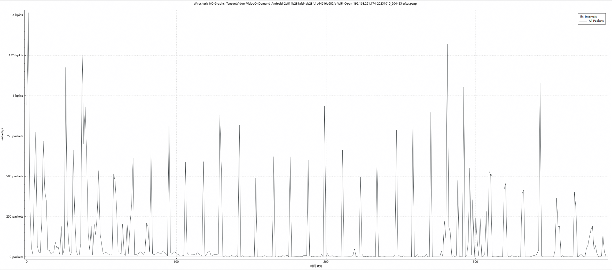
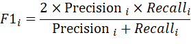
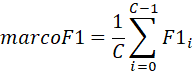
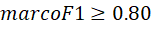
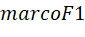
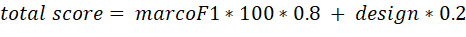

# 01 AI-QoE加密流量分类问题

> 本文件为官网公开赛题原文的 Markdown 整理版；正文按原文保留，图片和公式本地保存，未自行改写赛题要求。

- 官方标题：【2026Hackathon决赛】1：AI-QoE加密流量分类问题
- 来源：[官网赛题页](https://www.chaspark.com/#/races/competitions/1326610123207241728)
- 获取日期：2026-10-11（北京时间）
- 赛题 ID：1326610123207241728
- 原始资料：[JSON](../../官方资料/赛题原始数据/01_1326610123207241728.json) · [HTML](../../官方资料/赛题原始数据/01_1326610123207241728.html)

---

**AI-QoE加密流量分类问题**

**一、背景信息（赛题产生的业务背景）：**

QoE（Quality of Experience）客户感知体验，是一种性能指标，用于评价用户对设备、网络、系统、应用或业务的质量和性能（包括有效性和可用性等方面）的综合主观感受，通常从业务应用的舒适度来定义。运营商可以通过QoE评分来评估视频业务质量，从而优化网络。

 

在路由器AI QoE场景下，期望通过网络流量AI大模型，针对点播等大类应用实现分辨率质量分类，分类准确性>90%，保证地域泛化性不劣化。

 

**三、问题描述（现状、技术挑战等）：**

互联网传输架构正由传统以 TCP 为核心的内核协议栈，逐步向以 QUIC、DoH、ECH/eSNI 为代表的用户态加密协议体系演进，同时 DNS 加密、握手加密、业务载荷加密以及大量私有协议的普及，使网络侧无法解析业务类型与流媒体特征，原先依靠明文应用数据计算卡顿、播放分辨率等业务 KQI 的监测手段不再可用，导致传统网络质量评估算法失效。

 

本赛题以点播大类下的腾讯视频点播应用为例，期望通过网络流量AI模型算法优化，突破加密网络流量下分辨率这一关键业务KQI指标精准识别的难题。

图一. 典型的流量特征

**问题描述：**

分辨率预测可以看成一个分类问题。

- 输入：给定一条已清洗干净的窗口大小为30秒的网络流量数据（标准parquet格式）。
- 输出：模型需要对每条parquet数据最后5s的流量预测分辨率标签。
- Parquet所有的列名及其格式、内容如**附录一**所示，pkts\_timetofirst字段（相对流首包的时间偏移秒数）大于25的包即属于最后5s的流量。

 

对于腾讯点播大类来说，其分辨率标签含义如下

| 真实标签类别 | 业务含义 |
| --- | --- |
| 0 | 分辨率低于720P，画面清晰度较低 |
| 1 | 分辨率为720P，画面清晰度处于中等状态 |
| 2 | 分辨率为1080P，画面清晰度较高 |

**数据：**

我们将提供若干parquet格式的网络流量数据和一个csv标签文件。

赛前我们会发布**所有训练数据集**以及**部分评测数据集**。

1. Parquet文件

所有的Parquet文件根据Apache Parquet列式格式存储数据，每行对应一个双向的30s网络流量。

- Parquet所有的列名及其格式、内容如**附录一**所示；
- **附录二**提供了一个读取parquet文件并统计parquet内上下行流量总字节数的程序供参考。

1. CSV文件

csv标识文件的每行记录着一个parquet文件名-标签二元组，用于标示每个文件所记录的网络流量对应的**最后****5s****内的真实分辨率**。

 

**代码结构：**

1. **文件结构**

我们将下发judge-dist文件夹，其文件结构如下图所示

judge-dist/

├── src/qoe\_judge/                 # 判题器

│   ├── model\_base.py              # 模型抽象基类

│   ├── runner.py                  # 预测运行器

│   ├── judge.py                   # 判分器

│   └── metrics.py                 # 指标计算

├── solution/                      # 你的提交（在此开发）

│   ├── pyproject.toml             # 声明依赖

│   ├── src/contestant\_submission/

│   │   ├── train/                  # 训练代码

│   │   ├── \_\_init\_\_.py            # 包初始化（勿改）

│   │   └── main.py    # 你的模型实现，你也可以在此文件夹内创建和导入代码

│   └── model/         # 模型权重文件目录

└── README.md

要求：

- judege-dist/solution 目录是你的最终提交，请在此开发。
- 模型load\_model方法和predict方法实现务必放在solution/src/contestant\_submission/main.py 的ContestantModel类内。
- 模型训练相关的代码请放置在solution/ src/contestant\_submission/train文件夹下，请保证您的训练过程是可以复现的。
- 模型权重文件请放置在solution/model文件夹下。
- 如果需要使用其他库函数，请在solution/pyproject.toml中声明。

 

1. **类结构**

请选手实现ContestantModel类，其结构如下

 

class ContestantModel(QoEModelBase):

    # 自定义类成员和方法区域 BEGIN

    # 请在此定义类成员和方法

    # 自定义类成员和方法区域 END

 

    def load\_model(self, model\_dir: str) -> None:

        """从 model\_dir 目录加载模型权重和配置，缺失此函数会导致运行错误。"""

        print(f"[ContestantModel] Loading model from {model\_dir}")

        self.model = None  # 替换为实际模型对象

 

    def predict(self, parquet\_file: BinaryIO) -> int:

        """对 parquet 文件进行分辨率预测，缺失此函数会导致运行错误。"""

        print(f"[ContestantModel] Predicting from file object")

        return random.randint(0, 2)

要求：

- 必须至少实现 load\_model 和 predict 两个方法
- 选手可以任意编写自己所需要的类成员
- 禁止链接网络。

 

1. **接口定义：**

判题程序将通过load\_model和predict两个接口调用你的模型：

1. **load\_model****：用于加载模型**

判题器将在开始时调用此接口一次，选手应在此方法内加载自己的模型。

此方法原型如下

def load\_model(self, model\_dir: str) -> None:

    """

    从 model\_dir 目录加载模型权重和配置，缺失此函数会导致运行错误。

    输入：

        model\_dir : 选手所提交的model文件夹路径。

                     约束：保证此路径存在，且与选手提交model文件夹内容一致

    输出：

        None（不得返回任何内容）

    """

    print(f"[ContestantModel] Loading model from {model\_dir}")

self.model = None  # 替换为实际模型对象

1. **predict****：用于执行推理**

判题器将对每个测试样例调用此接口一次，选手应返回自己模型的输出，不符合约束的输出将会被判定为运行错误。

此方法原型如下：

def predict(self, parquet\_file: BinaryIO) -> int:

    """对 parquet 文件进行分辨率预测。

    输入：

        parquet\_file : 一个待预测的parquet文件。

                       约束：保证其为一个已经打开的，合法的parquet文件

    输出：

        一个[0,2]范围内的整数，为模型的预测结果。

    """

    print(f"[ContestantModel] Predicting from file object")

    return random.randint(0, 2)

 

**提交：**

选手需要提交一个 ZIP 压缩文件，需要包含以下内容

1. solution/ 目录，solution文件夹结构如附件内所规定，其内部需要包含完整的模型定义、权重、训练和推理代码及相关配置；
2. 一个描述解题所用的网络流量数学模型、数据特征建模和计算方法的介绍文件；
3. 若使用算法，需要输出算法实现原理
4. 若使用模型，需要给出模型结构介绍和训练流程。

**四、期望达到的指标和效果（含性能/****精度等指标）：**

**1.** **功能目标**

1) 你的代码/模型需要能够正确导入，依赖项可安装。

2) 你的模型输出结果需要在标签范围内，且无运行时错误。

3) 你的模型在测试集上运行时间不得超过1800s。

 

**2.** **性能指标**

如果你的模型无运行错误，我们将将你的答案和标准标注进行比较，针对每个分辨率类别，独立计算其精确率（Precision）和召回率（Recall），得出该类别的F1

最后求均值：

你所提交的模型需至少达到，我们将根据和你的模型设计综合得出你的得分。

 

**五、测试用例**

我们将提供若干parquet格式的网络流量数据和一个csv标签文件。

赛前我们会发布**所有训练数据集**以及**部分评测数据集（****30%****）**。赛时会发布所有评测数据集。

 

**六、评选标准：**

1) 如果你的代码/模型无法导入，或依赖项无法安装，得0分。

2) 如果你的模型输出了不在标签范围内的结果，或发生运行时错误，得0分。

3) 如果你的模型在测试集上运行时间超过1800s，得0分。

4) 如果你的模型无运行错误，我们将根据和你的模型设计（design）综合得出你的得分（0 ~ 100）：

 

 

**附录1****：parquet****列名及其格式、内容**

**标识列**

| **列名** | **类型** | **说明** |
| --- | --- | --- |
| src\_eth | str | 源 MAC 地址 |
| dst\_eth | str | 目的 MAC 地址 |
| src\_ip | str | 源 IP（已调整为 client → server 方向） |
| dst\_ip | str | 目的 IP |
| src\_port | int | 源端口 |
| dst\_port | int | 目的端口 |
| proto | str | 传输层协议："TCP" / "UDP" / "ICMP" |
| flow\_tuple | str | 流标识字符串，格式 src\_ip:port-dst\_ip:port-proto |
| client\_ip | str | 客户端 IP（私网侧地址） |

**流级标量列**

| **列名** | **类型** | **说明** |
| --- | --- | --- |
| first | float | 流首包 Unix 时间戳（秒） |
| last | float | 流末包 Unix 时间戳（秒） |
| duration | float | 流持续时间（秒） |
| bytes | int | 总字节数 |
| packets | int | 总包数 |
| data\_packets | int | 有 payload 的包数 |
| is\_quic | bool | 是否为 QUIC 流 |
| is\_bidir | bool | 是否双向 |
| is\_valid\_tcp\_handshake | bool | TCP 三次握手是否有效 |
| icmp\_num\_probes | int | ICMP 有效探测数 |
| icmp\_num\_null\_probes | int | ICMP 无效应答数 |

**逐包数组列**

每个流内所有数据包组成一个 list，长度等于该流的包数。

| **列名** | **类型** | **说明** |
| --- | --- | --- |
| pkts\_size | list[int] | 每包 IP 层长度 |
| pkts\_size\_l4 | list[int] | 每包 L4 payload 长度 |
| pkts\_timetofirst | list[float] | 相对流首包的时间偏移（秒） |
| pkts\_dir | list[int] | 方向：1 = 上行，-1 = 下行 |
| pkts\_tcp\_flags | list[int] | TCP 标志位（bitmask） |
| pkts\_tcp\_seq | list[int] | TCP 序列号 |
| pkts\_tcp\_ack | list[int] | TCP 确认号 |
| pkts\_ip\_id | list[int] | IP 标识符 |
| pkts\_size\_times\_dir | list[int] | 带符号包大小（size × dir），区分上下行 |
| pkts\_indices\_pureack | list[int] | 纯 ACK 包的索引列表 |
| pkts\_indices\_data | list[int] | 数据包的索引列表 |
| pkts\_icmp\_type | list[float] | ICMP 类型 |
| pkts\_icmp\_id | list[float] | ICMP ID |
| pkts\_icmp\_seq | list[float] | ICMP 序列号 |
| pkts\_icmp\_pairs\_unixtime | list[float] | ICMP 应答时间戳 |
| pkts\_icmp\_pairs\_seq | list[float] | ICMP 配对序列号 |
| pkts\_icmp\_pairs\_rtt | list[float] | ICMP 往返时延（秒） |

**派生列**

| **列名** | **类型** | **说明** |
| --- | --- | --- |
| src\_ip\_is\_private | bool | 源 IP 是否为私网地址 |
| src\_ip\_is\_global | bool | 源 IP 是否为公网地址 |
| src\_ip\_is\_special | bool | 源 IP 是否为特殊地址 |
| dst\_ip\_is\_private | bool | 目的 IP 是否为私网地址 |
| dst\_ip\_is\_global | bool | 目的 IP 是否为公网地址 |
| dst\_ip\_is\_special | bool | 目的 IP 是否为特殊地址 |
| has\_packets\_over\_max\_mtu | bool | 是否有超过 1500 字节的包 |
| flow\_rank | int | 按字节数降序排名 |
| flow\_idx | int | 流序号 |

**附录2****：parquet****文件读取示例：统计parquet****内上下行流量总字节数**

import pandas as pd

import numpy as np

 

df = pd.read\_parquet("flow.parquet")

 

for idx, row in df.iterrows():

    sizes = np.array(row["pkts\_size"])

    dirs  = np.array(row["pkts\_dir"])

 

    up\_bytes   = sizes[dirs == 1].sum()

    down\_bytes = sizes[dirs == -1].sum()

 

    print(f"Flow {idx}: {row['flow\_tuple']}")

    print(f"  上行: {up\_bytes} bytes, 下行: {down\_bytes} bytes")

    print(f"  总包数: {row['packets']}, 持续: {row['duration']:.2f}s")
