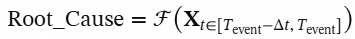

# 02 5G全栈网络的感知劣化溯源

> 本文件为官网公开赛题原文的 Markdown 整理版；正文按原文保留，图片和公式本地保存，未自行改写赛题要求。

- 官方标题：【2026Hackathon决赛】2：5G全栈网络的感知劣化溯源
- 来源：[官网赛题页](https://www.chaspark.com/#/races/competitions/1326612402953629696)
- 获取日期：2026-10-11（北京时间）
- 赛题 ID：1326612402953629696
- 原始资料：[JSON](../../官方资料/赛题原始数据/02_1326612402953629696.json) · [HTML](../../官方资料/赛题原始数据/02_1326612402953629696.html)

---

# 5G全栈网络的感知劣化溯源

## 一、题目名称：

决赛赛题名称：5G全栈网络的感知劣化溯源

决赛赛题来自技术领域：网络性能与体验管理

## 二、背景信息（赛题产生的业务背景）：

在 5G向 6G 网络架构演进的深水区中，全栈业务加速迈向泛在超宽带、确定性极低时延与强交互沉浸式场景（如高清视频动态分片流、全景云渲染游戏、低空无人机高精控制等）。一个网络会话瞬间跨越“端（手机OS）- 管（基站无线）+输（核心网）- 云（应用CDN）”四大异构域。在此背景下，网络监控和优化已从优化单一网络设备表现（KPI：Key Performance Indicator）转向保障用户体验质量（QoE Status：Quality of Experience）。

当前业界通行的排障机制高度依赖物理指标（如基站丢包率、核心网转发时延）的硬性静态阈值告警。然而现网中大量涌现出“网络设备 KPI 处于名义安全域、未触发任何阈值红线，但终端用户体验质量塌陷（QoE隐蔽性劣化）”的复杂故障，成为网络智能化监控和优化难点。

基于真实主观体验对网络监控和优化需要解决的关键问题：

1、网络指标与用户体验的断层：在实际业务中，经常出现的是网络各项指标表面上完全正常，但由于跨域多指标的微弱扰动和联合交织，导致个别用户的真实体验（QoE，如视频彻底卡死、游戏断连）变差。

2、多指标因素逻辑组合：现实网络问题通常很少由单一指标恶化引起，往往呈现出带有方向性且符合布尔逻辑门（AND / OR）的复杂条件组合。例如：“无线噪声上升 OR 基站拥塞度上升”触发用户感知劣化；

3、多指标因果传导：现实网络中往往同时出现多指标异常，但是部分指标异常是由于其他指标异常导致的：如指标A，指标B同时异常，但是指标A与指标B之间存在因果传导关系，指标B只是下游受害者，此时根因是A，而不是A&B；

4、时滞窗口动态：真实网络中不同领域指标之间的传导速度完全不同，如：基站的PRB利用率飙升，几乎会在秒级传导到手机端，而云端服务器资源不足，可能需要累积到分钟级；

基于以上问题，需要构建设计并构建一套网络智能化全景因果溯源算法，通过对秒级对齐的网络 KPI 时序流进行全局检测，基于用户实际体验测量数据，逆向推导全网全栈指标间传导关系，并找到体验质量恶化的根因；

## 三、问题描述（现状、技术挑战等）：

问题拆解：

参赛选手需在纯CPU算力场景下，基于24小时现网日常监控KPI指标大表进行全网指标依赖拓扑推导，并在评测阶段针对连续时序流中离散出现的体验质差事件进行隐藏因果逻辑链的自动化逆向溯源。该问题可拆解为以下核心技术挑战：

- 去除未知混杂因素影响： 实际业务中存在大量未知混杂因素以及多指标之间的因果传导，会造成多个KPI 发生被动的协同起伏，制造出统计相关假象。算法须具备高效的特征剪枝与“因果去混杂”能力。
- CPU下高精度时序特征检索： 故障从源头到用户感知，在时间轴上存在异步滞后性，网络质差很少由单点瞬时毛刺引起，往往是由于某些指标在一段时间窗口内发生了“持续提升（+）”或“持续下降（-）”，算法须完成时间滑窗趋势的时空推演。
- 连续漂移与离散布尔逻辑组合： 在日常业务中，单一的体验质差，通常是多个指标连续趋势变化导致，如无线噪声上升 OR 基站拥塞度上升。算法必须从连续的高维时序数据中，逆向推导并还原出与真实情况完全逻辑等价的布尔表达式，面临极其严重的离散组合搜索空间爆炸挑战。

问题抽象：

- 对一个网络对象的“端（手机OS）- 管（基站无线）+输（核心网）- 云（应用CDN）”的秒级监控KPI定义为31维的时序大表：时间戳（表示监控的秒数）作为第一列，Node0~Node29是各监控KPI；
- 对该网络对象的QoE状态(体验质差状态)和根因定义为3维的离散小表：时间戳（表示体验质差时间）作为第一列，QoE状态做为第二列，根因作为第三列；其中QoE状态分为[0, 1, 2, 3, 4]五个状态码，其中0表示网络健康，1~4表示四种不同的质差状态；根因是造成质差的根因表达式（在实际业务中需要由算法计算出来），由KPI的变化加逻辑关系组成，如“({12-} & {15+} & {2+} & {28-})”表示Node12下降并且Node15抬升并且Node2抬升并且Node28下降；

这样就将问题抽象为“基于连续时序反向因果推理与因果逻辑链重建问题”：

最终输出的根因表达式Root\_Cause等于将发生质差前几秒钟内的局部KPI时序大表（X），喂入设计的因果溯源算法（F）后得到的计算结果。

接口定义：

选手使用Python语言(>=Python3.12)实现以下接口，可选择在本地进行离线训练(纯CPU环境)，或者直接使用算法进行推理。

其核心接口规范信息如下：

|  |
| --- |
| class CausalMiner:  """  可选类：离线学习/训练引擎，选手可以采用先离线学习/训练方案，此时需要输出学习或训练的参数结果文件，供后续根因溯源使用  """      def \_\_init\_\_(self):      def fit\_baseline(self, kpi\_file\_path: str, exp\_file\_path: str) :          """          接口名称：fit\_baseline (基线因果学习接口)          功能描述：输入24小时秒级网络指标时序大表与体验质差表的物理文件路径。选手在此接口内实现因果学习并自行持久化保存结果；          输入参数：              - kpi\_file\_path: str, 24小时指标长时序大表（kpi\_data.csv）的磁盘路径。                数据内部结构：Column 'Timestamp': int秒级时间戳; 'Node\_0' ~ 'Node\_29': 30个核心全栈网络KPI指标值。              - exp\_file\_path: str, 24小时日常体验质差表（experience\_data.csv）的磁盘路径。                数据内部结构：Column 'Timestamp': int异常时间; 'True\_QoE\_Class': int质差状态; 'Root\_Cause\_Expression': str根因表达式。          返回值：              - None: 选手自行训练或学习的参数文件，并持久化到自定义的磁盘文件路径（选手自定义扩展名与内容）。          """  class PerceptionEngine:  """  必选类：根因溯源引擎类，选手可以采用先学习/训练，再溯源方案；也可以选择直接采用算法进行根因溯源方案；  """      def \_\_init\_\_(self):          """          在线推理引擎初始化，选手可在此加载CausalMiner输出的训练或学习的参数文件；          """      def locate\_root\_cause\_expression(self, test\_kpi\_file\_path: str, blind\_test\_incidents\_path: str, output\_submission\_path: str):          """          接口名称：locate\_root\_cause\_expression (根因溯源接口)          功能描述：输入决赛当天全新的24小时网络指标时序大表磁盘路径与体验质差表磁盘路径。  引擎在规定的超时时间内，完成对体验质差的反向因果推理，并写入指定的磁盘文件。          输入参数：              - test\_kpi\_file\_path: str, 全新的 24 小时网络指标时序大表（test\_kpi\_data.csv）的磁盘文件路径。                数据内部结构：Column 'Timestamp': int秒级时间戳; 'Node\_0' ~ 'Node\_29': 30个KPI指标值。              - blind\_test\_incidents\_path: str, 全新的体验质差表（blind\_test\_incidents.csv）的磁盘文件路径，内含100条体验质差记录。                数据内部结构：Column 'Timestamp': int异常时间戳; 'True\_QoE\_Class': int质差QoE状态。              - output\_submission\_path: str, 最终根因溯源结果文件（submission.csv）导出路径。                要求选手的写入数据结构：                Column 'Timestamp': int异常时间戳; 'True\_QoE\_Class': int质差QoE状态; 'Root\_Cause\_Expression': str根因表达式。          返回值：              None (选手需确保在函数结束前，成功将数据写入 output\_submission\_path 对应的文件中)          """ |

 

提交结构：

选手需按照如下结构提交代码资产包：

队伍名称/

├── readme.md            # 必选：实现原理说明:如果使用算法，需给出算法实现原理; 如果使用模型，需给出模型结构设计;

├── causal\_miner.py                # 可选：选手的核心算法代码（CausalMiner 类所在的脚本，注意最终评判时不执行该脚本）;

├── perception\_engine.py # 必选：选手的核心算法代码（PerceptionEngine 类所在的脚本，最终评判时执行该脚本）;

├── requirements.txt            # 必选：选手代码的依赖声明，如果选手代码只依赖标注库，该文件保留为空文件；

└── xxx                     # 可选：选手CausalMiner离线训练学习的参数文件，选手需PerceptionEngine 类中咨询加载该文件；

## 四、期望达到的指标和效果（含性能/精度等指标）：

功能目标：

 实现24 小时连续网络长时序流环境下的自适应质差根因溯源。算法引擎必须统一遵循上述接口规范，具备高鲁棒性，能够自适应解析包含“与（&）”、“或（|）”门控复合交织的离散布尔表达式。架构要求轻量化且易用，能够直接嵌入现网的 AIOps 微服务中。

性能目标：

选手需要在纯CPU环境下完成题目，性能约束为：

时间复杂度限制：在线流式推理 locate\_root\_cause\_expression单次执行时间严格限制在60秒以内（单线程, Intel(R) Core(TM) i7-10510U CPU @ 1.80GHz (2.30 GHz)，每次输入24小时时序大表+100个QoE异常点）。

空间与资源限制：PerceptionEngine引擎运行时峰值内存占用不得超过 4GB。

精度指标要求：最终客观评测采用符号计算根因溯源结果与因果真值的逻辑语义一致性，要求做到逻辑等价。

## 五、测试用例

决赛公示阶段仅展现输入输出规范。比赛当天将下发全新的 24小时时序数据大表，用于比赛选手进行因果学习和根因溯源测试。

输入示例：

测试集网络指标时序大表(kpi\_data.csv/test\_kpi\_data.csv)：

Timestamp,Node\_0,Node\_1,Node\_2,...,Node\_29

0,0.124,0.051,0.892,...,-0.122

1,0.115,0.048,0.712,...,-0.110

...

86399,0.095,-0.012,0.412,...,0.054

 

QoE状态表(blind\_test\_incidents.csv)：

Timestamp,True\_QoE\_Class

4122,1

6940,3

12401,2

 

带根因的QoE状态表(experience\_data.csv)：

Timestamp,True\_QoE\_Class,Root\_Cause\_Expression

2251,3,({12-})

3417,1,({12-} & {2+})

3727,2,({21+})

 

输出示例：

根因溯源结果(submission.csv)：

Timestamp,True\_QoE\_Class,Root\_Cause\_Expression

3705,1,({22+})

3727,2,({0-} & {14+})

3771,4,({0+} & ({6+} | {22+}))

## 六、评选标准（如评分维度，分成几档等）：

最终评判时使用全新数据进行综合评测：共3份数据，每份数据包含24小时时序大表和100个QoE异常点。评判程序执一次PerceptionEngine类初始化，并对每份数据执行locate\_root\_cause\_expression接口获取每个QoE异常的根因逻辑表达式，评判根因逻辑表达式与因果真值是否逻辑等价，获取三份数据所有根因逻辑表达式的等价率进行评分：

- Rate<50%, 不及格
- Rate>=50%& Rate<85% 达成基础要求；
- Rate>=85% 达成挑战结果；

备注：

1. locate\_root\_cause\_expressio接口单次执行超过60秒或执行期间峰值内存占用大于4G，总得分为0；
2. 根因逻辑表达式不满足格式要求，如无法解析、为空等，直接判定为与因果真值不等价；
