# 03 针对无线特征向量的最优化存储和计算

> 本文件为官网公开赛题原文的 Markdown 整理版；正文按原文保留，图片和公式本地保存，未自行改写赛题要求。

- 官方标题：【2026Hackathon决赛】3：针对无线特征向量的最优化存储和计算
- 来源：[官网赛题页](https://www.chaspark.com/#/races/competitions/1326623932680531968)
- 获取日期：2026-10-11（北京时间）
- 赛题 ID：1326623932680531968
- 原始资料：[JSON](../../官方资料/赛题原始数据/03_1326623932680531968.json) · [HTML](../../官方资料/赛题原始数据/03_1326623932680531968.html)

---

针对无线特征向量的最优化存储和计算

 

1. **背景信息（赛题产生的业务背景信息）**

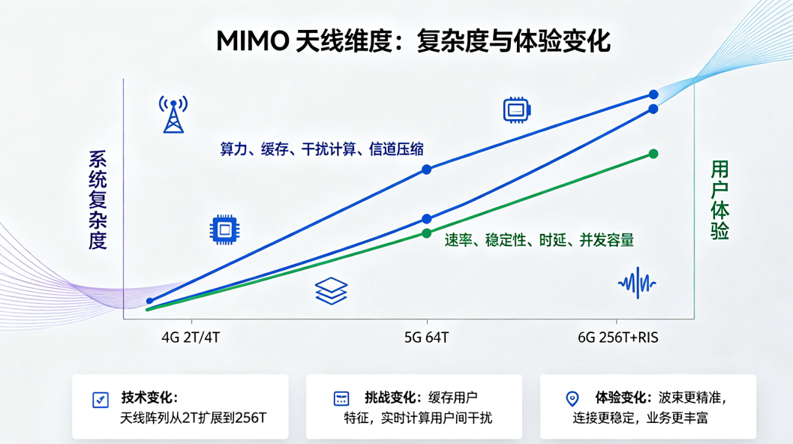

 

从 4G 到 5G 再到 6G，带宽和MIMO天线维度持续升级：4G 采用 2T/4T/8T 天线，实现基础空间复用；5G 引入 64T Massive MIMO，依靠高精度波束赋形将能量定向聚焦用户，显著提升小区容量；6G 将迈向 256T 超大规模 MIMO 与 RIS 智能超表面辅助 MIMO，进一步扩展空间维度。

超大带宽、超大规模天线带来系统性复杂度跃升：基站需缓存海量用户的信道与特征信息，实时计算用户间的空间干扰关系，矩阵运算与波束权值更新呈指数级增长，对硬件算力、内存资源和功耗提出严苛要求，必须配套高效调度算法、信道与模型压缩、干扰抑制等软件手段，才能在海量接入下缓解用户间干扰，支撑百万级每平方公里连接密度和高质量用户体验。

 

1. **问题描述（现状、技术挑战等）**

1. **业务背景**

基站通过SRS测量得到用户的特征向量，以此来表征手机用户的位置信息。相邻的手机用户之间，在信号传输时会有较大的干扰。通常，基于两个用户的特征向量来计算相关性，并以相关性的大小来表征干扰的大小。在此背景下，基站系统需要保存每个用户的特征向量，同时每0.5ms完成约几十或者上百次次相关性计算。为最优化内存和算力开销，我们希望用尽可能少的内存、尽可能少的算力开销实现尽可能无损的相关性计算。

1. **问题抽象**
2. **问题描述**

每个用户的特征向量都保存在DDR上。测量核根据信道情况为每个用户生成特征向量（生成算法可以忽略），并将其逐个写入到DDR中。计算核会根据业务需要，随机的选若干个用户（比方说32个用户），计算两两用户之间的相关性（接口函数oriCalculateCorrelation），并将结果发送给调度核。

整个流程的图示如下。

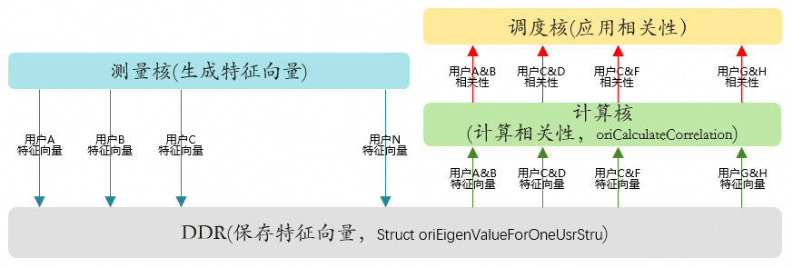

保存特征向量需要内存成本。计算相关性需要算力成本（核的开销）。

为最小化内存和算力成本，同时不恶化空口性能（即相关性计算不要有太大误差），我们做如下拓展：

1）测量核生成的特征向量，可以先做数据预处理（transferOneUsrEigenValue），然后再以新的数据格式（struct newEigenValueForOneUsrStru）保存到DDR上。

2）基于新的数据格式（struct newEigenValueForOneUsrStru），设计新的相关性计算函数newCalculateCorrelation。

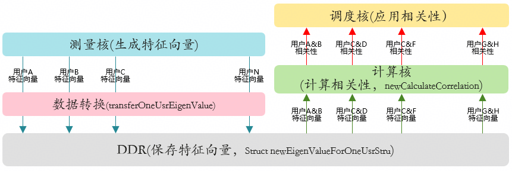

请你帮我们完成如下设计：

1）设计新的数据结构struct newEigenValueForOneUsrStru

2）设计和实现函数transferOneUsrEigenValue和newCalculateCorrelation。

 

1. **宏和数据结构定义**

*#define MAX\_USR\_NUMBER 100000 //* *固定值，不做修改*

*#define BEAM\_NUMBER 64        //* *固定值，不做修改*

*Struct oriEigenValueForOneUsrStru {*

*UINT16 eigenValue[BEAM\_NUMBER];*

*};*

*Struct newEigenValueForOneUsrStru {             //* *不要改变结构体名称*

*……;                                        //* *请设计该结构体*

*};*

*Struct oriEigenValueForOneUsrStru allUsrOriEigenValue[MAX\_USR\_NUMBER];*

*Struct newEigenValueForOneUsrStru allUsrNewEigenValue[MAX\_USR\_NUMBER];*

1. **接口定义：**

*void transferOneUsrEigenValue(Struct oriEigenValueForOneUsrStru \*source, Struct newEigenValueForOneUsrStru \*dst) {*

*……;                                        //* *请设计和实现该函数*

*}*

*//* *已实现的接口，作为基线实现方式。基线的实现方式请参见附录*

*UINT32 oriCalculateCorrelation(Struct oriEigenValueForOneUsrStru \*usr1, Struct oriEigenValueForOneUsrStru \*usr2);*

*该函数输入：*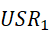*的特征向量* 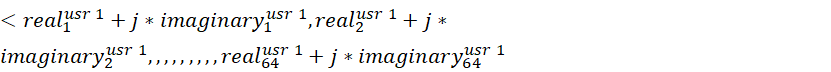*>*

*的特征向量* *>*

*该函数输出：**和*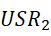*的相关性，计算公式如下*

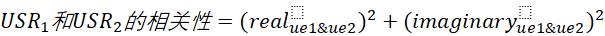

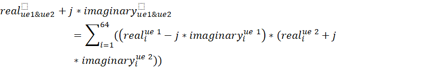

*UINT32 newCalculateCorrelation(Struct newEigenValueForOneUsrStru \*usr1, Struct newEigenValueForOneUsrStru \*usr2)*

*{*

*……;                                        //* *请设计和实现该函数*

*}*

1. **期望达到的执行和效果（含性能/精度等指标）**

希望达成的目标是：1）相关性计算的开销 越少越好；2）特征向量保存的内存成本 越少越好；3）相关性误差 越小越好。

 

**特别说明**：

1. 数据转换（函数transferOneUsrEigenValue）的计算开销可以大一点。这个是背景计算，开销不敏感。因此，该函数的开销不在评价范围以内。
2. oriCalculateCorrelation函数的计算开销在几百us的数量级。因此，在实现newCalculateCorrelation接口时，不建议采用多核并行的方式，因为fork带来的开销就比并行的收益还大。

 

1. **测试用例**

输入信息为用户个数，以及每个用户的特征向量（1 x 64的复数矩阵）。

 

**输入样例1**：（2用户）

2

64786 61443 3829 3336 58880 63968 6676 60429 64776 62722 4600 2832 60153 65504 5655 61198 64522 63752 4346 2060 60413 65515 4371 62738 62983 64260 3329 780 59892 2282 3348 61960 250 63491 64503 1028 64251 3322 10 64503 1529 63235 64505 65282 64514 2561 523 245 3581 64515 65524 2 63746 2046 780 65528 2562 64524 65271 768 64776 260 779 2045

64010 63227 2547 2054 62471 63473 3325 2315 3584 64532 62474 502 4100 776 61684 1259 60916 2277 2055 61963 62959 4091 65297 62215 2580 58892 64223 9471 61212 57849 5873 3864 64507 763 65535 0 65029 64769 1537 65031 776 64008 1529 1791 508 63743 64506 1021 758 1790 64517 62465 1789 2049 63238 64245 64513 64512 511 1281 61956 65018 4356 277

**样例解析**：

第一行的“2”表示一共2个用户。第二行（以“64786”开始）的64个复数是用户1的特征向量。每个复数是一个UINT16的数，其高8bit是复数的实部，低8bit是复数的虚部。

对于每个实部和虚部，采用的是<1,0,7>的数据格式。其最高位表示符号位，剩余的7bit表示小数部分。比方说，如果实部的8bit为00010101，则其表示的数为+0.164（即 (16+4+1)/128）。

 

基于<1,0,7>数据格式解析，我们可得这两个UE对应的特征向量如下：

**UE1****的特征向量**：

[-0.0234375+0.140625j  -0.125    +0.0234375j  0.109375 -0.0859375j  0.1015625+0.0625j    -0.203125 +0.j        -0.0546875-0.25j

  0.203125 +0.15625j   -0.15625  +0.1015625j -0.0234375+0.0625j -0.0859375+0.015625j   0.1328125-0.0625j     0.0859375+0.125j

 -0.171875 -0.0546875j -0.0078125-0.25j       0.171875 +0.1796875j -0.1328125+0.109375j  -0.03125  +0.078125j  -0.0546875+0.0625j  0.125    -0.046875j   0.0625   +0.09375j   -0.1640625-0.0234375j -0.0078125-0.1640625j  0.1328125+0.1484375j -0.0859375+0.140625j -0.078125 +0.0546875j -0.0390625+0.03125j    0.1015625+0.0078125j  0.0234375+0.09375j   -0.1796875-0.09375j    0.0625   -0.171875j  0.1015625+0.15625j   -0.109375 +0.0625j     0.       -0.046875j -0.0625   +0.0234375j -0.0390625-0.0703125j  0.03125  +0.03125j -0.046875 -0.0390625j  0.09375  -0.046875j   0.       +0.078125j -0.0390625-0.0703125j  0.0390625-0.0546875j -0.0703125+0.0234375j -0.0390625-0.0546875j -0.0078125+0.015625j  -0.03125  +0.015625j  0.078125 +0.0078125j  0.015625 +0.0859375j  0.       -0.0859375j  0.1015625-0.0234375j -0.03125  +0.0234375j -0.0078125-0.09375j

  0.       +0.015625j  -0.0546875+0.015625j   0.0546875-0.015625j  0.0234375+0.09375j   -0.0078125-0.0625j     0.078125 +0.015625j -0.03125  +0.09375j   -0.015625 -0.0703125j  0.0234375+0.j -0.0234375+0.0625j     0.0078125+0.03125j    0.0234375+0.0859375j  0.0546875-0.0234375j]

**UE2****的特征向量**：

[-0.046875 +0.078125j  -0.078125 -0.0390625j  0.0703125-0.1015625j  0.0625   +0.046875j  -0.09375  +0.0546875j -0.0703125-0.1171875j  0.09375  -0.0234375j  0.0703125+0.0859375j  0.109375 +0.j -0.03125  +0.15625j   -0.09375  +0.078125j   0.0078125-0.078125j  0.125    +0.03125j    0.0234375+0.0625j    -0.125    -0.09375j  0.03125  -0.1640625j -0.1484375-0.09375j    0.0625   -0.2109375j  0.0625   +0.0546875j -0.109375 +0.0859375j -0.0859375-0.1328125j  0.1171875-0.0390625j -0.0078125+0.1328125j -0.1015625+0.0546875j  0.078125 +0.15625j   -0.203125 +0.09375j   -0.046875 -0.2578125j  0.28125  -0.0078125j -0.1328125+0.21875j   -0.2421875-0.0546875j  0.171875 -0.1171875j  0.1171875+0.1875j    -0.0390625-0.0390625j  0.015625 -0.0390625j -0.0078125-0.0078125j  0.       +0.j -0.015625 +0.0390625j -0.0234375+0.0078125j  0.046875 +0.0078125j -0.015625 +0.0546875j  0.0234375+0.0625j    -0.046875 +0.0625j  0.0390625-0.0546875j  0.046875 -0.0078125j  0.0078125-0.03125j -0.0625   -0.0078125j -0.0390625-0.046875j   0.0234375-0.0234375j  0.015625 -0.078125j   0.046875 -0.015625j  -0.03125  +0.0390625j -0.09375  +0.0078125j  0.046875 -0.0234375j  0.0625   +0.0078125j -0.0703125+0.046875j  -0.046875 -0.0859375j -0.03125  +0.0078125j

 -0.03125  +0.j         0.0078125-0.0078125j  0.0390625+0.0078125j -0.109375 +0.03125j   -0.0234375-0.046875j   0.1328125+0.03125j  0.0078125+0.1640625j]

 

**相关性计算**：

通过oriCalculateCorrelation函数计算得到这两个用户的相关性为 0.02556.

 

**内存压缩：**

在计算相关性之前，为了降低存储开销，需要使用一定的内存压缩方法。

自由设计压缩算法和接口，比赛只统计内存开销

例如压缩后的码流

Compressed\_Bitstream = "00010011100010011010111101..."

如果使用到解码表，符号与解码表示例如下：

|  |  |  |  |  |
| --- | --- | --- | --- | --- |
| *复数定点对 (I,Q)* | *实际数值表示* | *出现频次* | *霍夫曼编码 (Huffman Code)* | *码长 (Bits)* |
| *(-3, 18)* | *-0.0234375 + 0.140625j* | *3* | *00* | *2* |
| *(-16, 3)* | *-0.125 + 0.0234375j* | *5* | *010* | *3* |
| *(14, -11)* | *0.109375 - 0.0859375j* | *4* | *011* | *3* |
| *(13, 8)* | *0.1015625 + 0.0625j* | *2* | *1000* | *4* |
| *(-26, 0)* | *-0.203125 + 0.j* | *3* | *1001* | *4* |
| *...* | *...* | *...* | *...* | *...* |

 

**输入样例2**：（18用户）

18

62219 1788 4599 1277 65025 62455 2294 1535 62710 2307 3342 59653 60672 63983 780 65289 3331 18 61463 63727 243 2313 0 63746 63759 64755 61168 3841 2829 60954 64257 2057 64781 62455 2299 3851 2572 242 508 753 60649 3072 2058 62992 63483 4599 64005 1282 4095 61451 58624 65519 3329 64530 507 64518 61695 64253 231 3340 65031 59886 63488 65277  
2319 2029 754 60933 64770 2052 0 256 63990 64533 63996 1026 64259 1533 64002 509 2064 489 3072 63995 247 61445 2563 509 61429 2062 59915 4867 520 2288 2 1531 64286 5871 3334 61425 2563 63234 2034 62722 64489 60194 63231 2059 63224 258 62727 3581 13 1003 64779 64506 1536 61430 4086 62972 2553 61962 65518 61709 63729 521 58377 5895  
64023 60407 246 5128 1 62980 63233 505 61712 61680 3062 4626 64006 63997 63998 507 59657 63211 5626 2840 63751 63734 65274 771 59651 65517 6398 537 62467 65521 765 521 63221 2812 4103 62738 60923 65520 1023 64267 246 3071 2829 62472 61433 2036 772 62476 2545 1546 65045 62716 62963 4861 778 61703 2549 1036 63758 64247 497 4611 12 60672  
5633 1512 61700 3087 2290 61433 62969 1802 3072 3041 64005 788 1278 65524 64263 65291 4866 5098 61451 65039 2547 256 64514 65282 2313 3056 60413 65291 3586 65535 64018 2556 61430 63757 5628 65514 63233 65292 3582 758 59636 63506 5126 2538 62972 1289 2306 250 61934 59666 3078 2796 65276 64275 1533 65272 62969 61699 1787 2044 1284 62718 759 251  
63752 64533 11 65279 58887 62227 62703 60919 1282 1292 3088 3328 61194 63509 62214 62209 65272 65025 4865 5108 2063 4621 64272 779 65006 62708 6393 3052 3595 4608 2054 1541 533 4102 60673 62992 64006 63739 62713 62725 3348 5375 64259 64269 65291 515 61949 61962 5131 6131 769 1283 1033 1795 62213 64777 2814 2548 2051 1793 2304 765 64526 2568  
1785 63748 2808 64005 3319 61956 4600 62213 2816 63745 2567 63226 2571 62968 2575 62961 1028 64759 65292 242 65036 501 63503 1520 62470 2036 60422 4090 60416 5119 61695 4609 61936 3079 62704 3086 63727 3341 496 1039 493 1041 1012 64269 2549 63754 4349 62469 5626 60679 6404 59138 5635 60160 2824 60919 3083 61687 1036 63986 65035 65265 64265 65013  
1018 761 2560 2300 778 1543 63752 65034 63748 63492 63739 63999 500 64505 2810 1529 2564 2814 266 1287 63242 64521 62716 61697 63481 62973 1016 65012 3069 2040 1803 3331 3834 2291 3081 5119 64275 1040 61185 61707 61695 61447 63984 62198 3571 1518 4873 4091 4110 4868 63764 1299 59395 61712 62703 60919 63977 60146 4593 1515 5387 5627 65304 3344  
3828 60938 2546 62481 1010 63502 1019 65027 62706 1290 61945 2829 65276 2560 64762 11 61700 5626 63741 2300 62717 1541 63485 3328 62742 65517 62236 4584 62743 3046 65048 1512 65287 65276 1028 64762 767 1 65265 62979 65266 64014 65024 1799 64766 65532 64257 515 64258 2814 61690 1792 62470 4094 62982 2295 64515 2557 5634 62721 7422 60418 7666 57090  
1025 65281 262 65279 1273 515 63494 63476 1282 64008 771 512 505 1280 63491 64501 519 63494 1 1023 1534 770 63230 64506 65287 64770 766 1027 1532 769 63226 509 62201 1269 7181 63250 59130 2017 2051 63508 64246 2042 5649 62475 59630 4587 1803 61713 65269 2049 788 62467 62946 6899 1813 58118 1274 3 15 61690 483 5886 64532 58110

64786 61443 3829 3336 58880 63968 6676 60429 64776 62722 4600 2832 60153 65504 5655 61198 64522 63752 4346 2060 60413 65515 4371 62738 62983 64260 3329 780 59892 2282 3348 61960 250 63491 64503 1028 64251 3322 10 64503 1529 63235 64505 65282 64514 2561 523 245 3581 64515 65524 2 63746 2046 780 65528 2562 64524 65271 768 64776 260 779 2045  
64010 63227 2547 2054 62471 63473 3325 2315 3584 64532 62474 502 4100 776 61684 1259 60916 2277 2055 61963 62959 4091 65297 62215 2580 58892 64223 9471 61212 57849 5873 3864 64507 763 65535 0 65029 64769 1537 65031 776 64008 1529 1791 508 63743 64506 1021 758 1790 64517 62465 1789 2049 63238 64245 64513 64512 511 1281 61956 65018 4356 277  
1289 61956 63989 3320 255 64257 63487 247 513 64763 756 2048 65526 65531 504 65274 2050 64263 62710 1780 2300 65289 64765 1272 774 63226 65269 2809 1790 64516 65032 64252 62202 1013 2570 62737 61445 247 6921 23 63225 63742 1034 61707 61183 509 7188 61979 61178 64242 781 61963 61169 2810 3618 58899 63724 2807 64789 59649 1771 4870 63510 58874  
5114 2058 61183 494 2061 63765 64743 4345 3316 1798 62718 65266 2571 64274 63211 3831 2029 2570 62208 64494 3344 275 61676 4601 65518 3332 62722 63219 4613 1556 62963 3320 60418 63477 3079 63754 62966 1517 784 62461 62467 63739 2817 64524 63730 1016 777 61443 62215 64249 3071 271 62962 759 528 60678 63498 63481 2045 1288 63224 758 2318 61453  
65260 1799 62226 65027 2050 766 62213 247 5124 60939 62464 3571 1283 1542 242 1795 61963 63217 1004 4100 65028 65027 1280 65283 64762 2053 4617 62980 64499 1269 1277 63231 3051 4868 523 61175 1261 1540 65042 59904 6925 62728 64247 2035 3599 61957 63744 3050 64250 3322 4867 63241 58878 2536 65279 2569 6394 775 62728 63722 2286 4118 3072 62467  
65284 64242 4079 62224 61938 62485 60160 5116 1555 764 3846 61429 64499 59909 64252 1052 60418 7156 1291 1780 5113 62719 62966 64003 64746 62999 64253 1041 62732 1782 512 63755 65033 65012 3318 65280 252 2315 63741 65519 65022 2819 1027 3323 1547 61942 5109 2825 65269 13 62221 64270 64252 4339 1014 61939 2309 59914 65517 3324 62979 1537 3089 767  
62723 62963 63755 64002 2814 2825 62969 1011 62723 62202 63500 62978 4603 2571 63227 499 62216 61435 63754 64775 3833 3336 62210 65264 63497 61952 63501 64518 3316 3081 63236 65007 64235 3060 60684 60151 4864 2322 764 2295 62448 2548 60947 59392 3578 2829 1273 1526 62702 3825 61977 59655 2550 3850 2038 248 62193 2026 64533 60683 507 3332 500 763  
63228 774 64006 2811 776 501 2295 62204 3590 65522 2031 60934 61940 17 63243 4605 61956 1798 1296 2802 2814 63222 65013 64263 1527 63746 62197 786 62988 5372 1027 65268 2541 60170 61947 1809 63241 3067 2312 65265 280 4074 3329 62195 65267 62979 62976 2566 61680 64279 62989 5374 1801 65525 1784 62208 6403 61930 235 59920 60926 3338 264 2547  
3552 61448 65002 64028 65271 2823 2037 64019 18 3570 62985 65273 60177 3062 63248 4328 64514 1538 5114 61943 5108 61442 3326 62989 65264 62472 764 2053 63734 64527 63991 1029 63248 2296 777 64496 2568 64246 265 63993 1778 61703 3571 63500 64747 64784 498 537 61449 3588 63497 3573 273 65520 258 65527 3576 61698 1790 63748 2556 64262 3068 62462

**特别说明**：赛题中的示例仅为总测试用例的一部分。最终的分数将基于总测试用例的执行情况来评定。

 

1. **评选标准**

1. 相关性**计算开销**

startTime = cycle()

for (int i = 0; i < 2000; i ++) {                    // 多次执行求平均值，避免波动

   int usr1 = random(MAX\_USR\_NUMBER);

   int usr2 = random(MAX\_USR\_NUMBER);

   while (usr2 == usr1) {

      usr2 = random(MAX\_USR\_NUMBER);

}

// 基线的相关性计算开销用函数oriCalculateCorrelation；优化后的相关性计算开销用函数newCalculateCorrelation

oriCalculateCorrelation(allUsrOriEigenValue + usr1, allUsrOriEigenValue + usr2);

}

baseTime = cycle() – startTime;   // 如果上面用的是函数newCalculateCorrelation，这里得到的就是newTime

 

**执行环境说明**：

处理器：Intel(R) Core(TM) i7-14700 (2.10 GHz)

内存：32.0 GB

 

1. 特征向量所需的**内存**：

基线的内存开销： baseMem = MAX\_USR\_NUMBER \* sizeof(Struct oriEigenValueForOneUsrStru)

优化后的内存开销： newMem = MAX\_USR\_NUMBER \* sizeof(Struct newEigenValueForOneUsrStru)

 

1. 相关性计算的**误差**

error = 0;        // 相关性计算的误差

errorCnt = 0;       // 相关性误差的统计次数

for (int usr1 = 0; i < MAX\_USR\_NUMBER; usr1 ++) {

   for (int usr2 = 0; i < MAX\_USR\_NUMBER; usr2 ++) {

         if (usr1 == usr2)       continue;

         oriCorr = oriCalculateCorrelation(allUsrOriEigenValue + usr1, allUsrOriEigenValue + usr2);

         newCorr = newCalculateCorrelation(allUsrNewEigenValue + usr1, allUsrNewEigenValue + usr2);

         error += | newCorr - oriCorr| / | oriCorr |;

   }

}

1. 最终评价

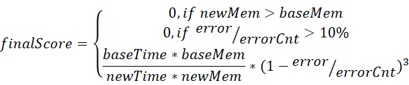

得分越高越好。

1. **一种可能的优化方向的示例**

1. 假定输入数据如下

2

3855 0 0 0 0 0 0 0 3855 0 0 0 0 0 0 0 3855 0 0 0 0 0 0 0 3855 0 0 0 0 0 0 0 3855 0 0 0 0 0 0 0 3855 0 0 0 0 0 0 0 3855 0 0 0 0 0 0 0 3855 0 0 0 0 0 0 0

3855 0 0 0 0 0 0 0 3855 0 0 0 0 0 0 0 3855 0 0 0 0 0 0 0 3855 0 0 0 0 0 0 0 3855 0 0 0 0 0 0 0 3855 0 0 0 0 0 0 0 3855 0 0 0 0 0 0 0 3855 0 0 0 0 0 0 0

【备注】：当前这组输入数据与真实测试数据不符，仅用于示例。

1. 优化方法
2. 定义结构体 newEigenValueForOneUsrStru 如下

*Struct newEigenValueForOneUsrStru {             //* *不要改变结构体名称*

*UINT64 bitmap;*

*UINT16 nonZeroEigenValue[ BEAM\_NUMBER / 2 ];*

*};*

1. 定义接口transferOneUsrEigenValue：

*void transferOneUsrEigenValue(Struct oriEigenValueForOneUsrStru \*source, Struct newEigenValueForOneUsrStru \*dst) {*

*int count = 0;*

*for( int i = 0; i < 64 && count < BEAM\_NUMBER / 2; i++) {*

*if (source->eigenValue[i] != 0) {*

*dst->bitmap |= 1 << i;             // dst->bitmap* *初始化为0*

*dst->nonZeroEigenValue[count] = source->eigenValue[i];        // dst->nonZeroEigenValue[]* *初始化为0*

*count ++;*

*}*

*}*

*}*

1. 定义接口newCalculateCorrelation

*UINT32 newCalculateCorrelation(Struct newEigenValueForOneUsrStru \*usr1, Struct newEigenValueForOneUsrStru \*usr2)*

*{*

*int* 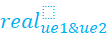*= 0,* 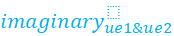*= 0;*

*for (int iter = 0; iter < 64; iter++) {*

*if (usr1->bitmap & (1 << iter) == 0 || usr2->bitmap & (1 << iter) == 0) {    //* *两个用户有一个如果为0，则整体为0*

*continue;*

*}*

*// calculate1Num**函数返回usr1->bitmap中从高往低数，第0bit到第iter bit中1的个数。*

*//* *比方说 calculate1Num(0b0101010101010101010101010101010101010101010101010101010101010101, 3)返回2*

*int usr1\_index = calculate1Num(usr1->bitmap, iter);*

*int usr2\_index = calculate1Num(usr2->bitmap, iter);*

*//* *此时，usr1-> nonZeroEigenValue[usr1\_index]是usr1的第iter个复数*

*// usr2-> nonZeroEigenValue[usr2\_index]**是usr2的第iter个复数，*

*//* *代入*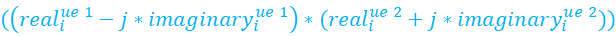*公式进行计算，并累加到*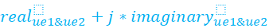*中*

*}*

*}*

 

1. 优化效果评估
2. 相关性计算开销

在该示例，每个用户的特种向量中只有8个是非0的。因此，相关性计算的开销预期是基线的1/8（实际值是按照环境执行得到的，参考第六章第1节的“1.     相关性计算开销”部分）。

 

1. 特征向量所需的**内存**

基线的内存开销： baseMem = MAX\_USR\_NUMBER \* sizeof(Struct oriEigenValueForOneUsrStru) = 128 \* 10000

优化后的内存开销： newMem = MAX\_USR\_NUMBER \* sizeof(Struct newEigenValueForOneUsrStru) = 72 \* 10000

压缩所需要的表项开销：例如符号与解码表字典字节数开销：tableSize = sizeof(struct LookupTable)

 

1. 相关性计算的**误差**

在该示例中，相关性计算误差为0，即error=0（因为每个UE的特征值大部分都是0）。

【备注】此处仅为示例。实际求解时，不能假设“每个UE的特征值大部分都是0”。实际求解的数据规律，需要参数选手自己挖掘。

 

1. 最终评价

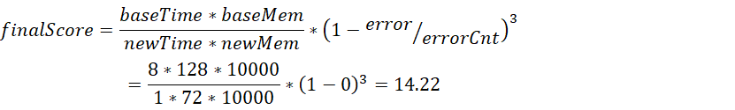

 

1. **附录：**

1. 接口oriCalculateCorrelation的实现方式

*//* *已实现的接口，作为基线实现方式。基线的实现方式请参见附录*

*UINT32 oriCalculateCorrelation(Struct oriEigenValueForOneUsrStru \*usr1, Struct oriEigenValueForOneUsrStru \*usr2) {*

*const int8\_t \*pA = \*((const int8\_t\*\*)usr1);*

*const int8\_t \*pB = \*((const int8\_t\*\*)usr2);*

*int dotRe = 0, dotIm = 0;*

*for (uint32\_t i = 0; i < 64; ++i)*

*{*

*int32\_t reA = (int32\_t)(pA[2\*i]);*

*int32\_t imA = (int32\_t)(pA[2\*i+1]);*

*int32\_t reB = (int32\_t)(pB[2\*i]);*

*int32\_t imB = (int32\_t)(pB[2\*i+1]);*

*dotRe += reA \* reB + imA \* imB;*

*dotIm += imA \* reB - reA \* imB;*

*}*

*return dotRe \* dotRe + dotIm \* dotIm;*

*}*
