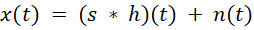

# 06 高噪场景下语音降噪的保真优化

> 本文件为官网公开赛题原文的 Markdown 整理版；正文按原文保留，图片和公式本地保存，未自行改写赛题要求。

- 官方标题：【2026Hackathon决赛】6：高噪场景下语音降噪的保真优化
- 来源：[官网赛题页](https://www.chaspark.com/#/races/competitions/1326633963903365120)
- 获取日期：2026-10-11（北京时间）
- 赛题 ID：1326633963903365120
- 原始资料：[JSON](../../官方资料/赛题原始数据/06_1326633963903365120.json) · [HTML](../../官方资料/赛题原始数据/06_1326633963903365120.html)

---

# 高噪场景下语音降噪的保真优化

## 背景

实时语音业务是云核心网 CS&IMS 域承载的基础业务（VoLTE/VoNR 通话、视频会议、实时字幕与转写等），通话语音质量直接决定用户感知。用户经常在高噪声环境中发起或接听通话——地铁、机场、街头、工厂车间、施工现场、商超与餐饮场所等。当环境噪声使接收信号信噪比（Signal-to-Noise Ratio, SNR）低至 [-10, 0] dB 区间时，语音会被噪声严重掩蔽，接收方可懂度显著下降，通话被迫中断或反复重述，体验急剧劣化。

语音降噪是消除上述影响的核心手段，但在极低 SNR 场景下长期存在“降噪量—语音保真”的两难矛盾：

- 传统信号处理方法（谱减法、维纳滤波、统计模型估计等）依赖噪声平稳性假设，在低 SNR 下易产生音乐噪声（musical noise）与语音能量过衰减，降噪后语音损伤明显；
- 深度学习降噪模型同样面临两难：抑制不足则残留噪声，影响听感与可懂度；抑制过度则损伤语音自身成分（辅音弱化、语音断续、音色畸变），甚至出现“降噪后可懂度反而低于降噪前”的失真损伤。

与此同时，实时通话链路对部署约束极为苛刻：模型必须为因果模型——只能利用已到达的历史音频，不得使用任何未来帧信息；必须以流式方式逐帧推理，与 20ms 的音频分帧节奏对齐；参数量与算力预算受限。如何在“最大化消除环境噪声（稳态与非稳态噪声，并抑制混响损伤）”与“最大化语音保真”之间取得最优平衡，并满足严格因果、流式、轻量化的工程约束，是本题要解决的核心技术难题。

本题以单通道、流式因果、轻量化为约束场景，考察低信噪比条件下降噪效果与语音保真的联合优化。

## 问题描述

本题将上述业务需求抽象为可量化、可验证的单通道语音增强问题。记干净语音为 s(t)，房间脉冲响应（Room Impulse Response, RIR）为 h(t)（以一定概率出现，用于模拟混响），环境噪声为 n(t)，则模型输入（加噪语音）为：

模型的目标是从逐帧到达的加噪语音流中恢复干净语音 s（同时消除环境噪声与混响），并满足以下三项硬性技术要求：

1. 因果语音降噪模型：模型在第 k 帧的输出仅允许依赖第 1 至第 k 帧的输入音频，不得使用任何未来帧信息（含未来样本与未来帧统计量）。双向循环结构、非因果填充、依赖未来上下文的注意力机制等组件均不允许；
2. 流式输入：模型以 20ms 为一帧接收音频，采样率 16kHz、单通道；评测时模型须转换为 ONNX 流式模型，按“每次输入一帧”的方式被反复调用，跨帧状态通过 ONNX 图的输入/输出张量显式传递（详见“输入输出与接口定义”）；
3. 模型参数量 < 0.8M：参数量按 ONNX 图中全部可训练权重张量的元素总数统计（含卷积、全连接、循环结构的权重与偏置以及归一化参数等；循环结构按单时间步参数计，不按时间展开重复计数）。

待消除的“噪声”涵盖稳态环境噪声（风扇、空调、发动机等）与非稳态环境噪声（键盘敲击、餐具碰撞、突发车流、音乐、嘈杂人语等）；当样本被选中加混响时，混响亦属于需要消除的损伤成分——所有效果指标的参考信号始终为未加混响的干净语音 s。

## 输入输出与接口定义

音频规格：16kHz 采样率、单声道、幅度范围 [-1, 1]，逐帧输入，每帧 320 个采样点（20ms），数据类型 float32。

ONNX 流式模型接口：参赛模型须导出为 ONNX 图并支持逐帧流式调用。接口分以下两种模式，选手任选其一：

- 模式 A（时域端到端）：输入张量 frame: float32[1, 320]；输出张量 enhanced: float32[1, 320]，为该帧对应的增强音频采样点；
- 模式 B（频域）：STFT/ISTFT 由评测框架统一执行、计算耗时不计入模型推理性能。STFT 参数固定为：FFT 点数 nfft = 512，分析窗长 480（Hann 窗），帧移 hop = 160。由于每次输入 20ms（320 个采样点）而帧移为 160（10ms），每次调用评测框架恰好产生 2 个新的 STFT 帧——分析窗采用尾对齐方式（窗口右端与所覆盖的最后一个样本对齐、仅覆盖历史样本，两个窗尾分别对齐于本块第 160、320 个样本处，不足 512 点处补零，以保证严格因果）。模型输入张量 frame\_stft: float32[1, 2, 257, 2]（2 个新频谱帧 × 257 个频点，最后一维为实部/虚部），输出张量 enhanced\_stft: float32[1, 2, 257, 2]；评测框架完成 ISTFT 与重叠相加（Overlap-Add）合成时域音频，每次调用输出 320 个增强采样点，增强音频与输入音频逐样本等长。

流式状态传递：两种模式下，模型的所有跨帧状态（循环结构隐状态、帧间缓存等）均须定义为 ONNX 图的显式输入/输出张量（形状与含义由选手在提交说明中给出），初始状态统一置零，由评测框架在帧间循环传递；禁止模型内部跨调用缓存未来帧信息。

算法时延：允许的端到端算法时延（含 STFT 分析窗与 OLA 合成引入的固有延迟）不超过 40ms。评测框架在计算客观指标前，将以干净语音为参考对增强音频做互相关时延估计，并在 [0, 40ms] 范围内补偿，超出该范围的时延不予补偿。

合规校验与禁止事项：参数量、因果性、流式调用合规性均由主办方评测脚本自动校验——

- 因果性校验：评测脚本以随机音频序列驱动模型后，仅打乱未来帧的输入顺序与内容，比对历史帧输出是否发生变化；发生变化即判定为非因果；
- 禁止事项：禁止模型内多线程/并行计算，禁止使用非 CPU 执行提供者（Execution Provider），禁止动态批量投机执行；允许标准量化手段（如 int8 量化），量化后的模型仍须满足全部接口与约束。

- 提交物清单：① 流式 ONNX 模型文件（满足上述接口与全部硬性约束）；② 模型说明文档（网络结构、参数量统计口径与结果、各状态张量的形状与含义、训练数据构造说明）；③ 训练与模型导出代码。提交物缺失或无法复现的，视为违规，不予评分。

## 优化目标

在满足因果、流式、参数量约束的前提下，同时最大化两项相互制约的目标：

- 噪声消除最大化：对稳态与非稳态环境噪声以及混响损伤的最大化抑制；
- 语音保真最大化：增强语音相对干净参考语音的失真最小化。

上述目标通过两个互补的客观指标量化：PESQ（ITU-T P.862，有参考评估，侧重语音保真与可懂度）与 DNSMOS（无参考评估，侧重整体听觉质量）；并以单核 CPU 上的实时率（Real-Time Factor, RTF）衡量推理性能。总分构成见“测评方法与评分”。

## 测评数据

评测数据全部取自公开开源数据集（OpenSLR，https://www.openslr.org/resources.php），不涉及任何内部数据。主办方将随机挑选 10,000+ 条干净语音，随机挑选环境噪声（SNR 在 [-10, 0] dB 内均匀随机）、以 30% 的概率随机挑选混响脉冲响应，进行加噪与加混响，构造加噪语音作为测试输入。选手可按同样的构造规范自建训练数据（推荐，见“技术路线建议”）。赛题包另提供小规模样例评测集与完整评测脚本（含 DNSMOS 多项式拟合系数、性能统计脚本），供选手本地验证接口、流程与评分口径。

评测集构建规范（评测脚本随赛题包发布，选手可据此精确复现同分布训练数据）：

1. 干净语音：随机抽取 10,000+ 条，覆盖多说话人、多语言（中文、英文等）与多录音条件，每条截取 3~10 秒，重采样至 16kHz 单声道；
2. 混响：以 30% 的概率从 RIR 库随机抽取一条房间脉冲响应并与归一化后的干净语音卷积，未选中时相当于单位冲激（不加混响）；环境噪声不施加混响；
3. 噪声：从噪声库随机抽取噪声段（覆盖稳态与非稳态类型），以混响后语音为参考、按目标 SNR 缩放后与语音叠加；目标 SNR 在 [-10, 0] dB 区间内均匀随机抽取；
4. SNR 定义：SNR = 10 × log₁₀(P\_s / P\_n)，按整段平均功率计算，其中 P\_s 为混响后语音的平均功率、P\_n 为按目标 SNR 缩放后噪声的平均功率。

推荐数据集清单如下（选手自建训练数据可从下列数据集及 OpenSLR 资源页同类资源中获取）：

| **类别** | **推荐数据集（OpenSLR 编号）** | **说明** |
| --- | --- | --- |
| 干净语音 | LibriSpeech（SLR12）、AISHELL-1（SLR33）、AISHELL-3（SLR93）、VCTK（SLR75） | 多说话人朗读语音，覆盖中、英文 |
| 环境噪声 | MUSAN（SLR17）等 | 含稳态噪声、非稳态噪声与嘈杂人语（babble） |
| 混响 | RIRS\_NOISES（SLR28） | 真实与模拟房间脉冲响应（RIR） |

上表为推荐候选；OpenSLR 资源页内的其它语音、噪声与混响数据集同样可用于自建训练数据。最终评测集严格按上述规范构造，不限定于上表所列数据集。

## 测评方法与评分

总分 Score = 效果分 × 50% + 性能分 × 50%，其中效果分 = PESQ 分（S\_PESQ）× 50% + DNSMOS 分（S\_DNSMOS）× 50%，即 Score = 0.5 × (0.5 × S\_PESQ + 0.5 × S\_DNSMOS) + 0.5 × S\_perf。

效果指标计算：

1. PESQ：采用 ITU-T P.862.2 宽带模式（16kHz）实现，参考信号为未加混响的干净语音；对每条测试语句计算 PESQ 后取全集算术平均，记为 PESQ\_avg。评测框架在计算前完成电平与时延的自动对齐（时延补偿上限 40ms）；
2. DNSMOS：采用微软 DNS-Challenge 开源的 DNSMOS P.835 模型（输出语音失真 SIG、背景噪声 BAK、整体质量 OVRL 三项分数），对增强音频直接计算（无参考）。计分使用 OVRL 分数经主办方给定的多项式拟合系数校准后的数值，记为 DNSMOS\*。多项式拟合系数与完整评测脚本随赛题包发布。

效果分映射（线性映射，区间外截断；clip(·, 0, 1) 表示将数值截断至 [0, 1] 区间）：

- S\_PESQ = 100 × clip((PESQ\_avg - 1.2) / (3.2 - 1.2), 0, 1)；
- S\_DNSMOS = 100 × clip((DNSMOS\* - 2.0) / (3.4 - 2.0), 0, 1)。

评分锚点如下表所示。锚点依据：下界锚点约为 SNR [-10, 0] 加噪未处理语音的指标水平（不做降噪即得 0 分），上界锚点为本题约束（因果、流式、参数量 < 0.8M）下当前技术的乐观可达水平。锚点数值连同多项式拟合系数以赛题包发布的评测脚本为准；如经赛题评审微调，将在决赛赛题公示前锁定并同步全部参赛队伍。

| **指标** | **零分锚点** | **满分锚点** | **计分方式** |
| --- | --- | --- | --- |
| PESQ\_avg | 1.2 | 4.5 | S\_PESQ = 100 × clip((PESQ\_avg - 1.2) / 2.0, 0, 1) |
| DNSMOS\* | 2.0 | 4.5 | S\_DNSMOS = 100 × clip((DNSMOS\* - 2.0) / 1.4, 0, 1) |
| 单帧耗时 T̄（ms） | 20ms | 0.01ms | S\_perf = 100 × clip((20 - T̄) / 18, 0, 1) |

性能指标计算：

1. 评测环境：主办方指定的 x86\_64 服务器（例如 Intel(R) Xeon(R) CPU E5-2620 v4 @ 2.10GHz），进程绑定单 CPU 核、单线程执行，ONNX Runtime CPUExecutionProvider；
2. 统计口径：对测试集随机抽样的子集（不少于 100 条语句）逐帧调用模型（每次调用处理一个 20ms 帧），前 100 帧为预热不计时，统计其后全部帧的单帧推理耗时（含状态张量传递，不含音频读写与框架 STFT/ISTFT），取平均值记为 T̄（毫秒）；
3. 实时率与性能分：RTF = T̄ / 20；性能分 S\_perf = 100 × clip((20 - T̄) / (20 - 2), 0, 1)，即 T̄ ≤ 2ms（RTF ≤ 0.1）得满分、T̄ ≥ 20ms（RTF ≥ 1，无法实时）得 0 分。

硬性约束与违规处理：参数量 ≥ 0.8M、因果性校验不通过、或无法按上述接口以流式 ONNX 模型完成全部测试语句推理的方案，不予评分（总分计 0 分）。

除上述自动化评分外，决赛最终评议还将结合现场答辩，从方案创新性、代码架构与质量、功能完成度等维度综合评价（详见大赛评审规则）。

## 进阶挑战（可选）

以下进阶方向不计入上述评分，供赛队自主选择，其成果将在答辩评议中作为创新性评价的参考：

- 瞬态噪声专项抑制：针对键盘敲击、碰撞等毫秒级瞬态噪声的快速响应与抑制；
- 极致轻量化：参数量 < 0.3M 的条件下效果不明显下降；
- 量化与部署优化：int8 量化感知训练，进一步压低单帧耗时（T̄ < 1ms）；
- 未知噪声泛化：对评测分布之外的噪声类型保持稳健的降噪与保真表现。

## 技术路线建议

本题可从网络结构、损失函数、训练数据、推理工程四个方面入手，以下路线供参考（不限于此）：

1. 网络结构：频域复数掩码路线（对复数频谱估计 cRM/cIRM 类掩码）与时域路线均可；轻量因果流式结构可参考 RNNoise（GRU + 特征增益）、DTLN（双信号变换 LSTM，参数量约 1M 的实时降噪）、DCCRN（复数域卷积循环网络）、DeepFilterNet（多帧深度滤波）等；状态空间/线性循环结构（如 Mamba、SRU 类）亦可探索其流式低时延优势；
2. 损失函数：保真与降噪的权衡本质上体现在损失设计——复数谱 L1/L2 损失、SI-SDR 损失、多分辨率 STFT 损失及其加权组合；可采用两阶段训练（先充分降噪、再以保真为主微调）或课程学习（SNR 由高到低渐次加难）；
3. 训练数据：按“测评数据”节的构造规范大规模自建仿真训练集是效果的关键基础——完全复现评测分布（SNR 区间、混响概率、电平归一化），并进一步做噪声、说话人、RIR 增广；
4. 推理工程：GRU/线性循环结构替换 LSTM、算子融合、ONNX 图优化、int8 量化均可显著降低单帧耗时；频域模式下 STFT/ISTFT 由评测框架承担，选手可专注网络本体的优化。

注意事项：双向结构与非因果填充会导致因果性校验失败；频域方案的 OLA 合成固有延迟需控制在 40ms 内；DNSMOS 为无参考指标，对其过度定向优化（如对抗样本式微调）存在泛化失效风险，建议优先保证语音保真，避免针对单一指标的过度定向优化。

## 参考资料

1. J.-M. Valin, A Hybrid DSP/Deep Learning Approach to Real-Time Full-Band Speech Enhancement, 2018（RNNoise）；
2. DTLN: Dual-signal Transformation LSTM Network for Real-time Noise Suppression, INTERSPEECH 2020；
3. DCCRN: Deep Complex Convolution Recurrent Network for Phase-Aware Speech Enhancement, INTERSPEECH 2020；
4. DeepFilterNet2: Towards Real-Time Speech Enhancement on Embedded Devices, IWAENC 2022；
5. C. K. A. Reddy et al., Deep Noise Suppression Mean Opinion Score (DNSMOS): A Non-Intrusive Speech Quality Metric to Evaluate Noise Suppressors, ICASSP 2020；
6. ITU-T Recommendation P.862: Perceptual evaluation of speech quality (PESQ)；
7. Microsoft DNS-Challenge 开源仓库（DNSMOS 模型与评测工具）：https://github.com/microsoft/DNS-Challenge ；
8. OpenSLR 开源语音资源库：https://www.openslr.org/resources.php 。【2026Hackathon决赛】3：针对无线特征向量的最优化存储和计算
