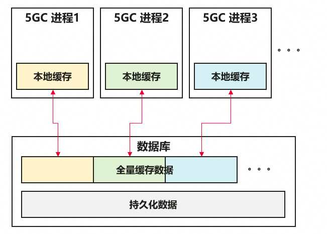
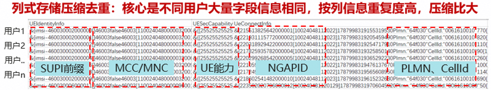
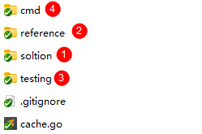
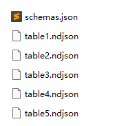
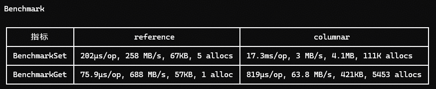
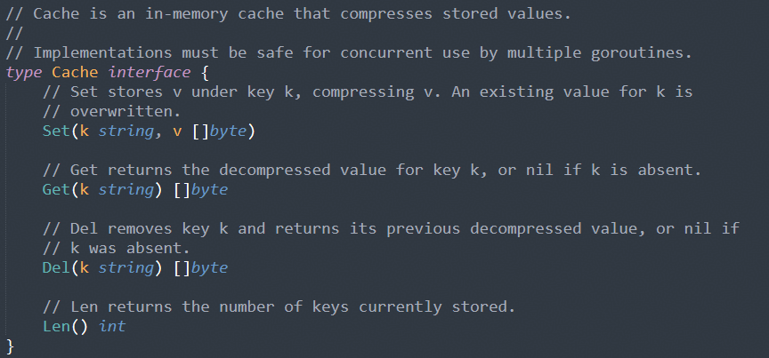
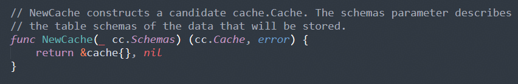
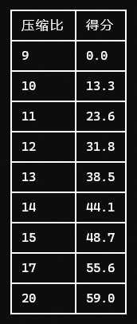
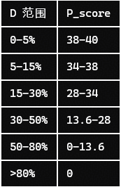
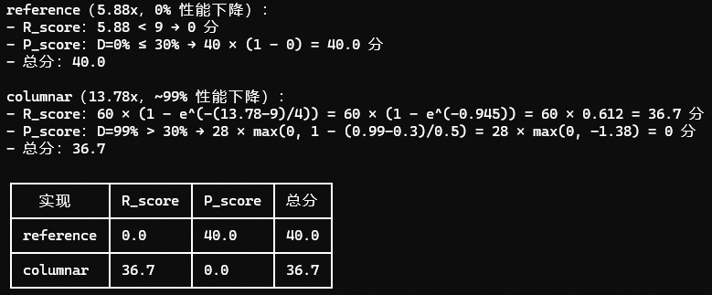

# 07 数据库缓存数据极致压缩算法

> 本文件为官网公开赛题原文的 Markdown 整理版；正文按原文保留，图片和公式本地保存，未自行改写赛题要求。

- 官方标题：【2026Hackathon决赛】7：数据库缓存数据极致压缩算法
- 来源：[官网赛题页](https://www.chaspark.com/#/races/competitions/1326635204541243392)
- 获取日期：2026-10-11（北京时间）
- 赛题 ID：1326635204541243392
- 原始资料：[JSON](../../官方资料/赛题原始数据/07_1326635204541243392.json) · [HTML](../../官方资料/赛题原始数据/07_1326635204541243392.html)

---

## 数据库缓存数据极致压缩算法

## 一、题目名称：

决赛赛题名称：数据库缓存数据极致压缩算法

## 二、背景信息（赛题产生的业务背景）：

随着内存价格的持续上涨，核心网设备内存成本占比持续上升，内存用量是成本关键因素。如何消减5G核心网软件使用的内存，变成当前的关键挑战。为了保证核心网软件的高吞吐、高并发，核心网软件采用了双层缓存的架构，简化后的示意图如下：

对这两层的缓存进行压缩，减小缓存占用内存空间，可获得巨大的竞争力收益。然而，什么样的压缩机制和算法，能保证**内存空间、读写CPU性能、时延/吞吐间取得平衡**，是本算法的关键挑战。

## 三、问题描述（现状、技术挑战等）：

### 业务背景：

当前核心网数据缓存几十张表，共占用数GB级的内存大小，需要进行压缩。出于对CPU性能与内存空间的权衡，当前采用了行压缩的机制，获取了综合70%~80%的压缩比。当前存在如下挑战：

1. 1、 泛用性：算法并不能在所有表上都取得稳定效果，即不是所有的表都采用了行压缩。
2. 2、 压缩比vs性能：核心网的数据中，一张表内列数据的重复度更高，列式压缩或其他综合多表的算法都能获得更好的压缩比，但同时数据读写性能存在数量级的下降。

本题目需要找到一套算法/数据结构，不限于继续优化行压缩、使用列压缩或其他机制，在性能牺牲较小的情况下，逼近极致的压缩比。

一些业界压缩比数据参考：

- ClickHouse：官方给出的典型列式压缩范围是 5:1～10:1，低基数列可以达到 30:1以上。
- BigQuery：Google 公开测试中，一张 NYC Taxi 表默认约 6.69:1，调整排序后可以达到 19:1；同一数据的 Parquet+GZIP 从约 4.55:1 提升到 10.68:1。

### 问题抽象：

1. **代码框架：**

题目包提供一套简化后的缓存接口操作的Go框架，顶层目录如下图

- ① 解答目录：**你需要实现这个目录下的接口，作为赛题的解答**，详细信息参考接口定义。
- ② 参考实现：用zstd逐行压缩的实现和做列压缩的实现，仅供参考，你不需要修改这个目录，**判题器不会用这个目录的内容**。
- ③ 测试用例：预置的测试框架，提供基础的功能测试和性能测试能力，你可以修改、增加用例，但**判题器不会用这个目录的内容**。
- ④ 表数据生成工具：你可以修改，推荐修改并用它生成更多数据用于性能测试，但**判题器不会用这个目录的内容**。注：题目附带测试数据仅供参考，最终提供和用于评测的数据会具备更高复杂度，如更多变的字段和嵌套的结构。

1. **测试框架**

Testing目录下提供三类测试：

- 功能测试-functional\_test.go：Set/Get/Del、字节一致性、NDJSON roundtrip、并发安全。
- 性能测试- perf\_test.go：压缩比、读写吞吐MB/s。
- Benchmark- bench\_test.go：通过 go test -bench 给出高精度读写平均时延µs/op。

1. **表数据说明**

一组测试数据由一个schemas.json和多个ndjson文件组成。schemas.json中描述每个缓存表的结构类型，这些类型会传递给cache的构造函数，给cache做压缩算法的规划，详情请参考题目框架代码。一个ndjson文件代表一个缓存的表，ndjson的一行代表这个表的一行数据，以{key:val}形式表达，题目提供的数据集中每个key全局唯一。

题目保证一个table.ndjson中的所有value都符合一套schema格式，**不同table.ndjson间的schema采用不同格式**。**不同table间的数据行数大致相同**，table内不同行的数据大小大致相同，固不同table的大小不同。**不同table间可能存在有相同的字段**(schema字段tables->fields->name)。

1. **参考实现说明**

题目框架中提供了基于zstd库做的**行压缩**实现和**列压缩**实现，在题目框架附带的数据集上分别实现了**~5.8:1和~13.7:1的压缩比**，但是行存储+列压缩的实现因追求压缩比基本**牺牲了吞吐，仅提供思路上的参考**。

### 接口定义：

为简化题目，当前仅需要实现Set、Get、Del、Len四个接口，接口定义在工程根目录的Cache interface中，接口签名如下，**实现需要保证并发安全，但性能验收不会基于并发场景验证**。

由于需要自动判题，Cache接口签名不允许修改、待你实现的solution包下的NewCache构造函数签名不允许修改，否则编译不通过则题目答案提交无效。

对solution包下结构体属性、结构体方法实现修改，对新增结构体、函数等内容均不做限制。

提交前请保证附带的testing目录中用例通过。

 

## 四、期望达到的指标和效果（含性能/精度等指标）：

### 评测方式

**评测环境：**Kunpeng920 ARM64，Go 1.24.1

为简化解题方对环境的依赖和保证评估结果的准确，**压缩比和性能采取相对验证**，即使用参考行压缩实现作为参考标准，评估提交的solution实现的压缩比和性能。

1、压缩比R：压缩比>=7:1，越高越好（对比raw数据和内存占用大小，非相对行压缩的数据）。

2、性能P：在100w基础数据下读取/写入吞吐<D%(对比MB/s)，时延影响<D%(对比µs/op)，D值参考后文计分方式。

3、泛用性：算法在不同表、不同数据集上均能取得较好的压缩效果和性能，计算方式为在不同测试数据集上取平均分。

### 计分方式

**总分Score = R\_score + P\_score**

**压缩比 R\_score（60分）**

R < 9:     R\_score = 0**（及格线设定为超过基线50%(即压缩比小于9倍不给分)**

R ≥ 9:     R\_score = 60 × (1 - e^(-(R - 9) / 4))

指数衰减曲线：前期提升收益大，后期边际递减，满分 60 分渐近。

**性能 P\_score（40分）**

吞吐量恶化率 = (T\_ref - T) / T\_ref

时延恶化率   = (L - L\_ref) / L\_ref

D = max(写吞吐恶化率, 读吞吐恶化率, 写时延恶化率, 读时延恶化率)

D ≤ 30%:  **P\_score** = 40 × (1 - D)              # 温和斜率，每1%扣0.4分

D > 30%:  **P\_score** = 28 × max(0, 1 - (D-0.3)/0.5)  # 陡峭斜率，每1%扣0.72分，80%归零

例，这个标准下，附带的参考实现评分：

## 五、测试用例

cache-compress.zip中已提供一份样例数据。最终的验证集单独提供。

注：题目附带测试数据仅供参考，最终提供和用于评测的数据会具备更高复杂度，如更多变的字段和嵌套的结构。

## 六、参考文献（可选，如有请提供）：

<https://clickhouse.com/resources/engineering/database-compression>

<https://cloud.google.com/blog/products/data-analytics/factors-influencing-bigquery-compression-ratios>

<https://learn.microsoft.com/en-us/sql/relational-databases/indexes/columnstore-indexes-design-guidance?view=sql-server-ver17>

## 七、评选标准（如评分维度，分成几档等）：

硬性要求：R\_score > 0

积分梯度：

Score < 60 不合格

60 <= Score < 70  合格

Score >= 70 优秀
