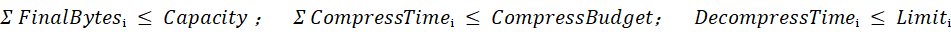
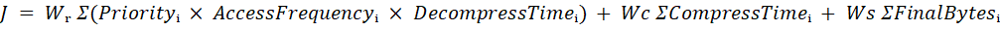
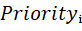
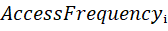
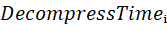
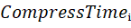
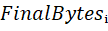
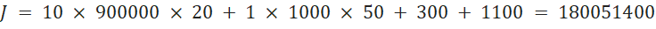
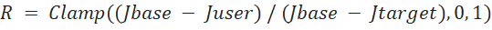

# 15 面向多类型数据的自适应压缩策略优化

> 本文件为官网公开赛题原文的 Markdown 整理版；正文按原文保留，图片和公式本地保存，未自行改写赛题要求。

- 官方标题：【2026Hackathon决赛】15：面向多类型数据的自适应压缩策略优化
- 来源：[官网赛题页](https://www.chaspark.com/#/races/competitions/1326688890680274944)
- 获取日期：2026-10-11（北京时间）
- 赛题 ID：1326688890680274944
- 原始资料：[JSON](../../官方资料/赛题原始数据/15_1326688890680274944.json) · [HTML](../../官方资料/赛题原始数据/15_1326688890680274944.html)

---

# 面向多类型数据的自适应压缩策略优化

# 一 、题目名称：面向多类型数据的自适应压缩策略优化

 

二、背景信息：

智能终端、高性能计算和数据存储系统需要处理模型、图像、日志、缓存等多种数据。业务规模增长后，系统必须同时控制内存占用、存储空间、压缩计算开销和数据恢复时延。

数据压缩可以减少空间占用，但不同算法在不同数据类型上的表现并不一致。赛题使用算法 A、B、C 表示三类通用压缩方法，不限定具体实现。算法特征通过压缩比、压缩带宽和解压缩时延刻画，具体数值以测试用例提供的测量结果为准。

 

| **算法** | **典型特点** | **可能适用的数据** |
| --- | --- | --- |
| A | 压缩带宽较高，解压缩时延较低，压缩比相对有限 | 访问频繁或时延敏感的数据 |
| B | 压缩比、压缩带宽和解压缩时延较为均衡 | 文本、日志或一般业务数据 |
| C | 压缩比可能较高，但压缩带宽较低，解压缩时延较高 | 访问频率较低且空间收益明显的数据 |

 

同一种算法处理不同数据类型时可能得到完全不同的结果。参赛者不能假设某种算法始终更优，也不能仅按照压缩比选择方案。

## 两阶段组合方式

除单独使用一种算法外，系统还可以先使用一种算法压缩，再使用另一种算法处理第一阶段的输出。例如：

原始数据  --算法A-->  中间数据  --算法B-->  最终数据  
最终数据  --算法B解压-->  中间数据  --算法A解压-->  原始数据

两阶段方案可能进一步减小数据，但会增加压缩时间和恢复时延。A 后接 B 与 B 后接 A 的结果也可能不同，因此每一种执行顺序都视为独立候选方案。

# 三 问题描述

系统中有 N 个待存储的数据对象。每个对象包含原始大小、数据类型、访问频率、业务优先级、最大恢复时延，以及若干候选压缩方案。

每个对象必须选择且只能选择一个方案。候选方案可以是不压缩、单阶段压缩，或由两个不同算法构成的两阶段压缩。测试平台为每个阶段提供输入大小、输出大小、压缩耗时和解压缩耗时。

参赛者需要在总容量、总压缩时间和单对象恢复时延的约束下，为所有对象作出全局选择，使综合代价最小。题目保证每个正式测试用例至少存在一个可行解。

## 性能指标

| 指标 | 定义 | 评价方向 |
| --- | --- | --- |
| 压缩比 | 原始大小除以最终大小 | 数值越大，空间节省越多 |
| 压缩带宽 | 原始大小除以完整压缩时间 | 数值越大，压缩速度越快 |
| 解压缩时延 | 恢复原始数据所需的总时间 | 数值越小，访问恢复越快 |
| 空间节省量 | 原始大小减去最终大小 | 用于评估容量收益 |

 

对于包含 K 个阶段的方案，最终大小等于最后一个阶段的输出大小，总压缩时间等于各阶段压缩时间之和，总解压缩时间等于各阶段解压缩时间之和。恢复时按照压缩顺序的相反方向执行。

两阶段方案的最终压缩比不能根据两个算法处理原始数据时的压缩比直接相乘，必须使用测试用例给出的逐阶段实际结果。

数据结构与接口

参赛者可以按照以下 C++ 数据结构理解题目。正式比赛可提供等价的头文件。

enum class AlgorithmType {  
    NONE,  
    ALGORITHM\_A,  
    ALGORITHM\_B,  
    ALGORITHM\_C  
};  
  
enum class DataType {  
    GENERIC\_DATA,  
    MODEL\_DATA,  
    IMAGE\_DATA,  
    TEXT\_LOG\_DATA,  
    CACHE\_DATA,  
    STRUCTURED\_DATA  
};  
  
struct CompressionStage {  
    AlgorithmType algorithm;  
    long long inputBytes;  
    long long outputBytes;  
    long long compressTimeNs;  
    long long decompressTimeNs;  
};  
  
struct CompressionOption {  
    int optionId;  
    std::vector<CompressionStage> stages;  
};  
  
struct DataObject {  
    int objectId;  
    DataType dataType;  
    long long originalBytes;  
    long long accessFrequency;  
    int priority;  
    long long maxRestoreLatencyNs;  
    std::vector<CompressionOption> options;  
};  
  
struct CompressionDecision {  
    int objectId;  
    int selectedOptionId;  
};  
  
struct OptimizationResult {  
    std::vector<CompressionDecision> decisions;  
    long long totalStoredBytes;  
    long long totalCompressTimeNs;  
};

建议实现以下接口：

OptimizationResult OptimizeCompressionStrategy(  
    const std::vector<DataObject>& objects,  
    long long storageCapacityBytes,  
    long long compressTimeBudgetNs);

## 合法性要求

| 约束 | 判定规则 |
| --- | --- |
| 唯一选择 | 每个数据对象必须且只能选择一个候选方案 |
| 容量 | 所有对象最终大小之和不超过 Capacity |
| 压缩时间 | 所有对象总压缩时间不超过 CompressBudget |
| 恢复时延 | 每个对象的总解压缩时延不超过 MaxRestoreLatency |
| 阶段连续 | 前一阶段输出大小等于后一阶段输入大小 |
| 首尾一致 | 第一阶段输入等于原始大小，最终大小等于最后一阶段输出 |

 

不压缩方案的阶段数为 0，最终大小等于原始大小，压缩时间和解压缩时间均为 0。只要违反任意硬约束，该测试用例即判定为无效。

## 优化目标

在满足全部硬约束的前提下，评测程序按照以下综合代价评价方案。权重由每个测试用例给出。

其中：

·  ：对象的重要程度。通常数值越大，表示越重要。

·  ：对象预计被访问或解压的频率。

·  ：每次解压耗时。

·  ：每次压缩耗时。

·  ：   最终占用空间大小。

 

| 组成部分 | 含义 |
| --- | --- |
| 恢复代价 | 高优先级、高频访问对象对解压缩时延更加敏感 |
| 压缩代价 | 限制压缩过程对计算资源和业务时延的影响 |
| 空间代价 | 鼓励在满足性能约束的前提下降低最终占用 |

 

综合代价采用整数计算，不执行浮点除法。实现时应使用足够宽的整数类型；当乘积可能超过 64 位范围时，建议使用 int128。

## 递进子目标

### 子目标一 单对象单阶段选择

系统只有一个数据对象，仅允许不压缩或使用算法 A、B、C。参赛者需要计算各方案指标，并排除不满足恢复时延要求的方案。

### 子目标二 多对象全局选择

系统包含多个对象，每个对象允许选择一种单阶段算法。参赛者需要同时满足总容量和总压缩时间约束。局部最优方案的组合不一定是全局最优解。

### 子目标三 两阶段组合方案

在单阶段方案基础上，增加 A 后接 B、A 后接 C、B 后接 A 等候选方案。不同顺序具有独立的压缩结果和耗时，不能互相替代。

### 子目标四 大规模近似优化

数据对象数量扩大到 100000，每个对象最多包含 10 个候选方案。参赛者需要在有限时间和内存内获得高质量可行解。允许使用动态规划、松弛、近似算法、启发式搜索或局部改进等方法。

# 四 期望达到的指标和效果

## 必须达到的指标

| **指标** | **要求** |
| --- | --- |
| 方案完整性 | 每个对象必须且只能选择一个方案 |
| 约束满足 | 容量、压缩时间和恢复时延满足率为 100% |
| 方案合法性 | 两阶段方案的输入输出关系正确 |
| 稳定性 | 无崩溃、超时、整数溢出和非法内存访问 |
| 通用性 | 不得针对公开数据或对象编号硬编码结果 |

 

## 建议达到的优化指标

| **优化维度** | **比较基准** | **建议目标** |
| --- | --- | --- |
| 综合代价 | 固定使用同一种算法 | 降低不少于 20% |
| 空间占用 | 固定使用高带宽算法 | 在相同时延约束下降低 10% 至 25% |
| 恢复时延 | 优先选择最高压缩比方案 | 加权平均解压缩时延降低 20% 以上 |
| 压缩效率 | 逐对象独立贪心 | 相同容量下总压缩时间降低 15% 以上 |
| 大规模性能 | N 为 100000 且候选数不超过 10 | 建议 2 秒内完成 |
| 峰值内存 | 同上 | 建议不超过 512 MB |

 

## 预期业务效果

- 针对不同类型数据选择更合适的压缩方案。
- 高频和时延敏感数据优先采用低恢复时延方案。
- 低频和空间敏感数据在约束允许时采用更高压缩比方案。
- 在收益合适时使用两阶段压缩，避免收益不足的重复计算。
- 容量紧张时进行全局资源分配，减少局部贪心导致的资源浪费。

# 五 测试用例

## 测试用例设计

| **测试组** | **主要考察内容** | **数据规模** | **建议占比** |
| --- | --- | --- | --- |
| A | 指标计算与单对象选择 | N ≤ 20 | 10% |
| B | 多对象容量约束 | N ≤ 200 | 15% |
| C | 压缩时间与恢复时延约束 | N ≤ 1000 | 20% |
| D | 两阶段组合方案选择 | N ≤ 10000 | 25% |
| E | 大规模综合优化 | N ≤ 100000 | 20% |
| F | 边界、异常和压力测试 | N ≤ 100000 | 10% |

 

## 测试组构造原则

- 最高压缩比方案因恢复时延超限而不可选。
- 每个对象的局部最优方案组合后超过总容量。
- 按照单位压缩时间节省空间进行贪心无法获得较优结果。
- A 后接 B 与 B 后接 A 的最终大小和耗时明显不同。
- 部分已经压缩的数据继续处理后几乎没有空间收益。
- 总容量、压缩时间或恢复时延恰好达到边界值。
- 存在多个综合代价相同的方案，需要按照统一规则决胜。

## 相同代价决胜规则

1. 最终数据总大小更小。
2. 总压缩时间更短。
3. 所有对象总解压缩时间更低。
4. 按输入顺序比较所选 optionId，字典序更小。

## 输入格式

### 总体格式

第一行包含测试用例数量 Q。每个测试用例的第一行包含：

N Capacity CompressBudget Wr Wc Ws

| **字段** | **含义** |
| --- | --- |
| N | 数据对象数量 |
| Capacity | 最终可使用总容量，单位 Bytes |
| CompressBudget | 总压缩时间预算，单位 ns |
| Wr | 恢复时延代价权重 |
| Wc | 压缩时间代价权重 |
| Ws | 空间占用代价权重 |

 

### 数据对象格式

ObjectId DataType OriginalBytes AccessFrequency Priority MaxRestoreLatency OptionCount

| **字段** | **含义** |
| --- | --- |
| ObjectId | 数据对象编号 |
| DataType | 数据类型编号 |
| OriginalBytes | 原始大小，单位 Bytes |
| AccessFrequency | 统计周期内预计访问次数 |
| Priority | 业务优先级，数值越大越重要 |
| MaxRestoreLatency | 最大允许恢复时延，单位 ns |
| OptionCount | 候选压缩方案数量 |

 

### 候选方案格式

OptionId StageCount  
AlgorithmId InputBytes OutputBytes CompressTimeNs DecompressTimeNs

StageCount 为 0、1 或 2。StageCount 为 0 时不再输入阶段数据；其最终大小等于对象原始大小，压缩和解压缩时间均为 0。

| **编号** | **算法或数据类型** |
| --- | --- |
| 算法 0 | 不压缩 |
| 算法 1 | 算法 A |
| 算法 2 | 算法 B |
| 算法 3 | 算法 C |
| 类型 0 | 通用数据 |
| 类型 1 | 模型数据 |
| 类型 2 | 图像数据 |
| 类型 3 | 文本或日志数据 |
| 类型 4 | 缓存数据 |
| 类型 5 | 结构化数据 |

 

## 输出格式

对于每个测试用例，首先输出：

Case #x:

随后按照输入对象顺序输出 N 行：

ObjectId OptionId

评测程序根据输入重新计算最终数据总大小、总压缩时间、每个对象的解压缩时延和综合代价。参赛者不需要输出这些统计值。

## 输入输出示例

### 示例输入

1  
2 1100 1000 1 1 1  
1 4 1000 900000 10 1000 2  
0 0  
1 1  
1 1000 700 100 20  
2 3 800 1000 1 1000 3  
0 0  
2 1  
2 800 400 200 50  
3 2  
1 800 600 100 20  
2 600 250 300 70

### 示例输出

Case #1:  
1 1  
2 2

### 示例说明

对象 1 选择方案 1，使用算法 A 后大小为 700 Bytes；对象 2 选择方案 2，使用算法 B 后大小为 400 Bytes。最终大小为 1100 Bytes，总压缩时间为 300 ns，均满足限制。

对象 2 的两阶段方案最终大小更小，但其压缩时间和解压缩时延也更高。在本示例给定的权重下，单独使用算法 B 的综合代价更低。

# 六 评选标准

## 评分构成

建议满分为 100 分，由自动评测和专家评审组成。不可行方案在对应测试用例中的正确性和优化效果均记 0 分。

| **评分项** | **分值** | **主要内容** |
| --- | --- | --- |
| 正确性与约束满足 | 20 | 输出格式、唯一选择、容量、压缩时间、恢复时延和阶段关系 |
| 优化效果 | 50 | 综合代价相对基准方案和目标方案的改善程度 |
| 运行效率 | 15 | 运行时间、峰值内存和大规模稳定性 |
| 鲁棒性 | 5 | 边界条件、大整数、相同代价和确定性 |
| 代码质量与创新性 | 10 | 结构、说明、复杂度分析、创新方法和扩展能力 |

 

## 优化效果计算

主办方为每个测试用例准备基准代价 Jbase 和目标代价 Jtarget。参赛者方案的代价为 Juser。优化得分比例按下式计算，并限制在 0 到 1 之间。

| **参赛结果** | **优化得分** |
| --- | --- |
| 与基准算法相同或更差 | 0 |
| 介于基准和目标之间 | 按照公式线性计分 |
| 达到或优于目标值 | 该测试用例优化分满分 |

 

## 建议资源限制

| **限制项** | **建议值** |
| --- | --- |
| 单个测试用例时间 | 2 秒 |
| 全部测试用例总时间 | 20 秒 |
| 峰值内存 | 512 MB |

 

## 公开测试与隐藏测试

建议公开测试占 30%，隐藏测试占 70%。公开测试用于验证输入输出、约束判断和基本指标计算；隐藏测试重点考察大规模性能、全局优化能力、两阶段方案选择和对特殊构造数据的泛化能力。

| **测试类型** | **占比** | **主要用途** |
| --- | --- | --- |
| 公开测试 | 30% | 格式、基础正确性、指标计算和调试 |
| 隐藏测试 | 70% | 优化质量、规模性能、鲁棒性和泛化能力 |

 

## 基准算法与参赛要求

### 建议提供的基准算法

主办方可提供一个基础版本，帮助参赛者快速完成可行解。基础版本首先为所有对象选择不压缩方案；容量不足时，按照单位压缩时间能够节省的空间排序，逐步替换为满足恢复时延要求的压缩方案，直到满足容量限制。

该方法易于实现，但没有同时处理访问频率、业务优先级和多重资源约束，在复杂用例中通常无法取得较高分数。

### 可探索的优化方向

参赛者可以探索多约束动态规划、拉格朗日松弛、分支限界、近似算法、分层贪心、局部搜索和启发式搜索等方法。评测只关注输出方案是否合法以及综合代价，不限制具体求解方法。
