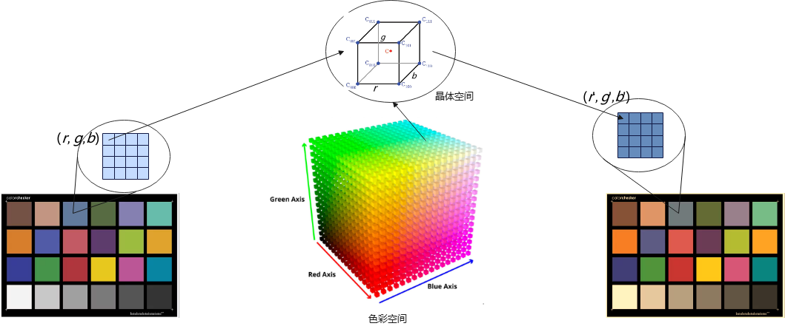
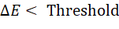
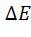
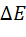
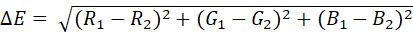

# 16 极速焕彩

> 本文件为官网公开赛题原文的 Markdown 整理版；正文按原文保留，图片和公式本地保存，未自行改写赛题要求。

- 官方标题：【2026Hackathon决赛】16：极速焕彩
- 来源：[官网赛题页](https://www.chaspark.com/#/races/competitions/1326689437612879872)
- 获取日期：2026-10-11（北京时间）
- 赛题 ID：1326689437612879872
- 原始资料：[JSON](../../官方资料/赛题原始数据/16_1326689437612879872.json) · [HTML](../../官方资料/赛题原始数据/16_1326689437612879872.html)

---

**极速焕彩**

**1.** **赛事背景**

在智能手机、车载显示和车载流媒体等实时图像处理场景中，对高清输入图像进行快速、精准的色彩风格化或色彩校正是一项核心需求，满足用户多样化的拍照体验。

 

**2.** **赛题任务**

系统输入一张RGB图和4个三维颜色空间，该图的像素RGB值作为输入坐标，在给定的颜色空间中查找计算得到目标值，参赛选手需要设计并实现一个色彩空间稀疏化算法和图像色彩映射算法，首先从三维色彩映射空间（256\*256\*256）维度稀疏化到m\*m\*m，m限制为（17 <= m <= 33），然后在稀疏色彩空间中计算出像素的映射值，在满足特定色差精度限制的前提下，经过4次颜色空间映射，输出最终的图像结果。

每个像素的计算步骤：

1. 将给定的三维色彩空间LUT稀疏化到m\*m\*m晶体空间，稀疏化算法由选手设计实现
2. 确定输入像素在晶体空间位置（立方体）
3. 在立方体通过插值算法求出目标值C，插值算法由选手设计实现

 

以上完成了单个像素色彩空间的映射，计算共需要完成4次映射，分别对应4个颜色空间，完成所有的颜色的映射调整。

 

 

**输入数据规格**

1）输入图像规格

- **图像分辨率**：1024 × 768 像素
- **图像格式**：RGB 3通道彩色图
- **位深**：每通道 8-bit 量化（像素值范围 0 ~ 255）

2）输入色彩空间规格

- LUT规格：256\*256\*256
- LUT数量：4个
- LUT变量类型：整型

**选手输出件：**

1. 提供稀疏算法完成颜色空间从256\*256\*256到m\*m\*m稀疏化处理
2. 提供查找和插值算法，完成输入图像像素在稀疏颜色空间的映射计算

 

**变换约束与定义**

1. **色彩映射**：每一步色彩映射均在稀疏化空间m\*m\*m中完成，且m\*m\*m空间与原色彩空间变量类型一致，m约束为（17 <= m <= 33）。
2. **多级串联**：输入图像必须通过 4 次独立且不同的色彩映射调整，4次色彩映射可以依次顺序通过，也可以做等价计算优化次数，每次映射变化的输入/输出约束均为整型变量，与最终计算结果输出类型一致。
3. **联合优化：**稀疏化算法可以与查找/插值算法联合优化设计，达到精度和速度最优；

---

**3.** **核心限制与技术引导**

- **矩阵稀疏化与压缩**：选手需要设计稀疏化方案（如稀疏采样、矩阵低秩分解、基函数拟合等），在降低内存占用的同时保证插值效率。
- **技术路线不设限**：允许并鼓励使用传统并行加速算法（如 CUDA 优化、多线程插值、SIMD指令集）或轻量化 AI 算法（如感知器拟合、超轻量神经网络、网络剪枝）。
- **精度硬约束**：输出图像与理论标准变换图像之间，必须满足色差公式约束：  
   

(注：  为总色差，Threshold 赛题组将在测试集发布时统一公布，用以过滤低质量退化图像)

 计算方法为： 

https://snki.nl/en/blogs/kleurverschilformules-uitgelegd-cie76-cmc-cie94-ciede2000

---

**4.** **评估指标与评分标准**

评测将从 **正确性**、**运行速度** 和 **内存占用** 三个维度进行综合考量，总分 100 分。

**A.** **算法正确性与精度（硬门槛，通过得** **40** **分）**

- 选手的输出图像必须完全通过  的硬性阈值约束。
- 若单张图片未能通过约束，则该图片计为 0 分。整个测试集平均色差越低，此项得分越高。

**B.** **执行速度（性能核心，****40** **分）**

- **评测环境**：统一在指定配置的服务器上运行。
- **吞吐量测试**：计算算法处理100张图像完成 4 次色彩变换的平均耗时如在Intel(R) Core(TM) i7-14700@2.1G通用CPU下单张图像处理耗时应在1.5s以下。耗时最短的队伍获得满分，其余队伍按比例得分。

**C.** **架构与算法创新性（****20** **分）**

- **内存与工程优化**：考察映射矩阵的稀疏化压缩比、高效插值计算方法等。
- **代码架构**：考量代码的工程落地可行性，是否便于移植到嵌入式或移动端设备
