# 17 内存带宽受限下的计算图多核调度问题

> 本文件为官网公开赛题原文的 Markdown 整理版；正文按原文保留，图片和公式本地保存，未自行改写赛题要求。

- 官方标题：【2026Hackathon决赛】17：内存带宽受限下的计算图多核调度问题
- 来源：[官网赛题页](https://www.chaspark.com/#/races/competitions/1326690139802284032)
- 获取日期：2026-10-11（北京时间）
- 赛题 ID：1326690139802284032
- 原始资料：[JSON](../../官方资料/赛题原始数据/17_1326690139802284032.json) · [HTML](../../官方资料/赛题原始数据/17_1326690139802284032.html)

---

内存带宽受限下的计算图多核调度问题

 

**一、背景信息**

传统算子编程方式由于编写困难、融合结构支持范围有限、成本与泛化性难以兼顾等原因，难以泛化到大规模的模型融合结构，导致模型在实际运行过程中形成算子间的数据通信墙。这在内存带宽受限的端侧平台上造成了严重的带宽瓶颈，限制了核心算力利用率。为此，PTO工具将整个计算过程拆解为细粒度原子操作节点组成的计算图，将整个网络融合为一个算子，离线完成所有操作节点的调度排布并生成可高效执行的算子文件，从而打破了算子间的数据通信墙，并在实际业务中带来了巨大的性能与功耗收益。

然而，随着端侧NPU单元向多核方向发展，当前PTO中的计算图调度算法面临着多核化难题：如何将一整张计算图调度到多个核心，在高效利用各核计算单元与私有缓存的同时，协调跨核数据依赖、减少核间数据通信对DDR带宽的占用，在多核并行度、核内缓存容量限制、共享主存数据搬运带宽等诸多约束之间取得平衡，最终缩短整个网络在多核上的端到端执行时间。本赛题希望参赛队伍给出一种基于静态日历调度的多核调度算法，支撑端侧最新NPU平台进一步提升计算单元利用率与能效表现。

**二、问题描述：**

在包含 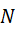 个同构NPU核心的平台上调度一张有向无环计算图（DAG）并使得总模拟执行时间最短。如图所示，计算图是由tensor节点和op节点构成的二部图。每个tensor节点包含pos（数据位于DDR还是核内L1缓存）与size两个属性；每个op节点包含操作名称（核内外数据搬运为COPY\_IN/COPY\_OUT节点，其余均为计算节点）和运行管道pipe两个属性。两类op节点的耗时模型不同：计算节点的耗时固定，由节点的cycles属性描述；数据搬运节点的耗时则在模拟调度时根据瞬时带宽与搬运数据量动态计算。

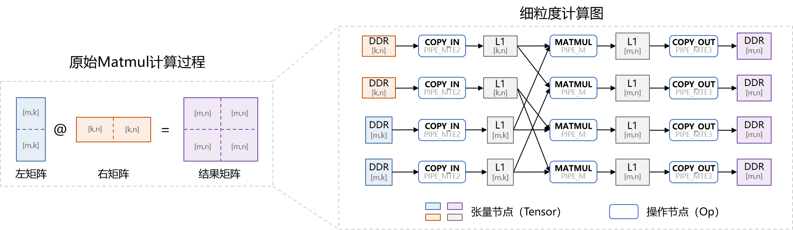

多核调度按两个相互衔接的阶段展开：（1）切图：将完整计算图中的所有计算节点（不包括数据搬运节点）划分到若干子图中，子图数量不作限制；（2）子图调度：将各子图分配到具体核心，并确定每个核心上的子图执行顺序。

算法需输出**切图方案**与**子图调度**方案两部分结果；赛题提供的示例评估程序将根据算法结果，补充跨子图边界的数据搬运、确定核内操作顺序，并模拟多核在共享带宽下的并行执行，最终给出模拟运行时间。

为了满足多核调度中物理条件的约束，示例评估程序按以下流程进行。

（记号约定：op的开始与结束时刻为 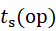 与 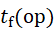，op所属子图与所在核为 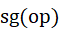 与 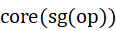，时刻  处于执行中的op集合为 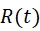（其中数据搬运节点集合为 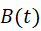），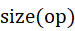 为数据搬运量，时刻  驻留核内L1的数据集合为 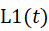，各核共享的DDR总带宽为 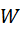）

**Step1: 插入核间数据拷贝。**对切图与调度后需要跨核的tensor节点，将其位置修改为DDR，并向其生产侧子图内插入COPY\_OUT节点、消费侧子图内插入COPY\_IN节点。

- 约束1：核间数据通信必须经由DDR完成，即跨核数据依赖的通路为 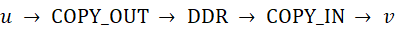。

**Step2: 核内op执行顺序确立。**各核通过固定启发式流水线确定该核上全部op的执行顺序与依赖：优先级排序 → 溢出控制 → 局部乱序调度。其中，同一子图内经反向DFS排出缓存占用最小的次序，子图间按照该核上子图调度顺序，对各子图的DFS次序进行串联（因此，可通过切图与子图调度顺序来间接调整核内执行序）；溢出控制按约束3自动插入缓存换入/换出节点；局部乱序调度依据各pipe与缓存的模拟占用情况，确定最终执行顺序与内存复用依赖边。选手也可自行优化核内执行序，但须同时满足约束2与约束3。

- 约束2：核内执行序必须满足计算图拓扑依赖关系，即 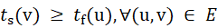（E为计算图依赖边集合）。
- 约束3：核内调度执行过程中，任一时刻驻留于核内L1缓存的数据量必须满足 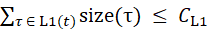（本题中L1为1M大小）。
- 约束4: 核内每个pipe任一时刻只能存在一个正在执行的op节点。

**Step3: 多核模拟执行。**以离散事件循环模拟多核并行执行：初始时刻 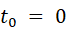；每一事件时刻卸载已完成的op、发射前驱均已结束且pipe资源空闲的op，并将时钟推进至所有正在执行的op中最早结束时刻作为下一个事件时刻。发射数据搬运节点时，按瞬时带宽平均分配原则，各在执行搬运节点获得的带宽为 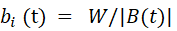，其余在执行搬运op的结束时间据此相应推迟，以保证瞬时带宽约束始终满足。全部op执行完毕后，输出模拟运行时间。

- 约束5: 多核模拟执行时，每个核内的执行过程需满足约束2、3和4。
- 约束6：多核模拟执行时，每个核内各个pipe的op执行序需遵守Step2中核内调度给出的执行序（pipe内部无乱序执行机制）。
- 约束7：核间存在中间数据依赖的op，其执行时间同样需要满足计算图拓扑依赖，其中，作为数据接受方的op，在数据生产方op执行结束后，需等待1000 cycles才能开始执行（跨核同步开销）。
- 约束8：模拟结果中，任一时间段内完成的DDR数据搬运总量，不能超过该时间段长度乘以总带宽常数（当前总带宽设置为60 bytes per cycle）。

**三、用例说明：**

本赛题提供多层卷积级联和Matmul两个基本结构的用例（一共30个测试计算图用例）供参赛选手测试，请勿对用例进行定制化处理。

1. 多层卷积级联网络。

卷积网络形成的基本计算图结构如下图所示。输入特征图为[N, H, W, C]格式，每张特征图沿H轴维度进行切分（C轴也有可能进行切分）。由于卷积算子自身的计算特性，卷积计算图的层间呈现交错的依赖结构。因此，多核切图算法需要寻找最优切分，在降低核间通信数据量的同时尽可能解耦核间依赖，提升核间并行度。

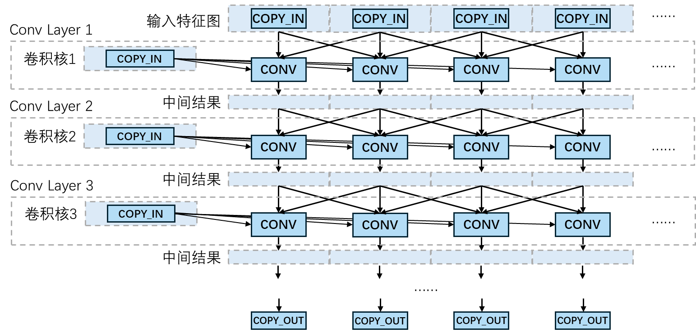

1. Matmul网络结构：

Matmul网络形成的计算图已在问题描述处给出，此处不再重复。该场景下，左右矩阵通过切块加载至核内进行计算。调度算法需要考虑多核计算引起的数据重复搬运会造成带宽瓶颈：当Matmul计算任务被均匀切分至个核上时，左右矩阵之一必然被重复搬运次；核数过多时，反而可能因搬运数据量增多导致时延劣化。因此，多核调度算法需要在计算均衡与带宽约束之间进行权衡，在最大化单核内数据的复用程度的同时，调整单核内的调度序来降低内存溢出开销，并选择性空核来避免带宽过载。

**四、评选标准：**

评分在多核模拟环境下进行，满分100分，由以下三项指标构成：

**（1）平均多核加速比（40分）：**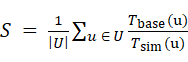，U为评测用例集合，加速比以用例的单核执行时间为基线，S越高越好。

**（2）算法求解时间（30分）：**参赛算法对用例完成切图与子图调度求解的耗时，越短越好。

**（3）总DDR数据搬运量（30分）：**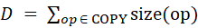，COPY为多核模拟执行中全部COPY\_IN/COPY\_OUT节点，D越少越好。
