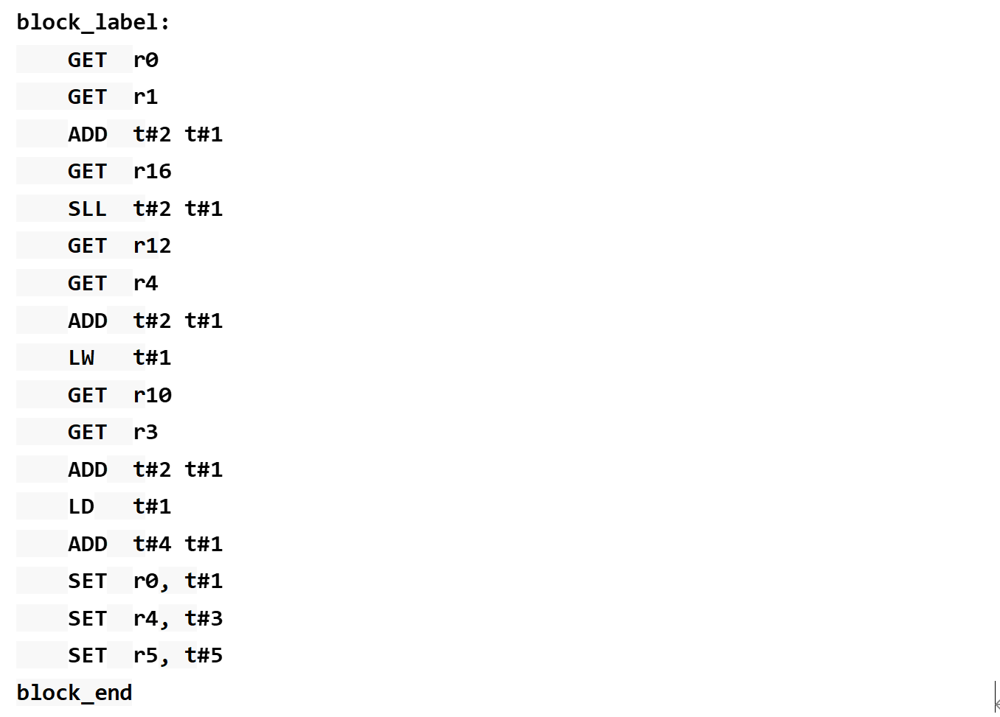
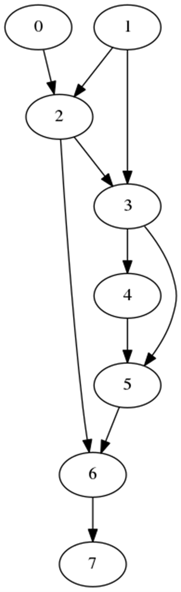

# 18 下一代ISA设计中的指令调度寻优问题

> 本文件为官网公开赛题原文的 Markdown 整理版；正文按原文保留，图片和公式本地保存，未自行改写赛题要求。

- 官方标题：【2026Hackathon决赛】18：下一代ISA设计中的指令调度寻优问题
- 来源：[官网赛题页](https://www.chaspark.com/#/races/competitions/1326690549003280384)
- 获取日期：2026-10-11（北京时间）
- 赛题 ID：1326690549003280384
- 原始资料：[JSON](../../官方资料/赛题原始数据/18_1326690549003280384.json) · [HTML](../../官方资料/赛题原始数据/18_1326690549003280384.html)

---

下一代ISA设计中的指令调度寻优问题

## 

## 一、题目名称：

**决赛赛题来自技术领域：** 计算机架构 / 编译器优化 / 下一代指令集架构 (ISA) 设计

## 二、背景信息：

在传统的ISA指令集中，如X86/ARM/RISCV，都是采用寄存器架构方式定义指令集，如ADD X3, X5，X6。而另外一类ISA指令集的设计方式，是采用间接索引而不是寄存器索引的方式来定义指令：

1. 指令的定义在一个basic block的空间内，即block内部没有跳转指令。只有block和block之间会发生跳转。
2. 每条指令都有输出(内部临时寄存器T<n>)，指令的输出会被后续的指令使用。例如下图l5: SLL t#2, t#1，即I5的做输入是相距I5距离为2(t#2)的指令I3的输出，和相距I5距离为1(t#1)的指令I4的输出。
3. GET从架构寄存器r<x>输入转移到T寄存器。 SET从T寄存器转移输出至架构寄存器r<x>中。暂时忽略立即数的定义。

汇编示例如下：



**当前面临的挑战与业务价值：** 通过观察大量实际的 Workload 发现，绝大多数指令的依赖关系非常近，即指令的输出会很快被后续指令使用。如果采用**间接索引**，当依赖距离较近时，仅需 2bit（至多向前索引 4 条指令）或 3bit（至多向前索引 8 条指令）即可高效编码。然而，当依赖距离超过硬件支持的最大索引限制时，必须通过插入 `copy` 指令来接力传递数据。 因此，如何通过编译器层面的**指令调度（重排）与合理的** `copy`**插入策略**，在受限的指令编码空间（如 2bit 至 5bit 限制）与额外引入的 `copy` 指令开销之间达到最优平衡，是本赛题的核心技术难题。

 

### 三、问题描述（现状、技术挑战等）

对当前问题进行业务抽象与形式化拆解：

- **1.** **问题拆解：**

1. **指令依赖图构建：** 将输入的 Basic Block 内 n 条指令（包含 `GET`、`SET` 及一/二输入一输出常规指令）转化为有向无环图（DAG）的指令依赖图，其中顶层节点为 `GET`，叶子节点为 `SET`。
2. **指令调度与重排：** 调整 block 内部指令的排列顺序，使得具有数据依赖关系的指令尽可能在空间上靠拢，以满足更小的索引 bit 限制。
3. **Copy** **策略插入：** 当指令间的实际距离超过当前编码配置所允许的最大索引距离时，算法需自动计算并插入 `copy` 指令以接力传递临时变量。

- **2.** **问题抽象：**

1. 本题可抽象为**带距离约束的图论调度与寻优问题**，兼具编译器中指令调度、寄存器生存期管理及启发式搜索（如贪心算法、模拟退火、遗传算法等）的特点。

- **3.** **接口定义：**

1. **输入接口：** 接收一个 Basic Block 的指令流文件（包含 `GET`、`SET` 及常规指令序列与依赖关系），以及索引编码配置参数（如最大允许索引 bit 数，范围 2bit~5bit）。
2. **输出接口：** 输出经过重排并按需插入 `copy` 指令后的功能正确的指令序列，以及对应的统计报告（包括引入的 `copy` 数量、算法执行耗时等）。
3. 

### 四、期望达到的指标和效果（含性能/精度等指标）

- **功能目标：**

1. 实现一个高效的指令调度与寻优编译器优化工具，能够针对输入的 Basic Block 自动进行指令重排和 `copy` 插入。
2. 保证生成的指令序列逻辑功能完全正确，支持从 2bit 到 5bit 等不同索引宽度的灵活配置。

- **性能目标：**

1. **时间复杂度：** 算法需要在合理的时间复杂度内处理中等规模的 block 指令集，避免状态爆炸。
2. **质量指标：** 在限定的索引 bit 约束下，极力压减额外引入的 `copy` 指令数量。

### 五、测试用例

- **测试用例说明：**

1. 赛题公示阶段仅公开输入输出规范及公开样本集；决赛开赛当天提供最终验收测试用例。验收用例结果将按一定权重（如 30%）计入决赛终评积分。

- **输入格式与样例：**

1. *输入格式：* 采用结构化文本/JSON 格式，描述 Basic Block 中的指令 ID、操作类型（`GET`/`SET`/`ADD`/`MULW`等）、操作数依赖声明。
2. *输入样例（示意）：*

```
{
```

```
  "block_id": "bb_001",
```

```
  "bit_width": 2,
```

```
  "instructions": [
```

```
    {"id": 0, "op": "GET", "reg": "r1"},
```

```
    {"id": 1, "op": "GET", "reg": "r2"},
```

```
    {"id": 2, "op": "MULW", "inputs": ["t#1", "t#2"]}
```

```
  ]
```

```
}
```

- **输出格式与样例：**

1. *输出格式：* 包含重新调度后的指令序列、插入的 `copy` 指令及对应的间接索引映射关系。
2. *输出样例（示意）：*

```
{
```

```
  "block_id": "bb_001",
```

```
  "optimized_instructions": [
```

```
    {"id": 0, "op": "GET", "reg": "r1"},
```

```
    {"id": 1, "op": "GET", "reg": "r2"},
```

```
    {"id": 2, "op": "COPY", "source": "t#1"},
```

```
    {"id": 3, "op": "MULW", "inputs": ["t#1", "t#2"]}
```

```
  ]
```

```
}
```

### 六、评选标准

设置基础要求、进阶要求与挑战要求，通过梯度差异化用例全面衡量参赛方案的优劣：

- **基础要求（Level 0）：**

1. 完成算法基础框架，在给定的索引 bit 限制下成功生成**功能正确**的指令序列。达成此项即可通过基础用例集。

- **进阶要求（Level 1）：**

1. 在测试集上，额外引入的 `copy` 指令数**平均占比在 10% 以内**。

- **挑战要求（Level 3）：**

1. 额外引入的 `copy` 指令数**平均占比在 2% 以内**，且算法时间复杂度表现优异。

- **其他加分项：**

方案的算法创新性（如启发式策略设计、图论建模巧思）、架构设计的优雅性、模块解耦程度以及代码工程质量等。
