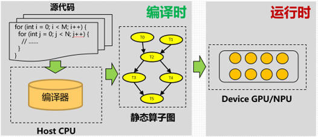
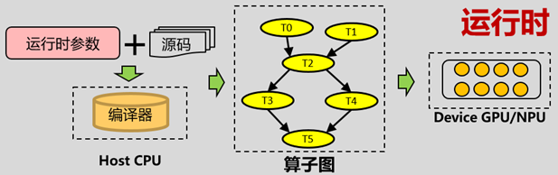
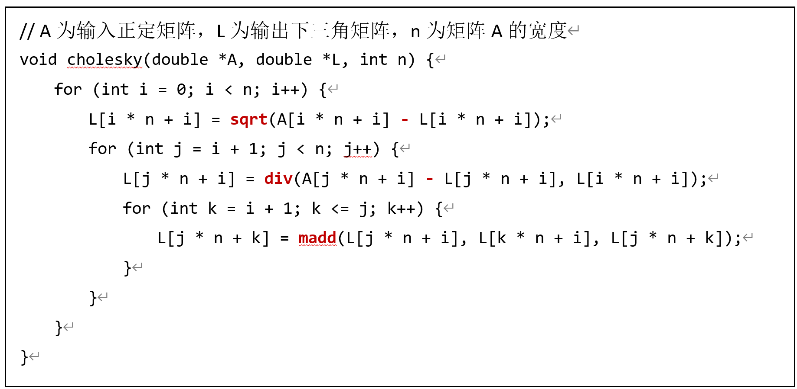
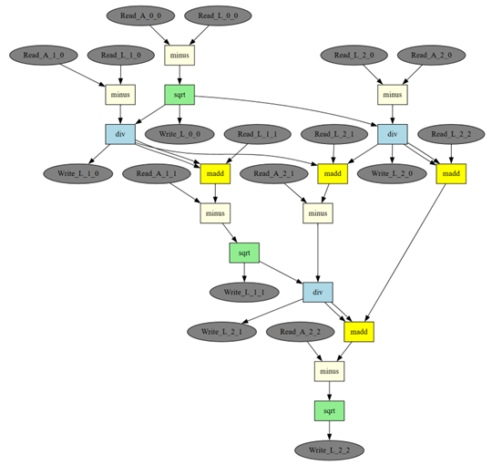
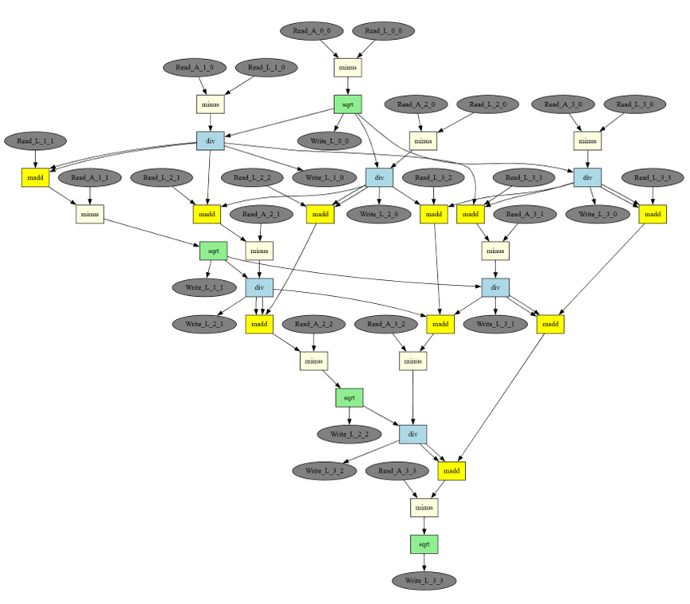
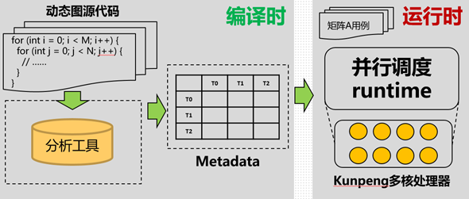

# 19 动态算子图编译与并行调度

> 本文件为官网公开赛题原文的 Markdown 整理版；正文按原文保留，图片和公式本地保存，未自行改写赛题要求。

- 官方标题：【2026Hackathon决赛】19：动态算子图编译与并行调度
- 来源：[官网赛题页](https://www.chaspark.com/#/races/competitions/1326691788365586432)
- 获取日期：2026-10-11（北京时间）
- 赛题 ID：1326691788365586432
- 原始资料：[JSON](../../官方资料/赛题原始数据/19_1326691788365586432.json) · [HTML](../../官方资料/赛题原始数据/19_1326691788365586432.html)

---

**动态算子图编译与并行调度**

 

1. **背景信息**

基于算子图的调度由于能够降低Kernel启动开销，减少运算单元的空载时间，在大模型训练/推理过程中得到了广泛的应用。然而当前业界方案以静态算子图为主，静态算子图的拓扑结构不随运行时发生变化，因此Host侧编译时即可生成算子图并一次性下发至GPU/NPU等Device侧执行。

图 1 静态算子图的编译运行模式

而在很多应用场景中，算子图的拓扑结构在运行时会变化，导致Host侧必须不断更新算子图并重新下发，产生不可忽视的开销，例如：

1. Batch size、输入序列长度变化：推理服务中的自适应batching、序列padding
2. 输出shape与输入数据相关：目标检测模型中的bounding box数量不固定
3. 稀疏数据场景：稀疏张量、不规则张量、图神经网络

图 2 动态算子图的编译运行模式

因此，如果能在Host侧编译时对动态算子图进行某种格式的表达，在Device侧运行时完成动态算子图的生成、算子下发、解依赖等过程，将有助于大模型训推性能的进一步提升。

以Cholesky分解算法为例。Cholesky分解是将一个正定矩阵A分解为一个下三角矩阵L和其转置矩阵L­T乘积的算法，即A = L LT。其C语言实现如下：

算法 1 朴素Cholesky分解算法

       如果将Cholesky算法中对矩阵元素的各种运算（sqrt、div、madd、减法）看做是一些算子，那么算法中所有算子根据它们之间的依赖关系可以构成一张算子图，如图 1所示：

图3 n = 3时朴素Cholesky算法对应的算子图

       当输入矩阵A的规模变化时，上述朴素Cholesky算法对应的算子图也会产生变化，图2展示了n = 4时朴素Cholesk算法对应的算子图：

图 4 n = 4时朴素Cholesky算法对应的算子图

 

1. **问题描述**

1. 对于题目给出的动态图算法C源码（例如算法1中的朴素Cholesky分解），实现一个分析工具对源码进行处理，生成表示算子间符号依赖关系的Metadata文件。

2. 实现一个并行调度runtime，读入上述Metadata文件，在运行时计算输入矩阵A的分解结果，输出下三角矩阵L

图 5 本题目要求的动态算子图编译调度方案

1. **期望达到的指标和效果**

**输入：**

1. 朴素Cholesky分解算法源码、分块Cholesky分解算法源码

2. 以数组形式描述的Cholesky算法的输入矩阵A和宽度n，包含多组不同宽度n的输入矩阵

**输出：**

1. 不同算法源码对应的Metadata文件
2. 不同输入矩阵A对应的Cholesky分解结果矩阵L

 

1. **测试用例**

1. 输入输出矩阵A、L类型均为double，矩阵宽度n取值范围为3 ~ 10000
2. 输入用例文件采用二进制格式连续存储矩阵A的数据，具体格式如下：

|  |  |
| --- | --- |
| 字段 | Size |
| 矩阵总数量M | 4 Byte |
| 矩阵1的宽度N1 | 4 Byte |
| 矩阵1的数据 | N1 \* N­1 \* 8 Byte（行优先存储） |
| …… | …… |
| 矩阵M的宽度NM | 4 Byte |
| 矩阵M的数据 | NM \* N­M \* 8 Byte（行优先存储） |

输出结果文件需要使用与输入用例文件相同的格式。

1. **参考文献**

对算法源码的分析可以借助LLVM工具，先生成IR文件，然后提取结构化IR中的算子依赖关系信息：[LLVM Language Reference Manual — LLVM 22.0.0git documentation](https://llvm.org/docs/LangRef.html)

 

1. **评选标准**

**基本要求：**能计算出正确的矩阵分解结果，和真值数据相比完全一致；需要支持动态Shape，如果硬编码不得分

**Metadata****编码效率：**Metadata文件越小，得分越高；占比15分，采用相对排名计分，第一名15分，每靠后一名得分减3分，最小为0分

**性能要求：**绝对执行时间越短，得分越高（输入输出文件的时间不计入总时间）；占比85分，采用相对排名计分，第一名85分，每靠后一名得分减5分，最小为0分

**总得分：**结果正确的队伍得分为2项得分之和；结果不正确的队伍不得分。
