# 22 CV融合算子流水调度优化：图片文字 OCR 辅助稿

> 本文件不是官方准确原文。采用 Windows 本地简体中文 OCR，未逐字校正；尤其变量、数字、上下标、数学公式、代码可能识别错误。用于搜索定位和辅助阅读，正式要求及评分以同目录 `原文.md` 中的官网图片为准。中文字符间多余空格仅作可读性整理。

- [官方原文与图片](原文.md)
- 提取日期：2026-10-11（北京时间）

## 图片 01

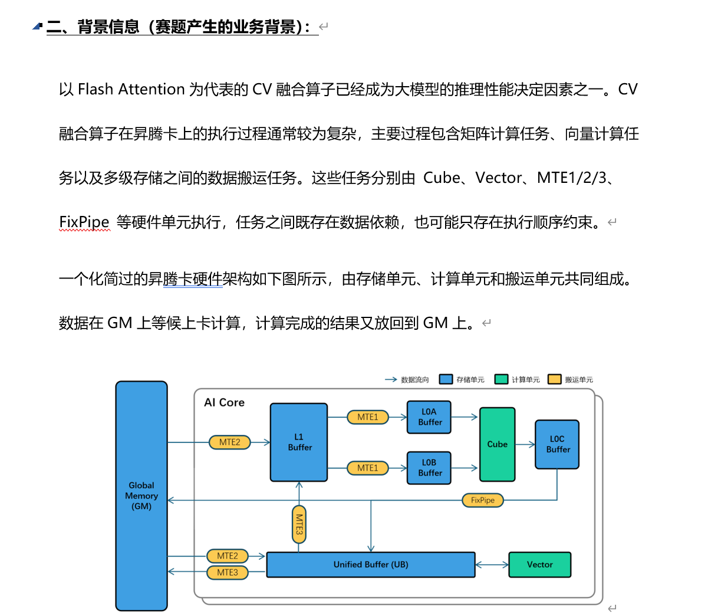

```text
、 背景信息 （ 赛题产生的业务背景 ） ：
以 Flash Attention 为代表的 CV 融合算子已经成为大模型的推理性能决定因素之一 。 CV
融合算子在舁腾卡上的执行过程通常较为复杂 ， 主要过程包含矩阵计算任务 、 向量计算任
务以及多级存储之间的数据搬运任务 。 这些任务分别由 Cube 、 Vecto r 、 MTEI / 2 ／ 3 、
EiE?ipe 等硬件单元执行 ， 任务之间既存在数据依赖 ， 也可能只存在执行顺序约束 。
一个化简过的舁腾卡硬件架构如下图所示 ， 由存储单元 、 计算单元和搬运单元共同组成 。
数据在 GM 上等候上卡计算 ， 计算完成的结果又放回到 GM 上 。
一吵数流向 0 存储单元囗计 0 单元囗
运单元
AI Core
LI
MTE2
Buffer
Global
Memory
(GM)
MTE2
LOA
MTEI
Buffer
LOB
MTEI
Buffer
Unified Buffer (UB)
MTE3
LOC
Cube
Buffer
FixPipe
Vector
```

## 图片 02

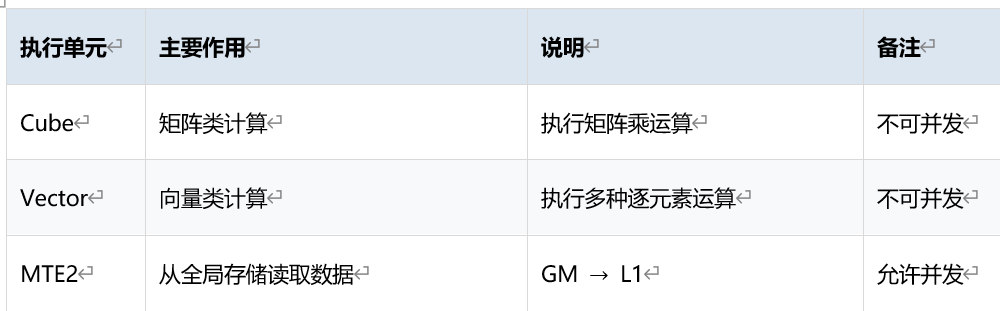

```text
执行单元 （ 〕
Cube
Vectore
MTE2e
主要作用 （ 〕
矩阵类计算
向量类计算 （ 〕
从全局存储读取数据 （ 〕
说明 （ 〕
执彳巨阵乘运算
执行多种逐元素运算
GM LI （ 〕
不可并发
不可并发
允许并发
```

## 图片 03

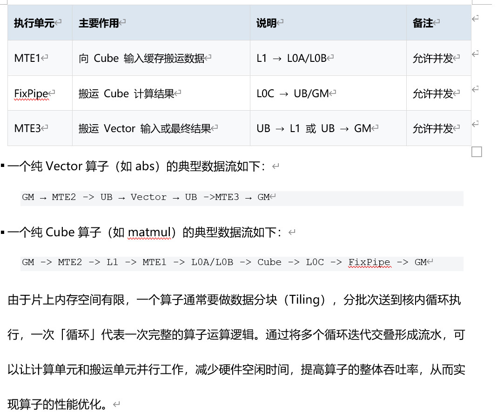

```text
执行单元 （ 〕
MTEI （ 〕
MTE3e 〕
主要作用 （ 〕
向 Cube 输入缓存搬运数据@
搬运 Cube 计算结果
搬运 Vector 输入或最终结果
说明 （ 〕
LI LOA/LOBe
LOC U B/G M
UB LI 或 U B
允许并发
允许并发
允许并发
一个纯 Vector 算子 （ 如 abs) 的典型数据流如下 ：
GM 一 MTE2 一 > UB 一 Vector 一 UB —>MTE3 一 GM
一个纯 Cube 算子 （ 如 matmul) 的典型数据流如下 ：
GM 一 > MTE2 一 > L 1 一 > MTEI 一 > LOA/LOB 一 > Cube 一 > LOC
一 > 焱占 p ． 一 > GM
由于片上内存空间有限 ， 一个算子通常要做数据分块 (Tiling) ， 分批次送到核内循环执
行 ， 一次 「 循环 」 代表一次完整的算子运算逻辑 。 通过将多个循环迭代交叠形成流水 ， 可
以让计算单元和搬运单元并行工作 ， 减少硬件空闲时间 ， 提高算子的整体吞吐率 ， 从而实
现算子的性能优化 。
```

## 图片 04

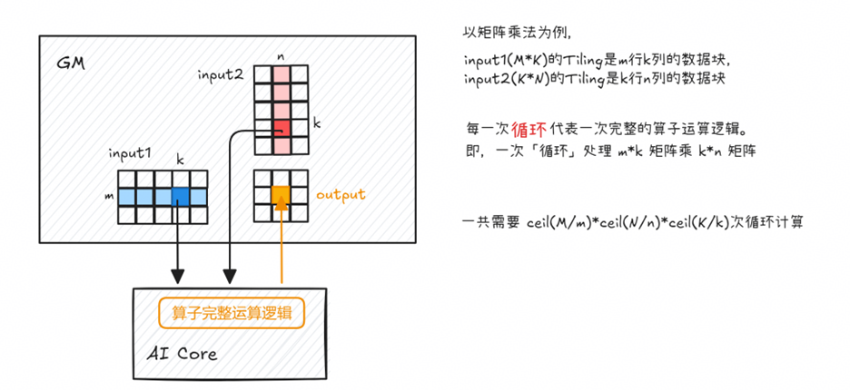

```text
;nputl
;nput2
output
0 子完整运算逻辑
工 Core
以阵乘法为例 ，
； 叩 utl 率的 T ； 是 “ 行列的数呋 ，
； 叩 ut2 〈 的 ； 嗎是行 ” 列的畎
每一 ： 欠俩环表一次完整的 + 运逻辑 。
一次 r 俩环 」 ， 里 M*k 矩阵乘 k*n 矩阵
一共要 ce ； 《 / 刁 e ； I( 丷刁 e ； l(k / 次傀环计篡
```

## 图片 05


```text
本题考虑简化的 CV 融合算子在单卡的运行过程 ， 给定参数化 Tiling 下 ， 算子单次循环执
行的有向无环图 (Directed Acycl ic Graph, DAG) 、 输入数据大小 、 硬件资源参数 ， 考
察资源约束下的 Tiling 和流水调度优化 。
```

## 图片 06

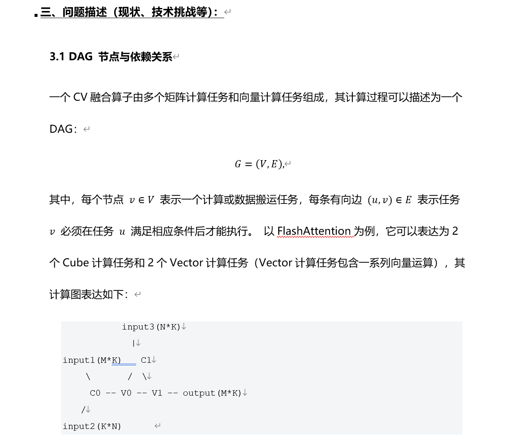

```text
、 问题描述 （ 现状 、 技术挑战等 ） ：
3 · 1 DAG 节点与依赖关系
一个 CV 融合算子由多个矩阵计算任务和向量计算任务组成 ， 其计算过程可以描述为一个
DAG ·
其中 ， 每个节点表示一个计算或数据搬运任务 ， 每条有向边 (u,v) 表示任务
必须在任务 u 满足相应条件后才能执行 。 以 FlashAttention 为例 ， 它可以表达为 2
个 Cube 计算任务和 2 个 vector 计算任务 (Vecto r 计算任务包含一系列向量运算 ） ， 其
计算图表达如下 ：
input3 (N*K) 、 L
0
unputl (M*K)
C 0
1nput2 (K*N)
VO
output (M*K) 、 L
```

## 图片 07

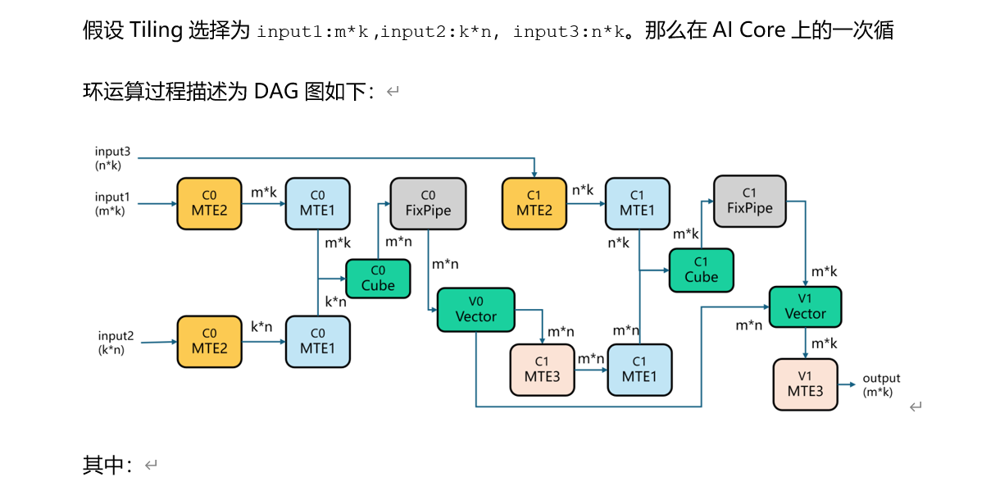

```text
假设 TiIing 选择为 inputl ： m* k ,input2 ： k*n,
环运算过程描述为 DAG 图如下 ：
m*n
input3:n*k
。 那么在 AI Core 上的一次循
input3
inputl
(m•k)
input2
(k*n)
其中 ：
CO
MTE2
MTE2
m*k
MTEI
m*k
Cube
CO
MTEI
FixPipe
MTE2
CI
MTE3
MTEI
n
MTEI
FixPipe
Cube
VO
Vector
m
Vector
MTE3
output
(m*k)
```

## 图片 08

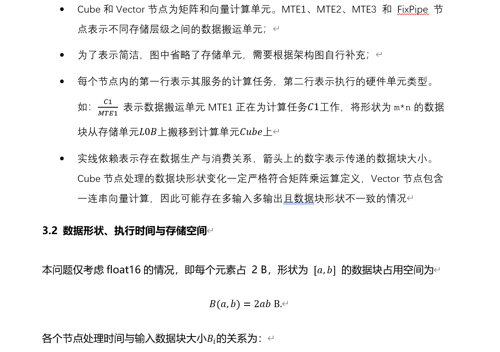

```text
」 be 和 vector 节点为矩阵和向量计筧单元 。 MTEI 、 MTE2 、 MTE3 和 0p0 节
点表示不同存储层级之间的数据搬运单元 ，
为了表示简洁 ， 图中省略了存储单元 ， 需要根据架构图自行补充 ，
每个节点内的第一行表示其服务的计算任务 ， 第二行表示执行的硬件单元类型 。
表示数据搬运单元 MTEI 正在为计筧任务 CI 工作 ， 将形状为 m*n 的数据
如
MTEI
块从存储单元 LOB 上搬移到计算单元 be 上
实线依赖表示存在数据生产与消费关系 ， 箭头上的数字表示传递的数据块大小 。
」 be 节点处理的数据块形状变化一定严格符合矩阵乘运筧定义 ， vecto r 节点包含
一连串向量计筧 ， 因此可能存在多输入多输出且数据块形状不一致的情况
3 · 2 数据形状 、 执行时间与存储空间
本问题仅考虑 floatl 6 的情况 ， 即每个元素占 2 B ， 形状为 @b] 的数据块占用空间为
B(a,b) = 2 ab B.
各个节点处理时间与输入数据块大小的关系为 ：
```

## 图片 09

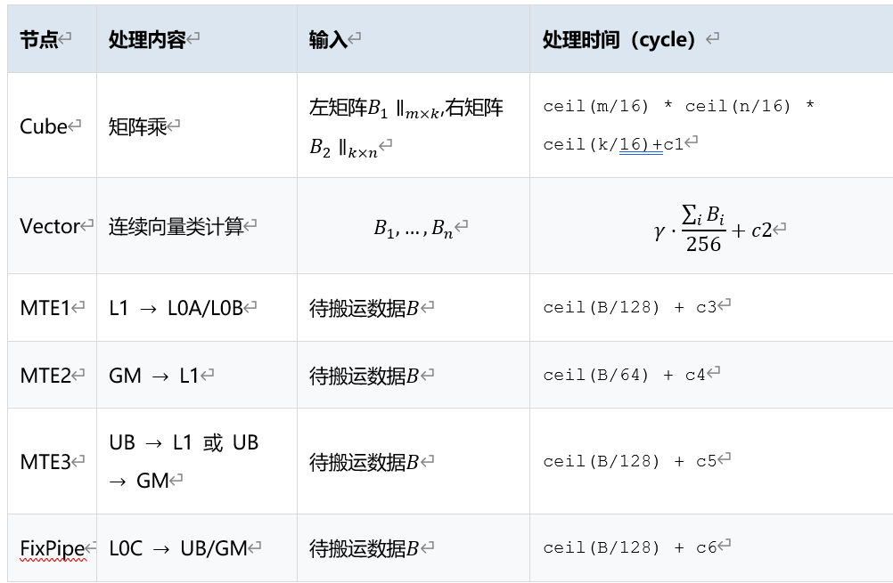

```text
节点
0
Cube
Vectore
MTEI （ 〕
MTE2e
MTE3e
处理内容
矩阵乘 （ 〕
连续向量类计算
LI LOA/LOB€ 〕
GM LI （ 〕
UB LI 或 U B
LOC U B/G M
左矩阵 B ll 右矩阵
1
老 × 踅 '
2 kXn
1 '
处理时间 (cycle)
c e 主 1 ()/ 16 ） 女
ceil （ n / 1 6 ）
c e 1 （ k/ 16 ） +c 1
256
ceil （ B / 128 ） + c3
ceil （ B / 64 ） + c4
c e 1 （ B / 12
c e 1 （ B / 12
```

## 图片 10

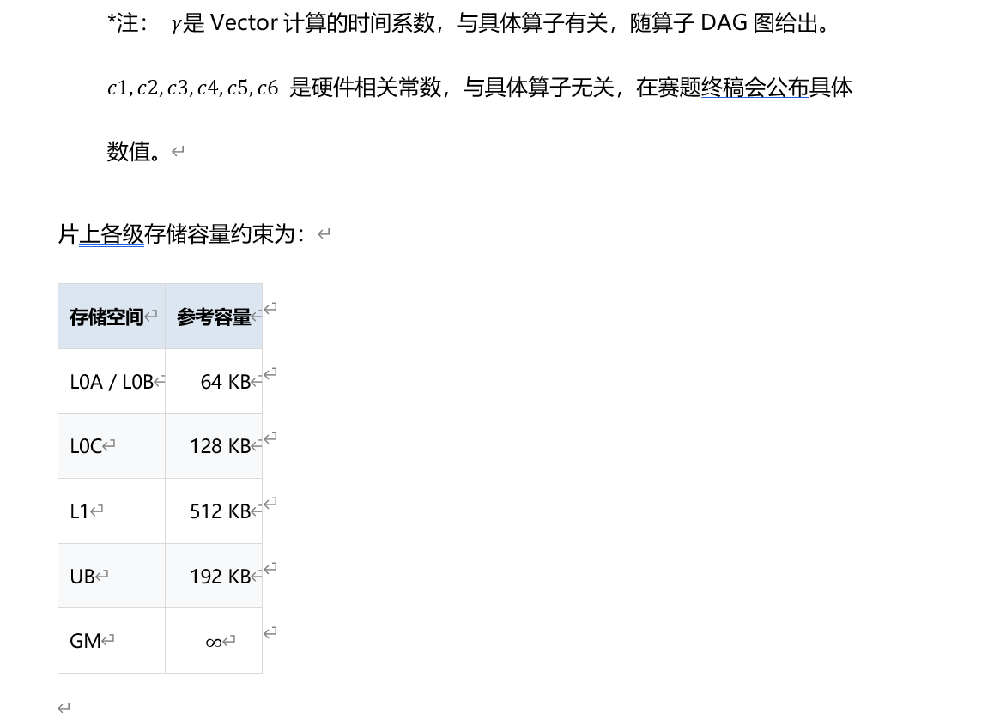

```text
* 注 ： 7 是 vector 计算的时间系数 ， 与具体算子有关 ， 随算子 DAG 图给出 。
c1,c2,c3,c4, c5, c6 是硬件相关常数 ， 与具体算子无关 ， 在赛题终稿会公布具体
片上各级存储容量约束为 ·
存储空间@ 参考容量 （ ．
LOA / LOB
L00 〕
LI （ 〕
GM
64 K
128 K
512 K
192 K
```

## 图片 11

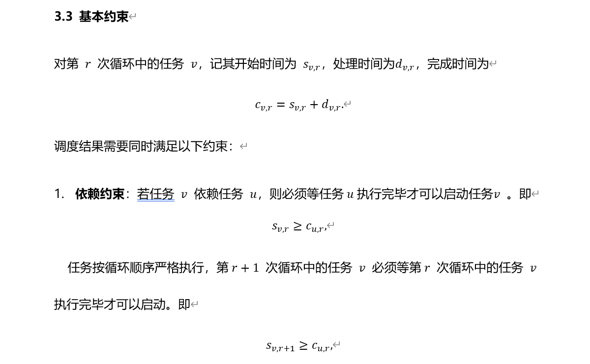

```text
33 基本约束
对第 r 次循环中的任务嫣记其开始时间为与 ， 处理时间为 r ， 完成时间为
调度结果需要同时满足以下约束 ：
1 ， 依赖约束 ， 若任务依赖任务 u, 则必须等任务衩执行完毕才可以启动任务 。 即 < 」
svr > ‰
任务按循环顺序严格执行 ， 第 r + 1 次循环中的任务必须等第 r 次循环中的任务
执行完毕才可以启动 。 即
```

## 图片 12

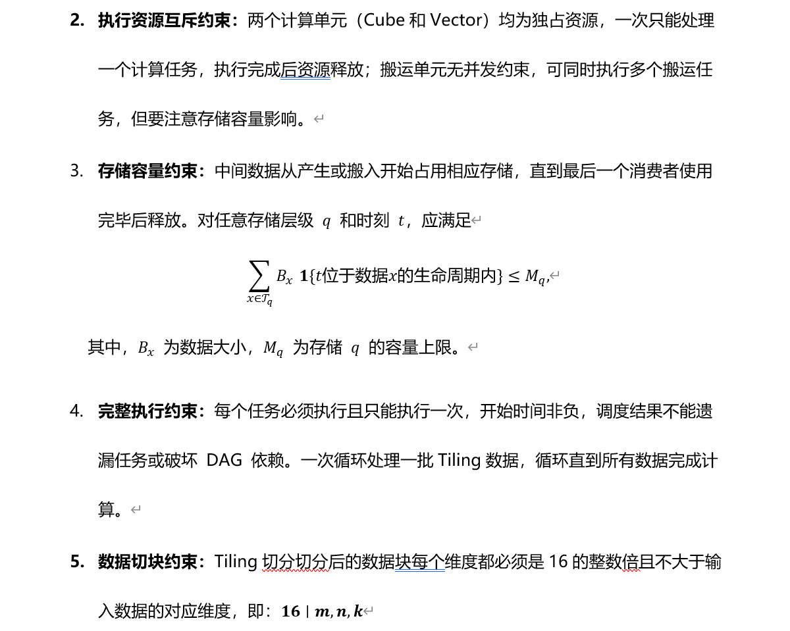

```text
2 · 执行资源互斥约束 ： 两个计算单元 (Cube 和 Vector) 均为独占资源 ， 一次只能处理
一个计算任务 ， 执行完成后资源释放 ； 搬运单元无并发约束 ， 可同时执行多个搬运任
务 ， 但要注意存储容量影响 。
3 ， 存储容量约束 ： 中间数据从产生或搬入开始占用相应存储 ， 直到最后一个消费者使用
完毕后释放 。 对任意存储层级 q 和时刻 0 应满足
〗 1 { t 位于数据无的生命周期内 } Mq,
xET
其中 ， 为数据大小 ， Mq 为存储 q 的容量上限 。
完整执行约束 ： 每个任务必须执行且只能执行一次 ， 开始时间非负 ， 调度结果不能遗
4 ，
漏任务或破坏 DAG 依赖 。 一次循环处理一批 Tiling 数据 ， 循环直到所有数据完成计
算 。
5 · 数据切块约束 ： Tiling 切分切分后的数据块每个维度都必须是 1 6 的整数倍不大于输
入数据的对应维度 ， 即 ： 16 《 “ 叫
```

## 图片 13

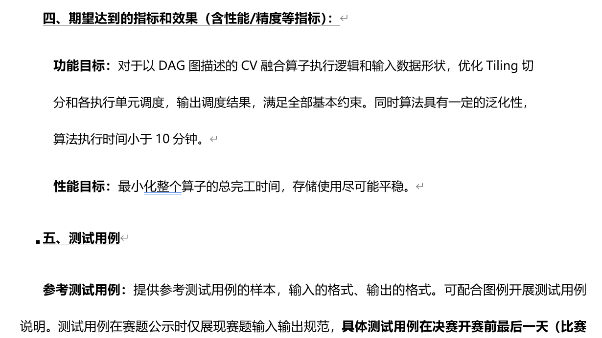

```text
四 、 期望达到的指标和效果 （ 含性能 / 精度等指标 ） ：
功能目标 ： 对于以 DAG 图描述的 CV 融合算子执行逻辑和输入数据形状 ， 优化 Tiling 切
分和各执行单元调度 ， 输出调度结果 ， 满足全部基本约束 。 同时算法具有一定的泛化性 ，
算法执行时间小于 1 0 分钟 。
性能目标 ： 最小化整个算子的总完工时间 ， 存储使用尽可能平稳 。
． 五 、 测试用例 《 」
参考测试用例 ： 提供参考测试用例的样本 ， 输入的格式 、 输出的格式 。 可配合图例开展测试用例
说明 。 测试用例在赛题公示时仅展现赛题输入输出规范 ， 具体测试用例在决赛开赛前最后一天 （ 比赛
```

## 图片 14

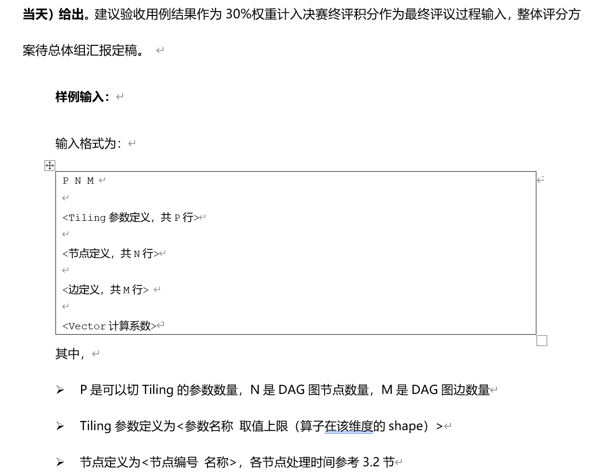

```text
当天 ） 给出 。 建议验收用例结果作为 30 ％ 权重计入决赛终评积分作为最终评议过程输入 ， 整体评分方
案待总体组汇报定稿 。
样例输入 ·
输入格式为 ：
P N M
<T111ng 参娄攵定 ． 义 “ 共 P 彳亍 > 〈 」
< 节点定义 ， 共 N 行
< 边定义 ， 共 M 行 >
<Vector 计算系数 >
其中 ，
P 是可以切 Tiling 的参数数量 ， N 是 DAG 图节点数量 ， M 是 DAG 图边数量
Tiling 参数定义为 < 参数名称取值上限 （ 算子在该维度的 shape) >
节点定义为 < 节点编号名称 > ， 各节点处理时间参考 3 ． 2 节
```

## 图片 15

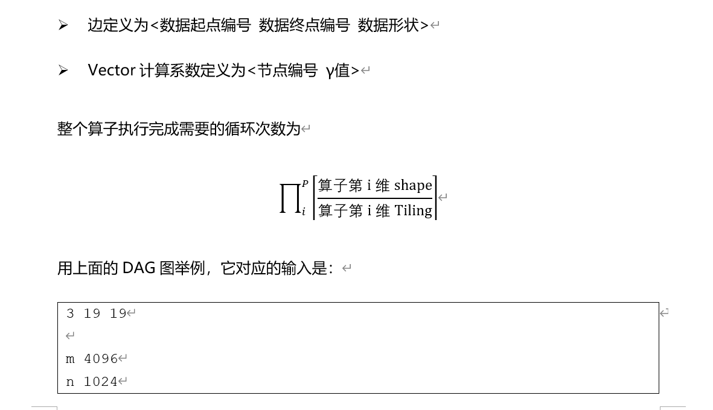

```text
边定义为 < 数据起点编号数据终点编号数据形状 >
Vecto r 计算系数定义为 < 节点编号 y 值 >
整个算子执行完成需要的循环次数为
P 筧子第 i 维 shape
筧子第 i 维 Tiling
用上面的 DAG 图举例 ， 它对应的输入是 ：
3
m
n
19 19 〈 」
4096 〈 」
1024 〈 」
```

## 图片 16

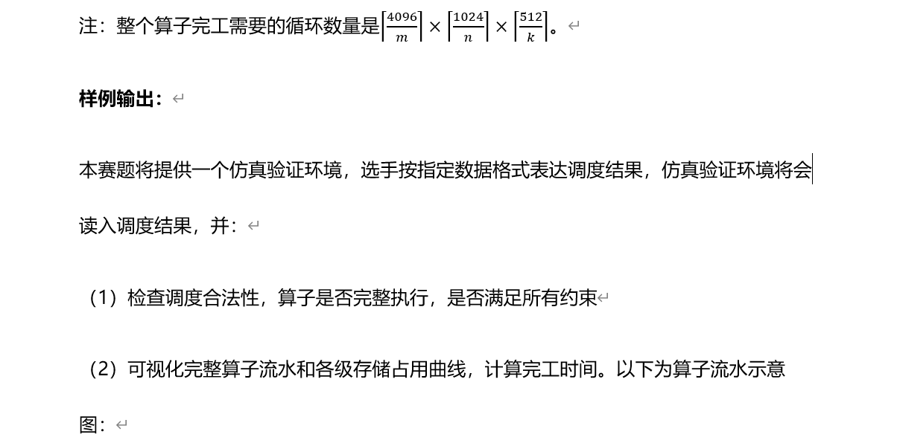

```text
注 ： 整个算子完工需要的循环数量是 [ 苷 ] × [
1024
样例输出 ：
本赛题将提亻共一个仿真验证环境 ， 选手按扌旨定数据格式表达调度结果 ， 仿真验证环境将
读入调度结果 ， 并 ：
（ 1 ） 检查调度合法性 ， 算子是否完整执行 ， 是否满足所有约束
（ 2 ） 可视化完整算子流水和各级存储占用曲线 ， 计算完工时间 。 以下为算子流水示意
图 ：
```

## 图片 17

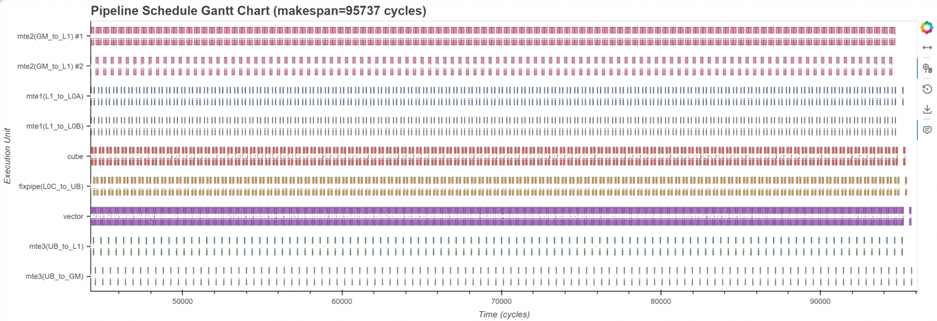

```text
Pipeline Schedule Gantt Chart (makespan=95737 cycles)
0
0
```

## 图片 18

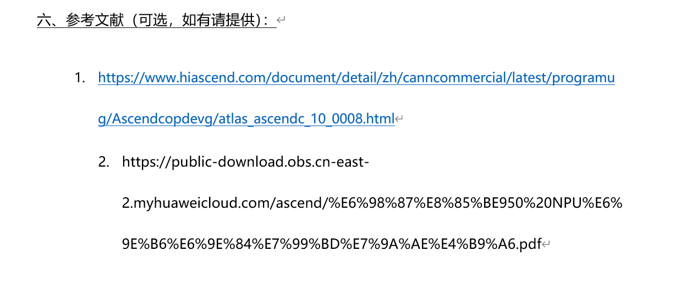

```text
六 、 参考文献 （ 可选 ， 如有请提供 ） ，
https://www.hiascend.com/document/detail/zh/canncommercial/latest/programu
g/Ascendcopdevg/atlas ascendc 10 0008 ． htm@
2 ， https://public-download.obs.cn-east-
2.myhuaweicloud.com/ascend/%E6%98%87%E8%85%BE950%20NPU%E6%
9E%B6%E6%9E%84%E7%99%BD%E7%9A%AE%E4%B9%A6.pdfe
```

## 图片 19

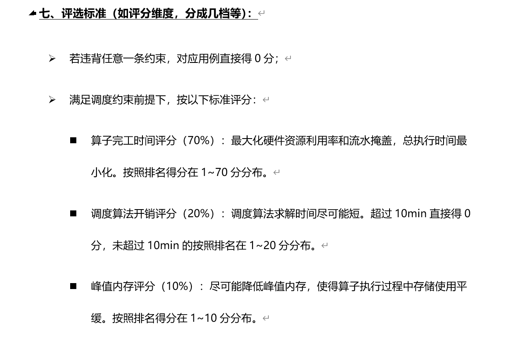

```text
七 、 评选标准 （ 如评分维度 ， 分成几档等 ） ：
若违背任意一条约束 ， 对应用例直接得 0 分 ；
满足调度约束前提下 ， 按以下标准评分 ：
0
0
算子完工时间评分 （ 70 ％ ） ： 最大化硬件资源利用率和流水掩盖 ， 总执行时间最
小化 。 按照排名得分在 1 、 70 分分布 。
调度算法开销评分 （ 20 ％ ） ： 调度算法求解时间尽可能短 。 超过 10min 直接得 0
分 ， 未超过 10min 的按照排名在 1 、 20 分分布 。
峰值内存评分 （ 10 ％ ） ： 尽可能降低峰值内存 ， 使得算子执行过程中存储使用平
缓 。 按照排名得分在 1 0 分分布 。
```
