# 23 面向鸿蒙生态的广告智能出价 Agent 设计与优化

> 本文件为官网公开赛题原文的 Markdown 整理版；正文按原文保留，图片和公式本地保存，未自行改写赛题要求。

- 官方标题：【2026Hackathon决赛】23：面向鸿蒙生态的广告智能出价 Agent 设计与优化
- 来源：[官网赛题页](https://www.chaspark.com/#/races/competitions/1326698984818110464)
- 获取日期：2026-10-11（北京时间）
- 赛题 ID：1326698984818110464
- 原始资料：[JSON](../../官方资料/赛题原始数据/23_1326698984818110464.json) · [HTML](../../官方资料/赛题原始数据/23_1326698984818110464.html)

---

## **面向鸿蒙生态的广告智能出价 Agent 设计与优化**

**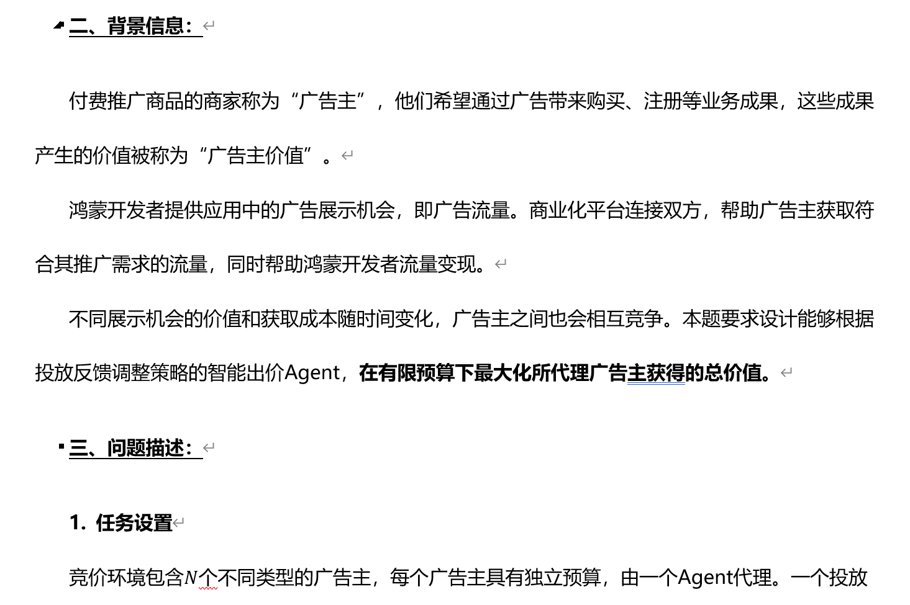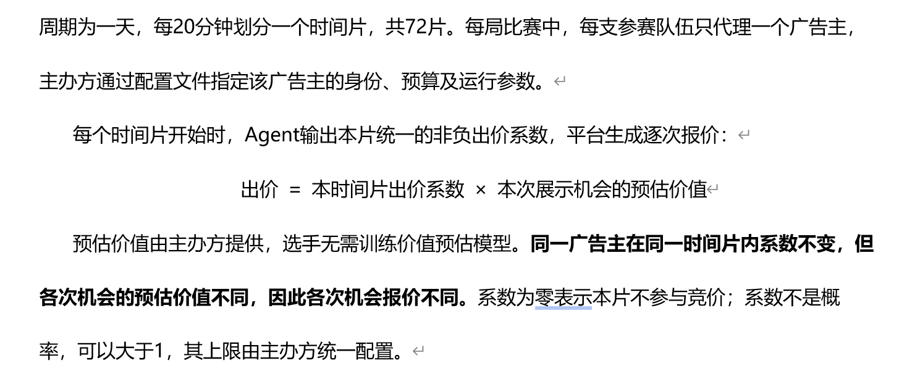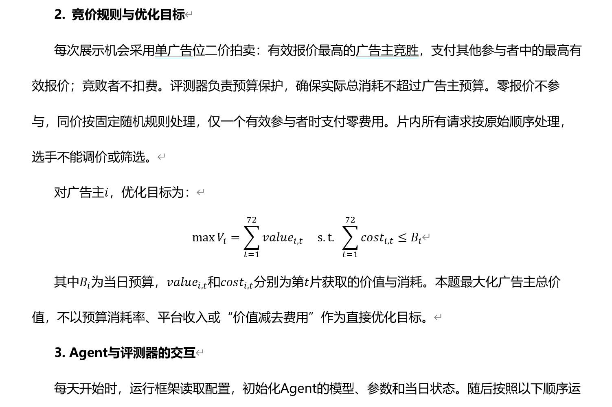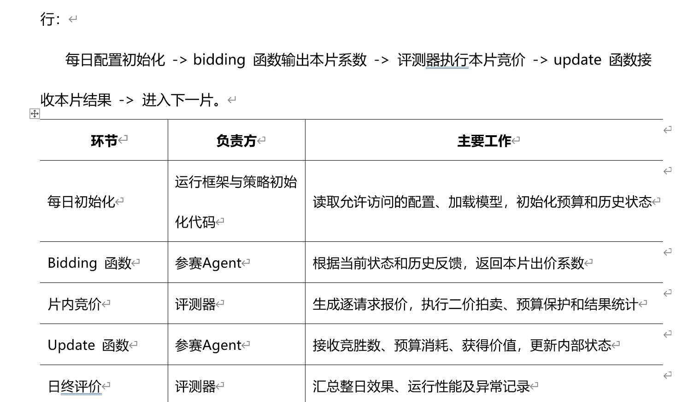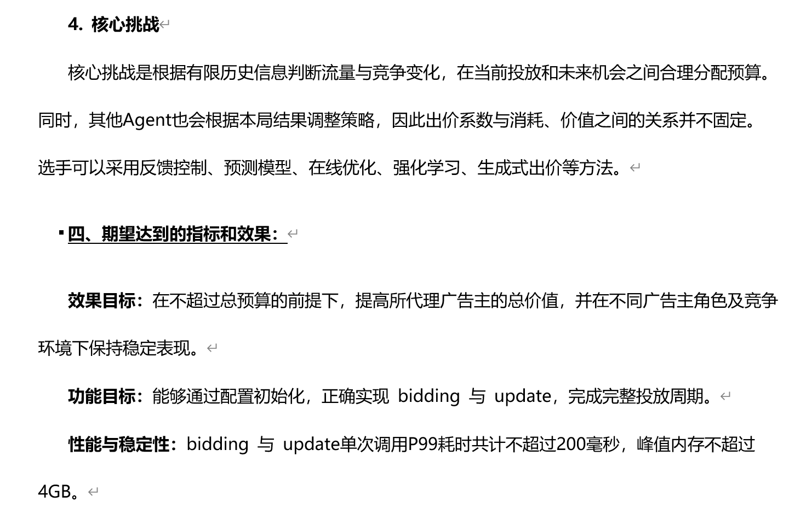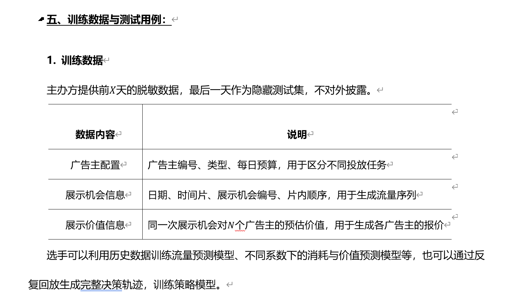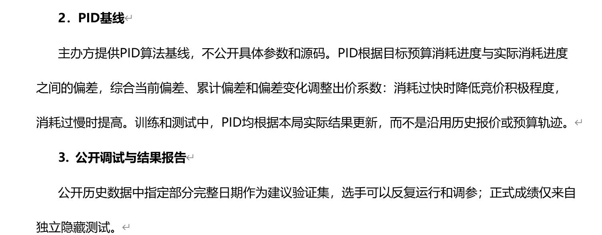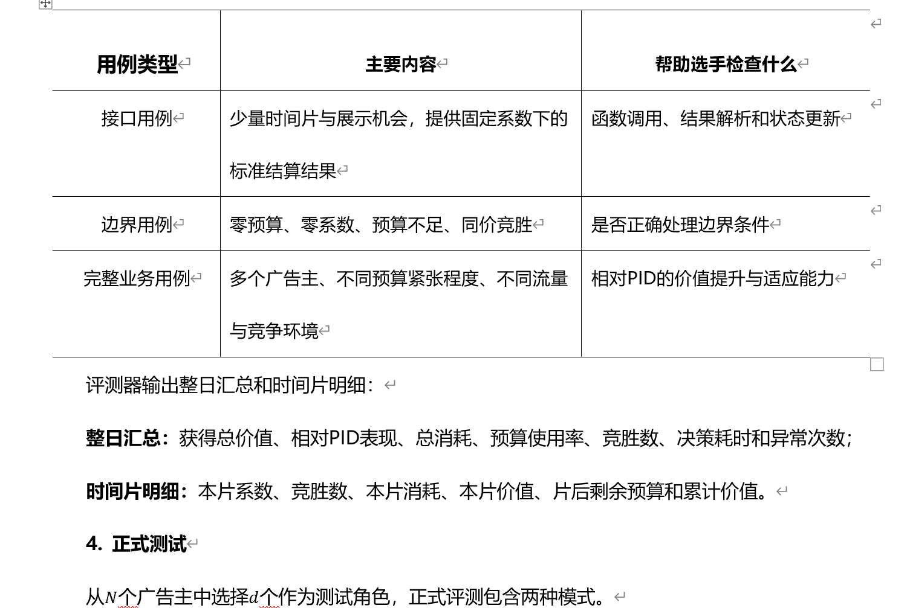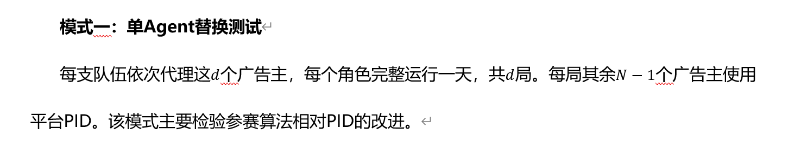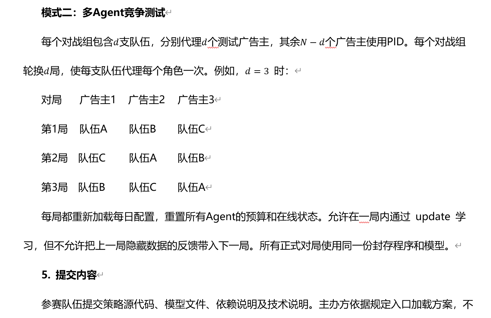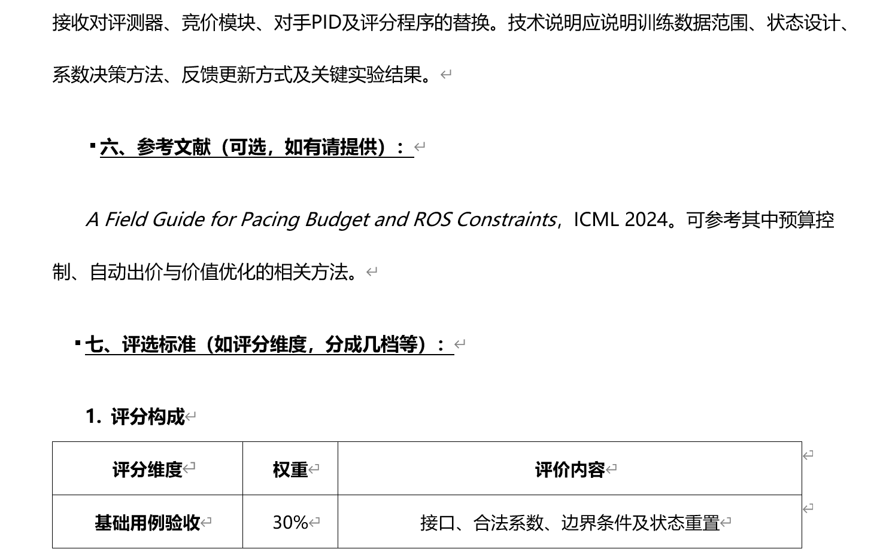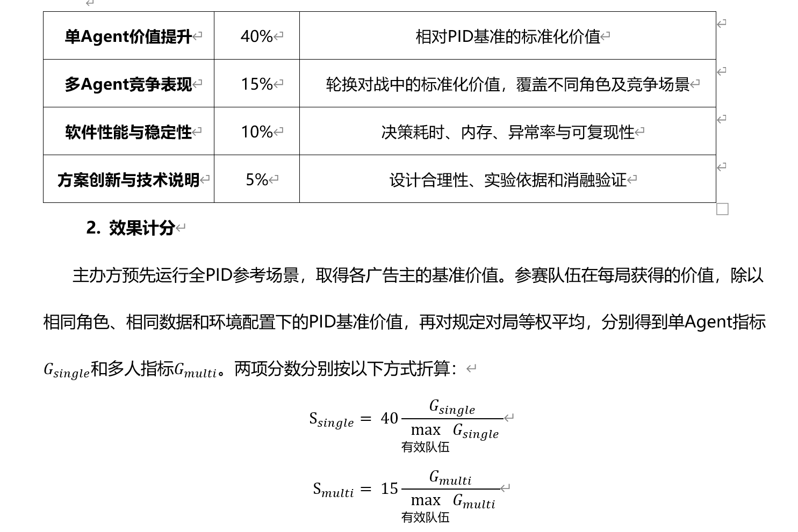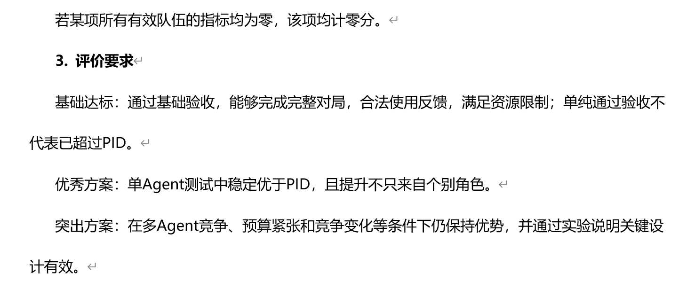**
