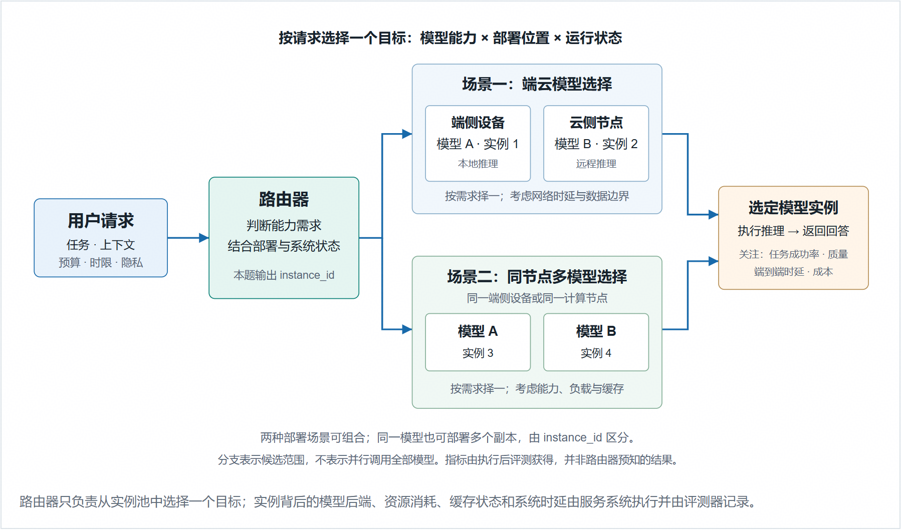

# 25 状态感知模型路由

> 本文件为官网公开赛题原文的 Markdown 整理版；正文按原文保留，图片和公式本地保存，未自行改写赛题要求。

- 官方标题：【2026Hackathon决赛】25：状态感知模型路由
- 来源：[官网赛题页](https://www.chaspark.com/#/races/competitions/1326709772098297856)
- 获取日期：2026-10-11（北京时间）
- 赛题 ID：1326709772098297856
- 原始资料：[JSON](../../官方资料/赛题原始数据/25_1326709772098297856.json) · [HTML](../../官方资料/赛题原始数据/25_1326709772098297856.html)

---

# 状态感知模型路由

## 背景

模型路由根据请求的任务、难度和上下文，选择合适的候选模型。路由策略需要在回答质量或任务成功率与推理成本之间取得平衡。

在实际部署中，路由策略还需要考虑时延、资源负载、服务可用性和数据隐私。因此，不同请求可以使用不同的模型。

模型选择和部署位置是两个不同的因素。路由程序可以在端侧模型与云侧模型之间选择，也可以在同一设备或计算节点上的多个模型之间选择。

本题将可供选择的模型称为“候选模型”。“模型实例”是部署并运行某个模型、能够接收请求的服务单元。同一模型可以部署多个实例。

实例调度还需要考虑队列状态、资源负载和缓存复用情况。本题在模型选择的基础上增加了这些调度要求，并非所有模型路由基准都包含这些要求。

### 基本运行原理

上图展示模型路由的通用原理。模型能力、部署位置和运行状态共同影响目标实例的选择。端云部署和同一节点上的多模型部署都适用。图中的两个场景与本题的两个评测维度没有对应关系。

本题要求路由程序返回目标实例的 instance\_id。维度 A 允许程序选择不同模型的实例。维度 B 的每个场景只包含同一模型、同一版本的多个实例。参赛者无需部署图中的真实模型服务或端云基础设施。

**背景参考：** [RouteLLM](https://arxiv.org/abs/2406.18665)、[RouterBench](https://arxiv.org/abs/2403.12031)、[LLMRouterBench](https://arxiv.org/abs/2601.07206)、[Mooncake（FAST'25）](https://www.usenix.org/conference/fast25/presentation/qin)。

## 题目要求

请实现一套模型路由软件。软件根据请求需求和系统状态选择目标实例。

本题通过两个维度评测同一套软件。维度 A 评测多个模型之间的语义路由。维度 B 评测同一模型多个实例之间的状态感知调度。软件通过评测配置切换模式，并在两个维度中都返回 instance\_id。参赛者无需实现两套系统。

参赛者可以使用公开数据开发和训练路由算法。主办方使用不向参赛者发放的测试数据计算最终排名。

**评测维度****A**

### 基础语义路由

维度 A 评测路由程序能否为不同请求选择合适的模型。评测器将每条请求作为独立样本，并固定候选实例的配置。该维度不模拟随请求变化的队列和缓存状态。

路由程序根据 query、允许使用的任务信息和候选模型的能力，选择目标实例。

本维度需要解决以下问题：哪些请求可以交给更小、更快、成本更低的模型？哪些请求需要能力更强的模型？在满足预先规定的质量要求后，如何兼顾任务成功率、模型计算成本和路由决策时延？

比赛不要求参赛者生成完整的质量与成本关系曲线，也不要求计算 AIQ 或 nAUC。

处理流程：接收独立请求 → 判断任务和能力需求 → 选择模型实例。评测器记录每条请求的质量、成本和路由决策时延，再按测试组计算分数。

### 评测维度 B 系统动态路由

维度 B 的每个场景包含同一模型、同一版本的多个实例。选择不同实例不会改变模型的回答质量。各实例的队列、任务进度、可复用前缀、缓存容量和可用性可以不同。

官方模拟器按请求到达时间回放请求。前面的路由决策会影响后面的队列和缓存状态。主办方使用 Mooncake 请求轨迹（trace）构造请求到达时间、输入输出长度和前缀复用信息。Mooncake 请求轨迹不提供回答质量标签，本维度也不评测回答质量。

本维度需要解决以下问题：某个实例可以复用更多 KV Cache，但该实例已有排队请求或正在执行长任务。此时，应继续选择该实例，还是选择另一个较空闲的同模型实例？

路由程序应根据可见的任务进度、缓存复用机会、实例可用性和完成时限，平衡资源消耗与系统时延。

处理流程：接收按时间到达的请求 → 读取前缀信息和实例状态 → 选择同一模型的一个实例。每次选择都会影响后续队列和缓存。评测重点是程序根据这些状态进行调度的能力。

### 比赛交付件

请提交一份可独立启动的模型路由软件包。官方评测器将调用该软件包。交付内容需要包含可执行的路由程序，仅提交方案文档、演示页面或预先生成的路由结果不满足要求。

路由程序接收请求及评测允许提供的上下文，并返回目标实例标识。同一软件包应支持两个评测维度，并能根据评测配置切换运行模式。

- 路由程序：提交决策代码和可运行实现。实现语言、算法和内部模块划分不限。
- 运行材料：提交 router\_manifest.json。文件包含 protocol\_version、启动参数数组 argv、相对工作目录 cwd 和方案版本。评测器使用 argv 直接启动进程，不通过交互式 shell 启动。

将源码、依赖、配置、路由算法权重和索引放入交付目录，并附离线启动说明。argv[0] 可以指定交付目录内的可执行文件，也可以指定主办方预装且已公布版本的语言运行时。

- 方案说明：说明路由策略、所用数据、两个评测维度的处理方式和已知限制。提供启动步骤和结果复现方法。

参赛者负责实现路由决策软件。在开发、调试和正式评测中，参赛者均无需调用或部署候选大模型，也无需部署真实端云基础设施或实现官方评测器。

主办方提前离线准备候选模型的质量结果、token 记录、成本记录、实例目录和系统回放数据。主办方在评测前确定这些数据，并在正式评测期间保持不变。后文将这种做法称为“冻结”。正式评测通过查表和确定性模拟器计算结果，不在线生成回答，也不调用模型裁判。

参赛者可以在赛前规则允许的资源范围内训练自己的路由算法。路由算法的依赖和权重须随软件包提交，并支持离线运行。

本题评测路由算法判断请求特征、模型能力和系统状态的能力。路由程序及其依赖、权重和索引须在主办方公布的仅使用 CPU 的环境（CPU-only）中离线运行。

正式评测不提供 GPU、候选大模型服务或外部网络。交付件不得依赖在线模型调用、在线训练、运行时模型下载或额外服务。这些限制用于控制模型规模和运行成本，使成绩主要反映路由策略、状态建模和工程实现能力。

## 评测目标与方法

本节说明路由软件的输入输出、两个评测维度和计分方法。路由程序返回目标 instance\_id 及请求关联字段。评测器使用隐藏测试数据运行程序，并通过查表或模拟计算加权成绩。参赛者无需自行完成完整的 AIQ 实验。

主办方通过模拟器维护队列、任务和缓存。路由程序只维护自己的算法状态。

路由程序读取当前请求和允许提供的实例状态快照，然后返回目标实例及请求关联字段。程序不得修改模拟器状态，也不负责申报质量分数、缓存命中量或资源用量。初始化、运行时字段和状态更新规则见附录。

### 接口与运行要求

正式接口采用版本 1.0 的有序 JSONL 协议。每条消息使用 UTF-8 编码，并占一个物理行。消息以换行符结束。发送方写入消息后须立即刷新输出缓冲区。

路由程序仅通过标准输出（stdout）发送协议消息，并通过标准错误（stderr）输出日志。文中的 JSON 示例为了便于阅读而分为多行。实际传输时，每条 JSON 消息必须写在一行中。

“评测单元”是独立运行和计分的最小单位。每次运行评测单元时，评测器都会重新启动路由程序。

维度 A 的一个评测单元称为“A 测试组”。主办方按任务类型和难度预先划分测试组，每组包含一批相互独立的请求。

维度 B 的一个评测单元称为“B 场景”。每个场景包含按到达时间排列的完整请求序列，以及对应的队列、缓存和实例可用性状态。评测器在处理完评测单元中的全部请求后计算分数。

路由程序按以下流程运行：

1. 评测器为当前评测单元启动一个新的路由程序进程。

2. 评测器发送 init 消息。路由程序完成初始化后返回 ready 消息。

3. 评测器逐条发送 route 消息。路由程序为每条请求返回一条 decision 消息。

4. 当前评测单元的全部请求处理完毕后，评测器关闭标准输入（stdin）。路由程序随后正常退出。

同一评测单元每次重复运行时，评测器也会启动新进程。程序不得保留上一个评测单元或上一次运行的可变状态。新进程可以重新加载软件包中的权重和只读索引。

两个评测维度都采用逐条请求、逐条响应的方式。评测器收到当前请求的 decision 后，才会发送下一条 route。因此，路由程序不得等待多条请求后再批量响应，也不得预读未来请求。

维度 A 中，各请求的质量和资源结果互不影响。维度 B 中，前一条路由决策会影响后续请求的实例状态快照。

路由程序可以使用 Rust、Python 等能在指定环境中离线运行的语言。程序通过协议接收当前请求和公开配置。程序不得访问评测器内部文件或外部服务。

评测器应能使用交付件中的启动入口、依赖和权重，重复启动并离线运行路由程序。

主办方在比赛开始前公布运行限制，包括启动超时、退出超时、单条请求超时，以及 CPU、内存、线程数和输出大小限制。评测器在 init.limits 中传入对应的限制参数。正式评测期间保持这些限制不变。

### 初始化握手

评测器先发送 init 消息，其中包含协议版本、run\_id、track、seed、实例目录、profiles 和 limits。

路由程序完成初始化后，返回以下 ready 消息：

{"type":"ready","protocol\_version":"1.0","run\_id":"demo-a"}

随后，评测器发送 route，路由程序返回 decision。双方重复此过程，直到评测器关闭 stdin。

### 本地 HTTP 调试接口

参赛者可以使用 HTTP 封装接口进行本地调试。提交的软件包仍须提供 JSONL 入口。正式评测只调用 JSONL 入口。

协议结构和异常处理规则见本节及附录。主办方在比赛开始前发布 JSON Schema、参考路由程序、协议自检工具和开发用模拟器。

开发包与正式评测使用相同版本的协议和模拟器。测试请求、请求轨迹和实例状态可以不同，但字段含义和处理规则保持一致。

### 请求与响应字段

#### 两个维度共用的消息字段

| 字段 | 方向 | 类型与说明 |
| --- | --- | --- |
| type | 输入/输出 | 输入为 "route"。输出为 "decision"。 |
| seq | 输入/输出 | 非负整数。每次运行从 0 开始连续递增。响应须返回相同的值。 |
| request\_id | 输入/输出 | 非空字符串，在当前运行中唯一。响应须返回相同的值。 |
| query | 输入 | 维度 A 为非空字符串。维度 B 固定为 null。 |
| task | 输入 | 维度 A 为公开任务标签或 null，标签范围须在赛前公布。维度 B 固定为 null。 |
| runtime\_context.track | 输入 | 取值为 A 或 B，须与 init.track 相同。 |
| instance\_id | 输出 | 非空字符串，须对应实例目录中的目标实例。维度 B 还要求该实例的 available 为 true。 |

表中的所有字段均须提供。允许为空的字段也不能省略，应将值设为 null。

维度 A 的 query 必须是非空字符串。task 是公开任务标签或 null。主办方在比赛开始前统一说明是否提供 task 标签。标签不包含隐藏难度或答案。

维度 B 不提供请求原文。query 和 task 固定为 null。

#### 维度 B 附加输入字段

| 字段 | 方向 | 类型与说明 |
| --- | --- | --- |
| runtime\_context.arrival\_ms | 输入 | 有限非负数，表示请求到达的模拟时间，单位为毫秒。输入按该值非递减排列。同一时刻的请求按 seq 排序。 |
| runtime\_context.deadline\_ms | 输入 | 有限正数，表示从 arrival\_ms 起允许的完成时长，单位为毫秒。 |
| runtime\_context.prefix\_group | 输入 | 字符串或 null。相同的非空值表示完整的可复用前缀相同。该字段不能表示所有部分前缀重叠关系。 |
| runtime\_context.eligible\_prefix\_tokens | 输入 | 非负整数，且为 512 的倍数，不大于 input\_tokens。主办方根据请求轨迹预先确定该值。路由决策和缓存状态不会改变该值。 |
| runtime\_context.input\_tokens | 输入 | 非负整数，表示完整输入的 token 数。 |
| runtime\_context.expected\_output\_tokens | 输入 | 非负整数，表示已确定的模拟输出 token 数。 |
| runtime\_context.instance\_snapshot | 输入 | 以 instance\_id 为键的对象。每个实例的状态字段见附录。 |

上述字段均位于 runtime\_context 对象中。instance\_snapshot 以实例 ID 为键，其键集合须与 init.instances 中的实例 ID 集合一致。各实例的状态字段见附录。快照只反映路由决策时的状态，模拟器会在请求开始执行时重新计算实际缓存命中量。

如果路由程序出现以下任一错误，评测器将当前评测单元记为 0 分，并终止该进程：

• 输出不是合法 JSON，或输出超过规定长度。

• 输出缺少必填字段，或字段类型错误。

• seq 或 request\_id 与当前请求不匹配。

• 目标实例不存在，或当前不能接收请求。

• 程序重复输出、响应超时或异常退出。

评测器继续运行其他评测单元。该规则要求协议有效率达到 100%，防止程序通过丢弃请求降低后续负载。

如果错误来自官方输入、评测平台或评测器，主办方应先修复错误，再重新运行受影响的评测单元。这类错误不计入参赛程序的成绩。协议自检工具应覆盖上述异常情况。

### 评分公式

维度 A 按测试组计算质量、模型成本和路由决策时延。测试组满足质量门槛且协议有效时，评测器按固定权重计算组分数。

维度 B 比较同一模型多个实例的缓存复用、资源成本和系统时延。回答质量不参与维度 B 的计分，也不作为门槛。

评测器分别对 A 测试组和 B 场景的最终分数取等权平均，得到两个维度的分数。这种按组或场景等权计算的方式称为“宏平均”。最后，评测器将两个维度的分数与工程评审分数加权相加。

各单项分数归一化到 [0,1]。clip(x)=min(1,max(0,x)) 用于将结果限制在该范围内。

维度 A 的权重为：质量 55%、模型成本 30%、路由决策时延 15%。维度 B 的权重为：资源成本 20%、缓存命中率 25%、按时完成率（SLO）25%、端到端时延 20%、路由决策时延 10%。成本或时延越低，相应单项得分越高。

主办方在比赛开始前确定并冻结权重、分组、宏平均规则、门槛、参考方案和归一化方法。

#### 维度 A 评分

维度 A 对一次提交的路由程序进行加权评分，不要求参赛者提供 AIQ 或 nAUC 曲线。

q\_i 表示请求 i 的质量分数。主办方按各任务的评价指标，预先将质量结果映射到 [0,1]。如果任务只判断成功或失败，则 q\_i∈{0,1}。

主办方预先确定各任务的映射方法、测试组和样本量。评测器不直接平均量纲不同的原始质量分数。

| **公式** | 变量含义与计算方法 |
| --- | --- |
| Q\_A,g = mean\_i(q\_i) | Q\_A,g 是 A 测试组 g 的平均质量。q\_i 是请求 i 的官方质量分数，范围为 [0,1]。mean\_i 表示对组内全部请求取算术平均。 |
| C\_A,g = mean\_i(model\_cost\_i) | C\_A,g 是 A 测试组的平均模型成本。model\_cost\_i 是请求 i 所选模型的模拟成本。评测器使用已冻结的 token 记录和单价计算该成本。 |
| T\_A,g = P95(router\_ms\_i) | T\_A,g 是 A 测试组路由决策时延的第 95 百分位数。router\_ms\_i 从评测器开始写入已序列化的 route 行起算，到收到完整 decision 行结束，单位为毫秒。P95 使用 nearest-rank 方法。 |
| q\_A,g = clip((Q\_A,g - Q\_low,g) / (Q\_high,g - Q\_low,g)) | q\_A,g 是归一化后的质量得分。Q\_low,g 和 Q\_high,g 分别是主办方预先确定并冻结的质量下限和上限。质量越高，得分越高。 |
| c\_A,g = clip((C\_high,g - C\_A,g) / (C\_high,g - C\_low,g)) | c\_A,g 是归一化后的模型成本得分。C\_low,g 和 C\_high,g 分别是成本下限和上限。成本越低，得分越高。 |
| t\_A,g = clip((T\_slow,g - T\_A,g) / (T\_slow,g - T\_fast,g)) | t\_A,g 是归一化后的路由决策时延得分。T\_fast,g 和 T\_slow,g 分别是主办方在正式环境中标定的快、慢参考时延。不高于快参考值时得 1 分，不低于慢参考值时得 0 分。两者之间按线性比例计分。 |
| G\_A,g = P\_g × I(Q\_A,g >= Q\_min,g) | G\_A,g 表示本次运行是否具备计分资格。P\_g 为协议有效标记，无协议错误时为 1，否则为 0。Q\_min,g 是质量门槛。I(·) 为指示函数，条件成立时取 1，否则取 0。 |
| S\_A,g = 100 × G\_A,g × (0.55 × q\_A,g + 0.30 × c\_A,g + 0.15 × t\_A,g) | S\_A,g 是 A 测试组单次运行的分数，满分为 100。质量、模型成本和路由决策时延分别占 55%、30% 和 15%。 |
| group\_score\_A,g = median\_r(S\_A,g^(r)),  r = 1,2,3 | group\_score\_A,g 是 A 测试组的最终分数。三次独立启动的运行均无协议错误时，按左侧公式取三次分数的中位数。如果任一次运行出现协议错误，该组最终得 0 分。 |
| S\_A = mean\_g(group\_score\_A,g) | S\_A 是维度 A 的自动评测分数。评测器对所有预定义 A 测试组的最终分数取等权平均，不按请求数量加权。 |

如果同一评测单元的三次运行都没有协议错误，group\_score 取三次组分数的中位数。如果任一次运行出现协议错误，group\_score 为 0。

g 表示预定义的 A 测试组。P\_g 表示单次运行的协议有效性：整组无协议错误时为 1，有协议错误时为 0。Q\_min 表示最低质量要求。质量门槛用于排除质量不合格的方案，满足门槛的方案仍按加权分数排序。

每个归一化区间的上限须大于下限。主办方应使用参考方案检查区间，避免大量方案的分数都被 clip 函数限制为 0 或 1。

主办方根据已冻结的离线参考方案确定 Q\_low/Q\_high 和 C\_low/C\_high。T\_fast/T\_slow 是参考路由程序在同一硬件上的快、慢时延基准值，后文简称“时延锚点”。维度 B 的 E\_fast/E\_slow 则通过固定模拟器和服务参数标定。

#### 维度 B 评分

维度 B 的回答质量不随实例选择变化，因此不设置回答质量门槛。

缓存得分只使用按 token 加权的命中率 H。重算量用于解释结果，不单独加权计分。这可以避免对同一次输入预填充（prefill）的缓存收益重复计分。

资源成本、按时完成率和端到端时延分别反映不同结果。这些指标虽然与缓存复用相关，仍按已公布的权重计分。

| **公式** | 变量含义与计算方法 |
| --- | --- |
| C\_B,g = (total\_compute\_cost + total\_KV\_cost) / N\_g | C\_B,g 是 B 场景 g 的平均资源成本。total\_compute\_cost 是重算输入 token 和生成输出 token 的计算成本。total\_KV\_cost 是缓存驻留成本。N\_g 是场景中的请求总数。 |
| H\_B,g = sum\_i(cache\_hit\_i) / sum\_i(eligible\_prefix\_i) | H\_B,g 是按 token 加权的缓存命中率。cache\_hit\_i 是请求 i 开始执行时实际命中的前缀 token 数。eligible\_prefix\_i 对应输入字段 eligible\_prefix\_tokens，表示请求 i 可复用的前缀 token 数。 |
| c\_B,g = clip((C\_high,g - C\_B,g) / (C\_high,g - C\_low,g)) | c\_B,g 是归一化后的资源成本得分。C\_low,g 和 C\_high,g 分别是主办方预先确定并冻结的成本下限和上限。成本越低，得分越高。 |
| k\_B,g = H\_B,g | k\_B,g 是缓存命中得分，等于按 token 加权的缓存命中率 H\_B,g。 |
| E\_B,g = P95(e2e\_ms\_i) | E\_B,g 是 B 场景端到端时延的第 95 百分位数。e2e\_ms\_i 从请求 i 的 arrival\_ms 起算，到模拟完成时结束。它包含排队、故障暂停和服务时间，不包含路由程序的实际耗时。 |
| e\_B,g = clip((E\_slow,g - E\_B,g) / (E\_slow,g - E\_fast,g)) | e\_B,g 是归一化后的端到端时延得分。主办方使用固定模拟器和服务参数标定 E\_fast,g 与 E\_slow,g，分别作为快、慢参考时延。时延越低，得分越高。 |
| SLO\_B,g = mean\_i(I(e2e\_ms\_i <= deadline\_ms\_i)) | SLO\_B,g 是按时完成率。deadline\_ms\_i 是请求 i 从到达时起允许的完成时长。逾期请求仍继续执行，并计入其他指标。 |
| T\_B,g = P95(router\_ms\_i) | T\_B,g 是 B 场景路由决策时延的第 95 百分位数。router\_ms\_i 的计时起止点和测量方法与维度 A 相同。 |
| t\_B,g = clip((T\_slow,g - T\_B,g) / (T\_slow,g - T\_fast,g)) | t\_B,g 是归一化后的路由决策时延得分。T\_fast,g 和 T\_slow,g 分别是快、慢参考时延。时延越低，得分越高。 |
| S\_B,g = 100 × P\_g × (0.20 × c\_B,g + 0.25 × k\_B,g + 0.25 × SLO\_B,g + 0.20 × e\_B,g + 0.10 × t\_B,g) | S\_B,g 是 B 场景单次运行的分数，满分为 100。资源成本、缓存命中率、按时完成率、端到端时延和路由决策时延分别占 20%、25%、25%、20% 和 10%。P\_g 为协议有效标记。 |
| group\_score\_B,g = median\_r(S\_B,g^(r)),  r = 1,2,3 | group\_score\_B,g 是 B 场景的最终分数。三次独立启动的运行均无协议错误时，按左侧公式取中位数。如果任一次运行出现协议错误，该场景最终得 0 分。 |
| S\_B = mean\_g(group\_score\_B,g) | S\_B 是维度 B 的自动评测分数。评测器对所有预定义 B 场景的最终分数取等权平均。 |

维度 B 使用与维度 A 相同的三次运行汇总规则。g 表示一个完整、独立的 B 场景。模拟器在场景运行期间不重置队列或缓存。

C\_B 等于整个场景的计算成本与缓存驻留成本之和，再除以请求总数。缓存驻留成本是缓存占用存储空间所产生的成本，具体计算方法见附录。

H 的分母是场景中所有请求的 eligible\_prefix\_tokens 之和。每个正式计分的 B 场景都须使该分母大于 0。完全没有可复用前缀的场景仅用于诊断。

SLO\_B,g 表示按时完成的请求数占全部请求数的比例。完成时限只用于判断请求是否按时完成，模拟器不会取消逾期请求。模拟器持续运行到全部请求完成，并计入所有请求的资源用量。

#### 综合排名

两个自动评测维度合计占总分的 80%，用于评价路由效果。工程评审占 20%，用于评价方案的可复现性、实验依据和设计说明。

| **公式** | 变量含义与计算方法 |
| --- | --- |
| S\_E = 100 × (0.40 × reproducibility + 0.30 × ablation\_evidence + 0.30 × design\_explanation) | S\_E 是工程评审分数，满分为 100。reproducibility、ablation\_evidence 和 design\_explanation 分别表示可复现性、消融证据和设计解释得分。三个评审项按预先公布的规则取 [0,1] 范围内的值。 |
| S\_total = 0.40 × S\_A + 0.40 × S\_B + 0.20 × S\_E | S\_total 是最终总分，满分为 100。S\_A、S\_B 和 S\_E 分别是维度 A、维度 B 和工程评审的分数。三部分分别占 40%、40% 和 20%。 |
| clip(x) = min(1, max(0, x)) | clip 将归一化结果限制在 [0,1]。归一化公式的分母都须大于 0。主办方预先公布并冻结参考时延及上下限，不使用参赛队伍结果的最大值或最小值。 |

总分按 S\_total=0.40S\_A+0.40S\_B+0.20S\_E 计算。工程评审内部的权重为：可复现性 40%、消融证据 30%、设计解释 30%。

如果任一评测单元出现协议错误，或任一 A 测试组未达到质量门槛，该方案不进入主榜。评测器仍可保留其分项成绩。

评委按预先公开的统一细则计算 S\_E。参赛者只需在公开开发集上提供小规模参考方案对比和消融实验，不需要完成完整的 AIQ 实验。

两名评委分别对三个工程评审项评分。每项可得 0、0.5 或 1 分，按以下标准判断。评委依据提交材料和公开开发集上的实验结果评分，再对两名评委的评分取平均。

• 可复现性：程序无法运行，得 0 分。程序可运行，但复现材料不完整，得 0.5 分。第三方能够依据材料完整地离线复现，得 1 分。

• 消融证据：没有有效对比，得 0 分。有参考方案对比，得 0.5 分。在对比基础上，另有单独检验关键因素作用的消融实验和结果，得 1 分。

• 设计解释：无法说明策略，得 0 分。能够说明策略和数据，得 0.5 分。在此基础上，还能解释设计取舍和已知限制，得 1 分。

### 模型与实例的对应关系

维度 A 的候选实例可以对应不同模型。维度 B 同一场景中的所有实例必须具有相同的 model\_id 和 model\_version。

评测器通过 init 提供实例 ID、模型对应关系和静态资源参数。路由程序应读取这些配置，不得在代码中写死私有场景的实例 ID。

维度 B 中，各实例有独立的队列和逻辑缓存。评测器通过实例状态快照提供当前可用性。

### 维度 A 处理流程

评测器发送 route（query、task、seq、request\_id）→ 路由程序返回 decision（instance\_id 及请求关联字段）→ 评测器查询已冻结的质量与成本矩阵。

评测器根据 instance\_id 找到对应的候选模型，再从已冻结的“请求 × 模型”结果矩阵中读取质量、token 和成本记录。参赛者无需调用候选模型。

### 输入与输出示例

{  
  "type": "route",  
  "seq": 0,  
  "request\_id": "q\_001",  
  "query": "...",  
  "task": "math",  
  "runtime\_context": {  
    "track": "A"  
  }  
}

{  
  "type": "decision",  
  "seq": 0,  
  "request\_id": "q\_001",  
  "instance\_id": "instance-a0"  
}

### 运行环境

参赛者可以在 macOS 或 Windows 上开发并验证软件包。主办方统一在已公布的固定 CPU-only 环境中进行正式评测和排名。

评测主机的总物理内存为 16 GB。16 GB 不等于路由进程可以使用的内存上限。路由进程的内存上限由 memory\_mb 单独规定。

主办方在公开运行配置中说明 CPU 型号和核心数。路由进程的内存上限、线程数、启动超时、请求超时、退出超时和输入输出大小限制同时写入公开配置，并通过 init.limits 传入程序。

软件包所需的依赖、本地模型和索引须随包提交，并在规定的资源配额内离线运行。正式评测不使用 GPU、候选大模型服务或外部网络。

### 重点指标

质量或成功率 Q：主办方按任务指标将结果映射到 [0,1]。评测器据此计算 Q，并检查 Q 是否达到最低质量要求。

模型 token 成本：成本越低，相应得分越高。

综合指标：评测器在私有测试集上计算质量、模型成本和路由决策时延的加权得分。参赛者无需提供 AIQ 或 nAUC 曲线。

路由决策时延的第 95 百分位数（Router P95）：评测器使用官方快、慢参考时延进行归一化。时延越低，相应得分越高。

### 维度 B 处理流程

模拟器推进到 arrival\_ms → 评测器生成当前实例状态快照 → 路由程序返回目标实例 → 模拟器将请求加入队列并更新任务、缓存状态 → 评测器统计所有请求的成本、时延和按时完成率。

维度 B 使用请求负载信息，query 和 task 固定为 null。主办方无需为 Mooncake 请求轨迹补充回答质量标签。

评测器向路由程序提供当前请求的输出长度，用它表示已知的模拟工作量。这是本题的调度假设，不表示真实业务能够提前知道模型的输出长度。

### 输入与输出示例

{"type":"route","seq":0,"request\_id":"e\_001042",  
 "query":null,"task":null,  
 "runtime\_context":{"track":"B","arrival\_ms":27300,  
  "prefix\_group":"pg\_117","eligible\_prefix\_tokens":6144,  
  "input\_tokens":6955,"expected\_output\_tokens":52,  
  "deadline\_ms":1200,"instance\_snapshot":{  
   "instance-a0":{"available":true,"queue\_length":1,  
    "running\_remaining\_ms":80,"queued\_work\_ms":200,  
    "cache\_used\_tokens":8192,"cached\_prefix\_tokens":4096},  
   "instance-a1":{"available":true,"queue\_length":0,  
    "running\_remaining\_ms":0,"queued\_work\_ms":0,  
    "cache\_used\_tokens":0,"cached\_prefix\_tokens":0}}}}

{  
  "type": "decision",  
  "seq": 0,  
  "request\_id": "e\_001042",  
  "instance\_id": "instance-a0"  
}

### 重点指标

协议有效性：所有消息须符合协议要求。回答质量不随同模型实例的选择变化，不计入维度 B 的成绩。

缓存命中率：评测器按可复用前缀的 token 数加权计算命中率。模拟器在请求开始执行时确定实际命中量。

资源成本：评测器按统一的模拟单价，将重算输入 token、输出 token 和缓存驻留量 GB·s 换算为成本。重算比例单独报告，不重复加权计分。

本题使用逻辑缓存模拟。主办方保留原始或改造后的有序前缀块，用于计算请求可以命中的最长连续前缀。路由程序读取 prefix\_group 和各实例当前可复用的 token 数，无需还原 KV 张量。

模拟规则见附录。开发与正式评测使用相同规则。评测结果反映本题规定的逻辑缓存和服务模型，不代表真实推理引擎的绝对性能。

### 时延测量与重复运行

评测器使用单调时钟测量路由决策时延。计时起点是评测器开始写入已序列化的 route 行，终点是评测器收到完整的 decision 行。

该时延包含管道传输，以及路由程序解析输入、计算决策和序列化输出的耗时。该时延不包含评测器生成快照、预先序列化输入、事后校验输出或执行模拟的耗时。初始化和加载耗时单独统计。

评测器先使用独立进程预热，再启动新进程进行正式测量。维度 B 的每次正式运行均从空缓存开始。

每个 A 测试组或 B 场景都独立运行 3 次。每次运行重新启动路由进程，并使用相同的测试数据和算法 seed。任一次运行出现协议错误，该评测单元的最终分数为 0。三次运行均协议有效时，取三次分数的中位数，再参与该维度的宏平均。

Router P95 使用 nearest-rank 方法计算。将 N 条请求的路由决策时延从小到大排序，取第 ceil(0.95N) 个值，其中 ceil 表示向上取整。主办方预先确定各测试组的样本量，正式评测不得使用空测试组。

快、慢参考路由程序使用相同的测量规则。路由决策时延按 t=clip((T\_slow−T\_team)/(T\_slow−T\_fast)) 归一化，且 T\_slow>T\_fast。维度 B 的端到端时延使用 E\_fast/E\_slow，并采用相同的“时延越低、得分越高”方向。

主办方在比赛开始前公开参考方案和标定方法。硬件确定后，主办方须在接收正式提交前公布并冻结锚点数值。锚点不采用参赛队伍成绩中的最大值或最小值。

### 分组与并列规则

| 部分 | 评价权重 | 评价内容 |
| --- | --- | --- |
| 语义路由维度 | 40% | 质量与成本的平衡、任务识别、路由稳定性和路由决策时延 |
| 系统动态维度 | 40% | 缓存复用、资源成本、系统时延、按时完成率，以及实例可用性变化时的调度效果 |
| 方案与工程评审 | 20% | 可复现性、设计解释、消融实验和工程质量 |

维度 A 对预定义测试组的最终分数取等权平均。维度 B 对预定义场景的最终分数取等权平均。每个测试组或场景的权重相同，不按其请求数量加权。

主办方在比赛开始前公布分组和相对样本配额。隐藏测试样本及数据生成种子不公开。

成绩计算保留原始精度，显示时四舍五入到小数点后 4 位。如果显示的总分相同，依次比较自动评测合计、A 质量宏平均和 B 按时完成率宏平均。如果仍相同，则并列。

## 比赛数据集与下载方式

公开的 LLMRouterBench 和 Mooncake 数据用于开发、训练和本地验证。主办方使用未发放的私有请求及改造后的请求轨迹计算最终排名。

正式评测期间，路由程序只能读取当前请求和允许提供的状态。“隐藏测试数据”表示主办方不向参赛者发放完整测试集、未来请求、答案和结果矩阵。

主办方应避免在维度 A 中使用可以从公开结果包直接查询答案的测试请求。维度 B 无需使用 LLMRouterBench 的质量标签。

| 数据集 | 数据内容 | 本题用途 | 使用限制 |
| --- | --- | --- | --- |
| LLMRouterBench | 多个任务和模型的预计算结果，包括 query、模型输出、质量分数、输入输出 token 数及成本。 | 用于维度 A 的公开训练与验证。主办方为隐藏测试请求离线生成候选模型的质量与成本矩阵。 | 主办方不发放正式测试的结果标签。维度 B 不依赖该数据集的质量标签。模型池、任务指标映射、数据版本和缺失值处理方法在赛前确定并冻结。 |
| Mooncake FAST'25 Trace Release | 包含 Conversation、Tool & Agent、Synthetic 三类请求轨迹。字段包括 timestamp、input/output length 和 hash\_ids。每个前缀块包含 512 个 token。 | 为维度 B 提供请求到达时间、输入输出长度和逻辑前缀复用关系。用于模拟同一模型多个实例的调度，不用于评测回答质量。 | 不含请求原文 prompt 或模型质量标签。主办方负责映射和改造数据，并发布可复现的开发集及固定协议。 |

开发包应包含确定版本的协议和模拟器、实例与服务参数配置（profile）示例、公开训练和调试数据、参考路由程序、协议自检工具、预期指标和评分配置。

主办方离线准备维度 A 的完整“请求 × 模型”质量与成本矩阵，以及维度 B 的请求轨迹和服务参数配置。在发布题目前，主办方应确认矩阵没有缺失项、每个场景都能在有限时间内完成，并且评分公式的归一化区间有效。

### 参赛者下载入口

[↗ LLMRouterBench GitHub 仓库](https://github.com/ynulihao/LLMRouterBench)  
[↗ LLMRouterBench Hugging Face 数据集](https://huggingface.co/datasets/NPULH/LLMRouterBench)  
[↗ Mooncake FAST'25 Release](https://github.com/kvcache-ai/Mooncake/tree/main/FAST25-release)

LLMRouterBench 的仓库 README 在“数据下载”部分提供百度网盘、Google Drive 和 Hugging Face 入口。预计算结果包的文件名为 bench-release.tar.gz。解压后的主要目录为 results/bench/。

Mooncake 请求轨迹位于 FAST'25 Release 的 traces/ 目录。文件包括 conversation\_trace.jsonl、toolagent\_trace.jsonl 和 synthetic\_trace.jsonl。

## 附录 评测接口与模拟规则

本附录规定协议版本 1.0 的接口和模拟规则。示例中的数值仅用于接口联调，不作为正式硬件配额或超时限制。主办方将正式参数写入公开配置，并在比赛开始前冻结。

主办方提供评测器、模拟器和自检工具。参赛者负责实现 init/ready 初始化交互和 route/decision 请求响应。

### 初始化与实例目录

init 消息包含以下必填字段：

• type：固定为 "init"。protocol\_version：固定为 "1.0"。

• run\_id：非空字符串。track：取值为 A 或 B。seed：非负整数。

• instances：非空数组。profiles 和 limits：对象。

路由程序完成初始化后发送 ready 消息。消息包含 type="ready"，并原样返回 protocol\_version 和 run\_id。评测器收到 ready 后，才发送 route。程序从启动到发送 ready 的耗时不得超过启动超时限制。

init.seed 只控制参赛算法使用的随机性。主办方独立保存生成隐藏请求、故障和场景的种子，不通过协议提供这些种子。

instances 数组中的每个条目都须包含 instance\_id、model\_id、model\_version 和 profile\_id。这四个字段均为非空字符串。各实例的 instance\_id 不得重复。profile\_id 须指向 profiles 中存在的配置。

维度 B 的实例条目还须包含 cache\_capacity\_tokens。该值为正整数，且为 512 的倍数。同一次运行中，候选实例集合保持不变。维度 B 的所有实例使用同一模型和版本，实例状态快照给出当前可用性。

维度 A 的 profile 须包含 input\_cost\_per\_token 和 output\_cost\_per\_token。两个值均为有限非负数。模型标识须与公开训练数据中的标识对应。

评测器使用已冻结的完整输入输出 token 记录和上述单价计算模型成本，并统一使用模拟成本单位。init 不提供私有质量结果、模型输出文本、参考答案或逐请求资源结果。

维度 B 的 profile 须包含以下参数：

• prefill\_ms\_per\_token 和 decode\_ms\_per\_token：有限正数。

• fixed\_ms、prefill\_cost\_per\_token、decode\_cost\_per\_token 和 kv\_cost\_per\_GB\_s：有限非负数。

• kv\_bytes\_per\_token：正整数。

这些参数公开用于模拟。评测器不调用真实模型来测量当次服务时间。

服务时间 = fixed\_ms + 重算输入 token×prefill\_ms\_per\_token + 输出 token×decode\_ms\_per\_token。

limits 须包含以下字段，且所有值均为正整数：startup\_timeout\_ms、request\_timeout\_ms、exit\_timeout\_ms、max\_input\_line\_bytes、max\_output\_line\_bytes、memory\_mb、cpu\_threads。

评测器在 cwd 指定的目录中，使用 argv 直接启动路由程序。程序不能访问外网。官方进程管理器执行内存和线程数限制。

收到输入结束信号（EOF）后，程序须在 exit\_timeout\_ms 内退出，退出码为 0。

程序应忽略不认识的输入扩展字段。输出只能包含协议定义的字段，不得包含 NaN、Infinity、重复的 JSON 键或额外日志行。

### 初始化示例

{"type":"init","protocol\_version":"1.0",  
 "run\_id":"demo-a","track":"A","seed":7,  
 "instances":[{"instance\_id":"instance-a0",  
   "model\_id":"model-a","model\_version":"v1",  
   "profile\_id":"pa"}],  
 "profiles":{"pa":{"input\_cost\_per\_token":1.0,  
   "output\_cost\_per\_token":2.0}},  
 "limits":{"startup\_timeout\_ms":30000,  
   "request\_timeout\_ms":5000,"exit\_timeout\_ms":5000,  
   "max\_input\_line\_bytes":1048576,  
   "max\_output\_line\_bytes":4096,  
   "memory\_mb":4096,"cpu\_threads":2}}

### 实例状态字段

runtime\_context.instance\_snapshot.<instance\_id> 中的以下状态字段全部必填。

协议版本 1.0 为每个实例设置一个服务槽，即同一时刻只执行一个请求。其余请求进入先到先服务（FIFO）队列。不同实例可以并行执行请求。

模拟器不模拟批处理、单实例多槽并发、KV 跨实例传输或抢占迁移。每个新请求到达时，路由程序只选择一次目标实例。

available：布尔值，表示实例当前是否接收新请求。实例不可用时，不接收新请求，并暂停已有任务的服务计时。模拟器保留该实例的队列和缓存，待实例恢复后继续执行。

主办方保证每个请求到达时至少有一个实例可用，并保证故障实例在有限时间内恢复。

queue\_length：非负整数，表示正在等待执行的请求数，不包含当前运行的任务。

running\_remaining\_ms：有限非负数，表示当前任务还需要的有效服务时间。实例空闲时，该值为 0。该值不包含未来故障造成的暂停时间。

queued\_work\_ms：有限非负数。模拟器假设等待队列中的请求完全未命中缓存，并据此估算各请求的服务时间，再将这些时间相加。该值不包含当前运行任务的时间。它表示等待任务的服务工作量上限，不是考虑未来缓存变化后的精确等待时间。

cache\_used\_tokens：非负整数，且为 512 的倍数。该值表示实例当前缓存的逻辑前缀 token 数，不得超过缓存容量。

cached\_prefix\_tokens：非负整数，且为 512 的倍数。该值表示当前请求在当前实例上可以复用的最长连续前缀长度，单位为 token，且不大于 eligible\_prefix\_tokens。该值只反映快照时刻的状态。请求排队期间缓存可能变化，因此该值不保证等于实际执行时的命中量。

### 模拟状态更新与缓存规则

1. 同一时刻的事件处理顺序

每个场景从空队列和空缓存开始。模拟器按模拟时间推进状态。同一时刻，模拟器先处理任务完成及缓存写入，再处理实例可用性变化，最后按 seq 处理新到达的请求。

多个任务在同一时刻完成时，模拟器先按 instance\_id 排序，再按原请求的 seq 排序。完成事件和可用性事件处理完毕后，模拟器按 FIFO 启动可以执行的等待任务，再生成路由输入快照。

路由程序选定实例后，模拟器立即将请求加入该实例的队列。如果实例空闲且可用，模拟器立即启动请求，然后处理同一时刻的下一条新请求。

如果新启动的任务在当前时刻即可完成，模拟器立即处理任务完成、缓存更新和后续 FIFO 任务。模拟器重复此过程，直到当前时刻没有待处理的完成事件，再生成下一条请求的快照。

2. 实际耗时与模拟时间

路由程序的实际耗时只计入 Router P95，不推进模拟器的虚拟时钟。维度 B 的 e2e\_ms 等于模拟完成时刻减 arrival\_ms。该值包含排队、故障暂停和服务时间，不包含路由程序的实际耗时。按此规则，相同路由决策序列可产生相同的系统模拟指标。

3. 前缀块与实际命中量

模拟器保留每条请求的有序前缀块，每个完整块包含 512 个 token。eligible\_prefix\_tokens 等于可复用完整块覆盖的 token 总数。输入末尾不足一个块的 token 始终重新计算。

块的 hash 映射须包含前序块链的信息，防止模拟器将不同上下文中的同名块误判为可复用块。请求开始执行时，模拟器查找最长的连续命中前缀。cache\_hit\_i 表示该前缀的 token 数，重算量按 recompute\_i = input\_tokens\_i − cache\_hit\_i 计算。

4. 缓存写入与淘汰

请求开始执行时，模拟器更新命中块的最近访问时间。请求完成时，模拟器按前缀次序写入或刷新该请求的全部可复用输入块。模型输出 token 不写入此前缀缓存。

相同块只占用一份缓存容量。缓存容量不足时，模拟器按最近最少使用（LRU）规则淘汰块。最近访问时间相同时，按块标识的字典序确定顺序。

同一场景中，各实例的缓存相互独立。实例因故障暂停时，模拟器保留其缓存。请求排队期间缓存可以变化，因此快照中的可复用量可能不同于实际命中量。

5. 计算成本与缓存驻留成本

计算成本 = 重算输入 token×prefill\_cost\_per\_token + 输出 token×decode\_cost\_per\_token。

缓存计费从首条请求到达时开始，到最后完成的请求结束时停止。对每个实例，模拟器先计算当前缓存 token 数×kv\_bytes\_per\_token，得到缓存字节数。再对缓存字节数按时间积分，并将结果换算为十进制 GB·s。该值乘以 kv\_cost\_per\_GB\_s，即为该实例的缓存驻留成本。最后，将所有实例的缓存驻留成本相加。

运行任务产生的临时 KV 不计入上述驻留缓存成本。

6. 请求完成与数据可见范围

请求合法分派后，模拟器不重试、不丢弃，也不改派。完成时限只影响按时完成率。最后一条请求到达后，模拟器继续运行，直到所有请求完成、队列排空。主办方须事先验证开发场景和隐藏测试场景都能在有限时间内完成。

模拟器不向路由算法回传当前请求的执行结果。评测器只在下一条请求到达时提供当时允许读取的状态，不提供未来事件、结果标签或尚未到达的请求。

### 评分配置与验收材料

主办方须在正式发布题目前公布 score\_config。配置包含协议及模拟器版本、维度 A 的质量映射方法和门槛、各组权重和相对样本配额、归一化上下限、参考算法、测量与重复运行规则，以及工程评审细则。

测试数据内容和数据生成种子可以保密，但配置含义及计算方法须公开。如果硬件尚未确定，主办方可以先公布时延锚点的计算方法，并在接收正式提交前完成标定、公布数值。

主办方使用固定路由、最短工作量和缓存优先三类参考方案检查评分配置。检查内容包括：质量门槛是否可达到、归一化分母是否都大于 0，以及多数有效方案是否因截断而得到相同分数。主办方还应检查权重变化对结果的影响。

在维度 A 的单次组分数中，质量得分占 55%。满足质量门槛后，质量得分的下降可以由成本得分的提高补偿。如果比赛要求严格按质量优先排序，主办方须在比赛前调整排序规则。

协议自检工具至少应检查初始化、EOF、合法路由、null 字段、未知实例、不可用目标，以及乱序、重复输出和响应超时。

模拟器自检至少应检查同一时刻到达、部分前缀命中、缓存淘汰、故障暂停与恢复，以及超过完成时限后仍继续执行的请求。自检还应覆盖评分边界和重复运行的一致性。

本次比赛时长为 24 小时。主办方应在比赛开始前提供可运行的开发包。参赛者无需补写协议或实现官方模拟器。
