# 26 面向智能体 AI 的预算感知 Token 估计

> 本文件为官网公开赛题原文的 Markdown 整理版；正文按原文保留，图片和公式本地保存，未自行改写赛题要求。

- 官方标题：【2026Hackathon决赛】26：面向智能体 AI 的预算感知 Token 估计
- 来源：[官网赛题页](https://www.chaspark.com/#/races/competitions/1326710344658481152)
- 获取日期：2026-10-11（北京时间）
- 赛题 ID：1326710344658481152
- 原始资料：[JSON](../../官方资料/赛题原始数据/26_1326710344658481152.json) · [HTML](../../官方资料/赛题原始数据/26_1326710344658481152.html)

---

## 面向智能体 AI 的预算感知 Token 估计

## 

## 一 赛题

赛题名称：面向智能体 AI 的预算感知 Token 估计

## 二 背景

智能体 AI 正越来越多地用于深度研究（DeepResearch）、编程、知识检索、规划和工具使用等复杂任务。与传统的单轮大语言模型（LLM）推理不同，AI 智能体可能通过较长的执行轨迹完成任务，其中包含多轮推理、工具调用、观察、反思和重新规划。

随着智能体执行轨迹不断延长，Token 消耗成为一项重要的系统资源指标。然而，大多数现有智能体系统仅在执行结束后统计 Token 消耗。在执行前或执行过程中，智能体往往无法判断完成任务还需要多少 Token。

这一能力对实际智能体系统尤为重要。准确的 Token 估计能够帮助系统：

- 为新到达的任务分配 Token 预算；
- 决定接受还是拒绝任务；
- 在执行过程中动态调整资源；
- 停止难以完成的任务；
- 减少不必要的 LLM 推理成本；
- 支持成本感知和服务等级协议（SLA）感知的智能体调度。

本赛题聚焦智能体 Token 估计问题：在对智能体任务进行高效调度之前，能否预测该任务实际需要多少计算资源？

## 三 赛题描述 现状与技术难点等

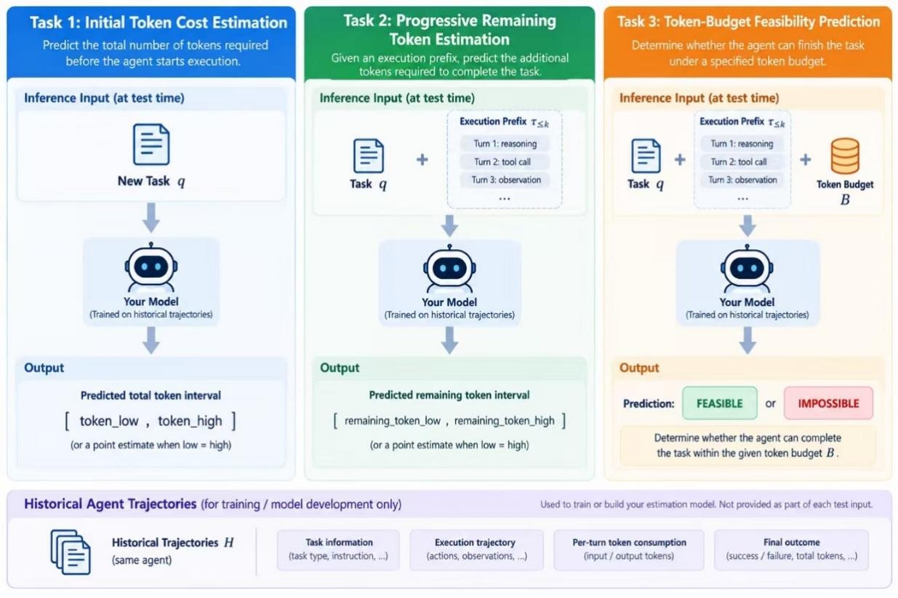

本赛题向参赛者提供某一 AI 智能体的历史执行轨迹，用于训练预测器。所有历史轨迹均由固定的智能体框架和指定的 LLM 后端（例如 DeepSeek）在同一领域的任务上生成。每条历史轨迹包含：

任务 → 智能体执行轨迹 → 每轮 Token 消耗 → 最终结果

对于历史数据集中未出现的新到达任务，参赛者需要根据以下信息预测其 Token 需求：

1. 新任务本身；
2. 同一智能体的历史执行轨迹；
3. 新任务已有的执行前缀（如有）。

预测结果以区间表示：

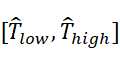

其中，T\_low 和 T\_high 分别表示预测的 Token 消耗下界和上界。当 T\_low = T\_high 时，预测退化为点估计。

本赛题包含三个相关子任务。

## 任务 1 初始 Token 成本估计

目标：在新任务开始执行之前，预测智能体完成该任务所需的 Token 总量。

输入：x = (q, H)

 

其中：

- q：新任务；
- H = {τ₁, τ₂, …, τₙ}：智能体的历史执行轨迹。

τᵢ = (yᵢ, cᵢ)，其中 yᵢ 是智能体在第 i 步生成的当前输出，可能包含推理、工具调用、中间结果或最终答案；cᵢ 是第 i 步消耗的 Token 数量。

 

输出：[T\_low, T\_high]

 

 

**任务** **2** **渐进式剩余** **Token** **估计**

 

智能体开始执行后，系统会获得更多信息。

给定任务及其执行前缀：

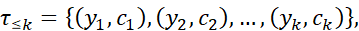

 

参赛者预测从下一轮开始直至任务完成所需的额外 Token 区间 [T\_low, T\_high]。评测时，任务 2 的实例通过从每条完整记录轨迹中采样部分中间执行前缀构建，不会在轨迹的每一轮都构建评测实例。

 

 

**任务** **3 Token** **预算可行性预测**

第三个任务要求参赛者判断智能体能否在指定的 Token 预算内完成任务。

给定 (q, τ≤k, B)，其中 B 为 Token 总预算，预测：FEASIBLE（可行）或 IMPOSSIBLE（不可行）。

同样，任务 3 的实例仅从每条完整记录轨迹中采样部分中间状态构建，而不是在每一轮执行时都构建。  
注意：预测方法自身产生的 Token 消耗不计入可行性判断条件。任务 3 仅判断智能体能否在剩余 Token 预算内完成剩余执行过程。

## 四 预期要求 性能与精度等

提交的系统应满足以下要求。

泛化能力。测试任务在训练过程中未出现过。参赛者应根据智能体的历史执行轨迹推断资源需求，而不是记忆任务编号。

不确定性感知估计。任务 1 和任务 2 允许提交区间预测，而非仅要求点估计。

区间校准。好的估计器应生成覆盖实际 Token 消耗且尽可能窄的区间。仅预测极宽的区间不应获得高分。

渐进式估计。对于任务 2，预测应根据智能体执行过程中观察到的信息动态调整。

尽早识别不可行任务。对于任务 3，参赛者应尽早识别无法在指定 Token 预算内完成的任务。

效率。沿用上一届赛题的运行时间约束方式，每次预测应在 5 秒内完成。

## 五 测试用例

我们将提供示例测试用例及输入输出格式。测试用例可通过图例说明。赛题公布时，仅公开输入输出规范；具体测试用例将在决赛当天提供。

历史轨迹数据：

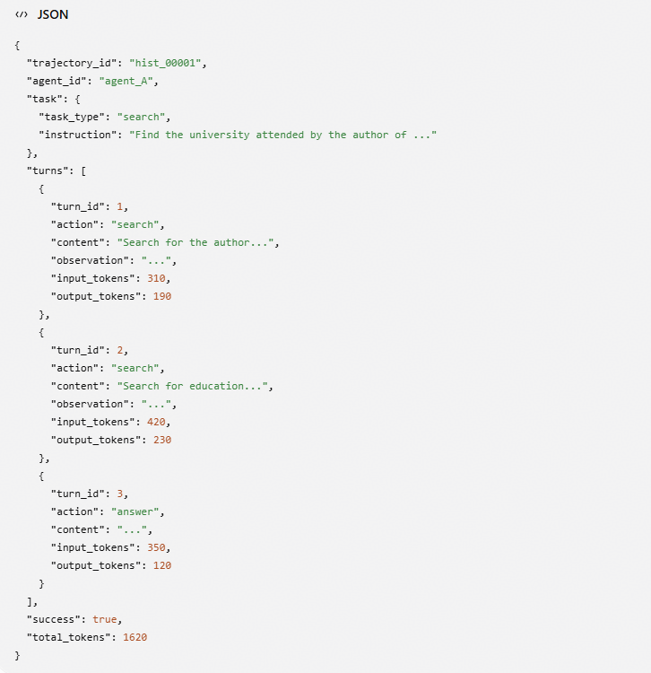

任务 1：

测试输入：

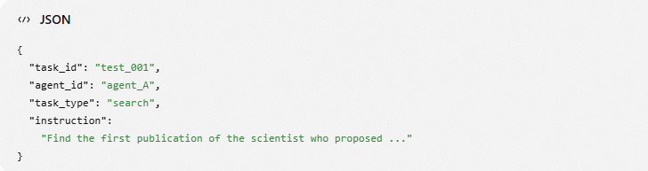

参赛者输出：

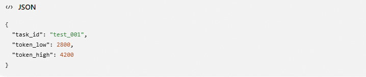

真实值（不向参赛者公开）：

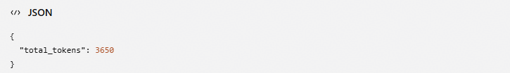

3650 ∈ [2800, 4200]，因此预测区间覆盖真实值。

 

任务 2：

测试输入：

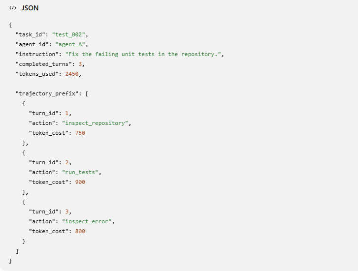

 

参赛者输出：

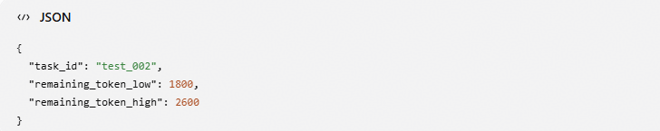 

真实值（不向参赛者公开）：

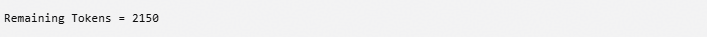

预测区间覆盖真实值。

任务 3：

测试输入：

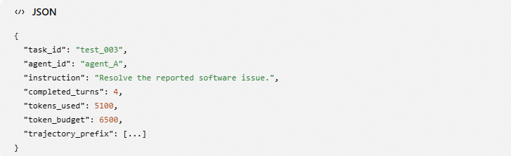

参赛者输出：

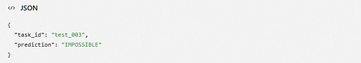

若智能体还需要额外消耗 2300 个 Token：

5100 + 2300 = 7400 > 6500，因此真实标签为 IMPOSSIBLE（不可行）。

 

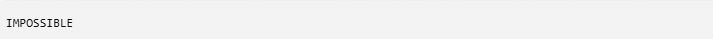

## 六 参考文献

无

## 七 评分标准 评分维度与等级等

预测开销惩罚。  
如果提交的预测方法在推理阶段调用一个或多个 LLM 来构建预测器，则预测器自身产生的 Token 消耗必须纳入评测。这是因为基于 LLM 的预测可能比传统机器学习或深度学习预测器产生明显更高的推理开销，而此类开销直接影响底层智能体任务的工程效率。

对于每个任务或轨迹 i，预测开销惩罚定义为：

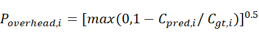

其中，C\_pred,i 表示预测器自身产生的 Token 消耗，C\_gt,i 表示对应智能体执行过程的真实 Token 消耗。

对于任务 1，C\_pred,i 为预测器对任务 i 进行预测时消耗的 Token 总量，C\_gt,i 为对应真实智能体轨迹的 Token 总消耗。

对于任务 2 和任务 3，C\_pred,i 为轨迹 i 上所有采样评测点累计产生的预测器 Token 消耗，C\_gt,i 为完整真实轨迹 i 的 Token 总消耗。因此，任务 2 和任务 3 的开销惩罚在轨迹层面计算一次，而不是针对每个采样执行前缀单独计算。

对于推理阶段不调用 LLM 的预测方法，C\_pred,i = 0，因此 P\_overhead,i = 1。

**任务** **1** **初始** **Token** **成本估计****权重** **30%**

对于每个未见任务，设 R 为真实 Token 总消耗，[L, H] 为提交的预测区间。每个样本的区间得分为：

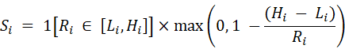

任务 1 的得分为所有测试任务的区间得分乘以相应开销惩罚后的平均值：

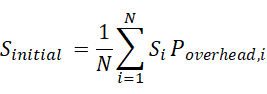

注意：如果预测区间的宽度大于或等于真实 Token 消耗（H − L ≥ R），区间得分为零，与预测区间未覆盖真实值的情况相同。在覆盖真实值的预测中，区间越窄，得分越高。完全准确的点预测 [R, R] 得分为 1。

**任务** **2** **渐进式剩余** **Token** **估计****权重** **40%**

在执行前缀 k 处，设 Rₖ 为从下一轮到任务完成实际消耗的 Token 数量，[Lₖ, Hₖ] 为预测的剩余 Token 区间。对每个评测前缀使用相同的区间评分方法：

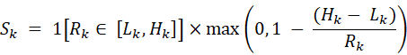

为确保每条轨迹对最终得分的贡献相同，首先对每条轨迹内各评测前缀的区间得分取平均，再对所有轨迹的轨迹级得分取平均。

任务 2 的得分为所有评测轨迹的轨迹级区间得分乘以相应开销惩罚后的平均值：

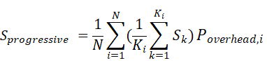

其中，N 为评测轨迹数，Kᵢ 为轨迹 i 中的评测前缀数，Sₖ 为该轨迹第 k 个评测前缀的区间得分。

**任务** **3 Token** **预算可行性预测****权重** **30%**

对于每个评测状态，若记录中的智能体执行过程能够在指定 Token 预算内成功完成任务，真实标签为 FEASIBLE（可行）；否则为 IMPOSSIBLE（不可行）。使用以下分类指标：

• F1@1：仅使用每个任务的首次预测，计算 FEASIBLE 和 IMPOSSIBLE 两类的宏平均 F1。

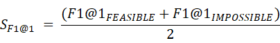

• F1@Later：使用每个任务首次预测之后的所有评测执行前缀，计算 FEASIBLE 和 IMPOSSIBLE 两类的宏平均 F1。

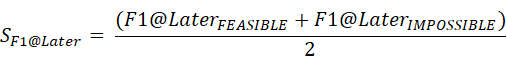

任务 3 的得分为 F1@1 和 F1@Later 的等权平均值，再乘以轨迹级开销惩罚的平均值：

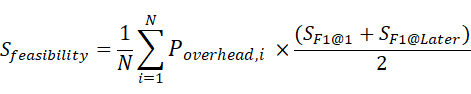

**总分**

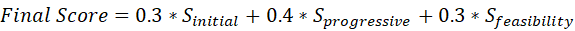
