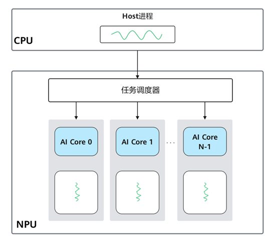
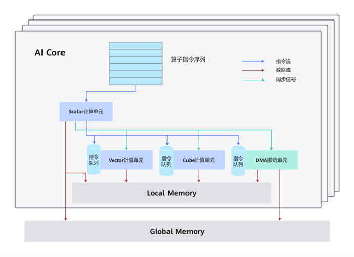
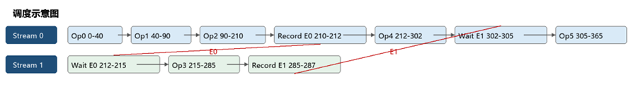
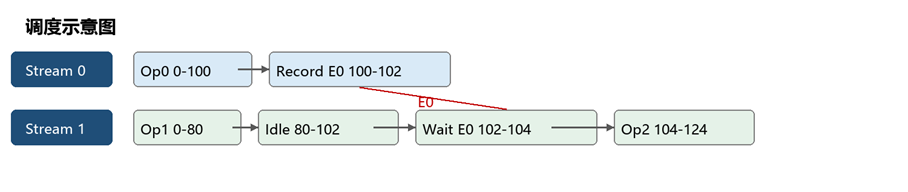
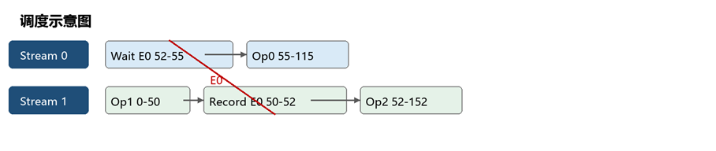

# 27 AI Core多流优化

> 本文件为官网公开赛题原文的 Markdown 整理版；正文按原文保留，图片和公式本地保存，未自行改写赛题要求。

- 官方标题：【2026Hackathon决赛】27：AI Core多流优化
- 来源：[官网赛题页](https://www.chaspark.com/#/races/competitions/1326715227709140992)
- 获取日期：2026-10-11（北京时间）
- 赛题 ID：1326715227709140992
- 原始资料：[JSON](../../官方资料/赛题原始数据/27_1326715227709140992.json) · [HTML](../../官方资料/赛题原始数据/27_1326715227709140992.html)

---

**AI Core****多流优化**

**一、背景信息**

一个基于昇腾处理器的异构系统通常包含CPU与昇腾NPU。其中，CPU及其内存称为Host与Host Memory；NPU及其内存称为Device与Device Memory。基于昇腾的应用程序通常包含两部分：一部分运行在Host CPU上，另一部分运行在NPU上。运行在NPU上的代码称为核函数（Kernel），需由Host代码调用执行。本题目重点关注NPU侧如何高效执行Kernel的问题。

AI Core（AI处理器的计算核心）是NPU的计算核心。为提升计算效率，NPU上通常有多个计算核（AI Core）并发执行，每个核一般处理不同的数据。传统上，AI Core遵循SIMD（Single Instruction Multiple Data，单指令多数据流）模型，通过一条指令同时操作多个数据实现并行计算。AI Core同时包含 AIC（计算密集型）和 AIV（向量型）两类计算核心，并提供多条执行流。**为简化题目复杂度，我们做了一层抽象假设，在****NPU****内打破AI Core****边界整体来看AIC****和AIV****的调度问题。**

即，目标 NPU 包含两大类计算核心：

**- \*\*AIC****（AI Cube Core****）\*\*****：主要执行卷积、矩阵乘等计算密集型算子；**

**- \*\*AIV****（AI Vector Core****）\*\*****：主要执行归一化、激活、数据处理和后处理等向量型算子。**

NPU 同时提供多条执行流（Stream）。同一 Stream 内的命令串行执行，不同 Stream 上的算子可以重叠运行。跨 Stream 的数据依赖需要通过 Event Record 和 Event Wait 同步。即使依赖关系允许并行，算子仍会共同竞争核心数量、显存，因此简单地增加 Stream 不一定能缩短执行时间。

对于深度模型来讲，在跑到NPU前会做很多高层编译优化和硬件相关优化。深度模型经过编译后，最终可以表示为计算图：节点是算子，有向边表示数据依赖。没有依赖关系的算子可能并行执行，汇合算子则必须等待所有输入完成。接下来我们就可以把经过编译后的计算图下发到NPU上去执行。而如何能在NPU上高效地执行计算图成为一个需要综合考量和在具体硬件上寻优的问题，我们需要把计算图的节点通过更合理的方式下发到AIC和AIV上去计算，实现计算图运行的最优性能。

在本题中，你扮演 AI 编译器或运行时调度器的开发者。给定硬件资源、一张算子 DAG 和业务截止时间，你需要生成一份合法且高效的多流调度方案。你需要为每个算子指定 Stream、流内顺序和必要的跨流 Event。判题器会按本文规定的确定性规则推导实际开始时间、完成时间和资源占用；你不能直接指定算子的开始时间。本题不要求使用真实 NPU，所有调度均由判题器模拟执行。

 

目标依次为：

1. 返回合法方案，并在 `deadline\_us` 内完成全部算子；

2. 尽量缩短全图完成时间，记为 T。

`event\_record\_time` 与 `event\_wait\_time` 是跨流 Record / Wait 的硬件耗时，已经进入模拟时间线，从而计入 T，不作为单独评分项。

所有时间单位为微秒（μs），显存单位为 MiB。

**二、问题描述**

给定硬件资源、一张算子 DAG 和业务截止时间，请为每个算子指定 Stream、流内顺序和必要的跨流 Event。判题器按本文规定的确定性规则推导开始时间与完成时间，选手不能直接指定开始时间。

• 返回合法方案，并在 deadline\_us 内完成全部算子。

• 在合法方案中，优先最小化全图完成时间 T；T 相同时比较峰值显存。

• 所有时间单位为微秒（us），显存单位为 MiB；Record 与 Wait 的耗时进入 T。

**2.1** **参赛接口**

|  |
| --- |
| #include <cstdint> #include <vector>  enum class CoreType : int { AIC = 0, AIV = 1 };  struct HardwareInfo {     int aic\_core\_num;     int aiv\_core\_num;     int stream\_num;              // 最多可使用的 Stream 数量     std::int64\_t memory\_limit;     std::int64\_t event\_record\_time;     std::int64\_t event\_wait\_time; };  struct OperatorNode {     int id;                       // 全局唯一，不保证连续     CoreType core\_type;     int core\_num;     std::int64\_t exec\_time;     std::int64\_t workspace\_memory;     std::int64\_t output\_memory;     std::vector<int> inputs;      // 直接前驱算子 ID };  struct StreamTask {     int op\_id;     std::vector<int> wait\_before; // Compute 前等待；可无序，但不得重复     int record\_after;             // Compute 后 Record；-1 表示不记录 };  struct StreamPlan {     std::vector<StreamTask> tasks; // 数组顺序就是流内执行顺序 };  struct SchedulePlan {     std::vector<StreamPlan> streams; // streams[i] 对应 Stream i };  SchedulePlan ScheduleCvGraph(     const HardwareInfo &hardware,     const std::vector<OperatorNode> &operators,     std::int64\_t deadline\_us); |

streams[i] 表示 Stream i，tasks 数组顺序就是流内顺序。每个算子必须出现且仅出现一次；Stream 数不得超过 hardware.stream\_num。空 Stream 会被删除并压缩流号，不单独判非法。

wait\_before 是 Compute 前要等待的 Event 列表，顺序不限；判题器会按 Event ID 排序，重复 ID 仍非法。record\_after 为非负时，Compute 完成后立即 Record 该 Event；-1 表示不记录。

若消费者和直接前驱位于同一 Stream，前驱必须排在消费者之前，不需要 Event。

编译与评测以 include/problem.h 为准。

**三、赛题要求**

**3.1** **调度合法性**

• 每个任务依次执行 wait\_before、Compute 和 record\_after。wait\_before 中 Event ID 必须非负；判题器先升序排列，重复则非法。

• 每个 Event 只能被一个算子 Record；Record 的 Event ID 由判题器按数值重映射为从 0 开始连续；每个 Record 必须至少被一个任务 Wait。

• 同一 Stream 内的依赖由流内顺序保证，禁止同流 Event。跨 Stream 的直接依赖必须同步；也允许额外跨流 Event 来调整资源竞争顺序。

• Wait 在全部 wait\_before 的 Event ready 后开始，耗时为 wait\_before.size() \* event\_wait\_time；Record 耗时为 event\_record\_time。

• 额外跨流 Event 只调整执行顺序，不新增数据依赖，也不改变输出显存释放时机。若造成循环等待，方案非法。

• 判题器从时刻 0 开始。同一时刻按 Stream 编号从小到大尝试启动；资源不足不阻止后续 Stream。零耗时 Wait/Record 立即完成。

• 若仍有算子未完成却没有任何命令可执行，方案非法。同一方案每次得到相同结果。

**3.2** **资源与显存**

• AIC 与 AIV 核数分别统计，正在运行的同类算子核数之和不得超过上限。

• Compute 开始时占用 workspace\_memory 与 output\_memory；结束后释放 workspace\_memory。

• 算子输出保留到最后一个直接后继完成后释放；最终输出保留到全图结束。任意时刻显存不得超过 memory\_limit。

执行区间均为左闭右开 [start, end)。算子 i 的结束时刻与全图完成时间：

|  |
| --- |
| E\_i = S\_i + D\_i T = max(E\_i) |

Record 和 Wait 不单独加到 T 上，但会推迟后续 Compute，因此已反映在 T 中。T 必须 <= deadline\_us。

任意时刻正在计算的 AIC / AIV 算子 core\_num 之和分别不得超过对应核数上限。Record 和 Wait 不占计算核心。零长度区间不占显存。

workspace 在 [S\_i, E\_i) 内存活；output 从 S\_i 开始存活。同一输出只保存一份，不因多个消费者重复计入。

**3.3** **输入保证与提交**

• 输入 DAG 无环，算子 ID 全局唯一；每个算子的资源需求不超过硬件上限。

• 1 <= aic\_core\_num, aiv\_core\_num <= 128；1 <= exec\_time <= 10^9；0 <= event\_record\_time, event\_wait\_time <= 10^6。

• 1 <= core\_num，且不超过对应类型总核数；workspace\_memory + output\_memory <= memory\_limit <= 10^9。

• inputs 中的 ID 均存在、不重复，且不等于当前算子 ID；算子 ID 与 operators 记录顺序均不保证为拓扑序。

• 所有时间计算均可放入有符号 64 位整数。deadline\_us 是图的业务截止时间，不是程序运行时限。

• 至少存在一种方案可在 deadline\_us 内合法完成。

• 提交 solution/solution.cpp 和 solution/README.md；自测用例与辅助材料可选。

提交包内容：

|  |
| --- |
| solution/solution.cpp   # 必需，实现 ScheduleCvGraph solution/README.md      # 必需，简要说明算法思路和复杂度 solution/tests/         # 可选，自测用例 solution/assets/        # 可选，辅助说明材料 |

公开样例与回归数据只用于本地理解和验证。正式评测使用结构和规模不同的隐藏数据。

**四、参考资料**

**4.1** **用例1**

硬件：AIC=16，AIV=12，Stream=3，显存=400，Record=2 us，Wait=3 us，deadline\_us=430。下表为算子 DAG 的节点信息。

对应本地文件 test\_cases/sample.case。

|  |
| --- |
| HardwareInfo hardware{16, 12, 3, 400, 2, 3}; // aic\_core\_num, aiv\_core\_num, stream\_num, memory\_limit, // event\_record\_time, event\_wait\_time std::int64\_t deadline\_us = 430; |

 

|  |  |  |  |  |  |  |
| --- | --- | --- | --- | --- | --- | --- |
| **ID** | **类型** | **核数** | **时间** | **workspace** | **output** | **inputs** |
| 0 | AIV | 4 | 40 | 60 | 40 | {} |
| 1 | AIV | 6 | 50 | 70 | 50 | {0} |
| 2 | AIC | 12 | 120 | 160 | 80 | {1} |
| 3 | AIC | 6 | 70 | 90 | 20 | {2} |
| 4 | AIC | 8 | 90 | 100 | 30 | {2} |
| 5 | AIV | 8 | 60 | 80 | 10 | {3,4} |

DAG：

|  |
| --- |
| /-> 3 -\ 0 -> 1 -> 2        -> 5           \-> 4 -/ |

一种合法方案（streams 下标即 Stream 编号）：

|  |
| --- |
| StreamPlan stream0; stream0.tasks = {     {0, {}, -1},     {1, {}, -1},     {2, {}, 0},       // Op2 后 Record Event0     {4, {}, -1},     {5, {1}, -1},     // Op5 前 Wait Event1 }; StreamPlan stream1; stream1.tasks = {     {3, {0}, 1},      // Wait Event0，Op3 后 Record Event1 }; plan.streams = {stream0, stream1}; |

示意图（实线为同流顺序，虚线为 Event 同步；图中已标注各段时间）：

图 1  用例1的两流调度与 Event 同步

Op3 与 Op4 重叠时，AIC 核数为 6+8=14，不超过 16；峰值显存为 320 MiB。因此该方案 T=365 us。

判题器推导出的时间线：

|  |
| --- |
| Stream 0:   Op0 Compute      [  0,  40)   Op1 Compute      [ 40,  90)   Op2 Compute      [ 90, 210)   Event0 Record    [210, 212)   Op4 Compute      [212, 302)   Event1 Wait      [302, 305)   Op5 Compute      [305, 365)  Stream 1:   Event0 Wait      [212, 215)   Op3 Compute      [215, 285)   Event1 Record    [285, 287) |

重叠期间显存 = Op2 output 80 + Op3 的 90+20 + Op4 的 100+30 = 320 <= 400。串行基线为 430 us。Op5 只跨流等待 Event1，k=1，Wait 耗时 3。k表示算子执行前需要等待的Stream个数。

若把 Op3、Op4 都放到与 Op5 不同的 Stream，则 Op5 的 k = 2，Wait 耗时 2 \* 3 = 6。

若把同一张图的 deadline 改为 400 us（本地 tight\_deadline.case），串行 430 会失败，本并行方案仍合法。

**4.2** **用例2**

AIC 和 AIV 的核数分别统计，因而 Op0 与 Op1 可并行。Op0 对 Op2 的跨流依赖通过 Event E0 同步，方案 T=124 us。

对应 tests/cases/heterogeneous.case。

|  |
| --- |
| HardwareInfo hardware{8, 8, 2, 200, 2, 2}; std::int64\_t deadline\_us = 200; |

 

|  |  |  |  |  |  |  |
| --- | --- | --- | --- | --- | --- | --- |
| **ID** | **类型** | **核数** | **时间** | **workspace** | **output** | **inputs** |
| 0 | AIC | 8 | 100 | 20 | 10 | {} |
| 1 | AIV | 4 | 80 | 15 | 10 | {} |
| 2 | AIV | 4 | 20 | 10 | 5 | {0,1} |

一种合法方案：

|  |
| --- |
| stream0.tasks = {{0, {}, 0}}; stream1.tasks = {     {1, {}, -1},     {2, {0}, -1}, }; |

Op1 -> Op2 由同流顺序保证；Op0 -> Op2 跨流，因此需要 Event0。时间线：

|  |
| --- |
| Stream 0: Op0 [0,100)  Record E0 [100,102) Stream 1: Op1 [0,80)   空闲 [80,102)  Wait E0 [102,104)  Op2 [104,124) |

Op0 与 Op1 在 [0,80) 重叠时，AIC=8，AIV=4，显存=(20+10)+(15+10)=55 <= 200。单流串行需要 200 us。

图 2  用例2的异构并行调度

**4.3** **用例3**

Op0 与 Op1 没有数据依赖，但同时启动会超过显存限制。通过由 Op1 Record、Op0 Wait 的额外 Event E0，可让关键路径 Op1 到 Op2 优先执行，完成时间由 210 us 缩短到 152 us。

对应 tests/cases/memory\_arbitration.case。

|  |
| --- |
| HardwareInfo hardware{8, 8, 2, 50, 2, 3}; std::int64\_t deadline\_us = 220; |

 

|  |  |  |  |  |  |  |
| --- | --- | --- | --- | --- | --- | --- |
| **ID** | **类型** | **核数** | **时间** | **workspace** | **output** | **inputs** |
| 0 | AIC | 4 | 60 | 20 | 10 | {} |
| 1 | AIV | 4 | 50 | 20 | 5 | {} |
| 2 | AIC | 4 | 100 | 5 | 5 | {1} |

一种合法方案（Event0 不是原始 DAG 边，只用于让关键分支先执行）：

|  |
| --- |
| stream0.tasks = { {0, {0}, -1} };   // Op0 前额外 Wait Event0 stream1.tasks = {     {1, {}, 0},     // Op1 后 Record Event0     {2, {}, -1},    // Op1 -> Op2 同流 }; |

Op1 在时刻 0 启动；Event0 在 52 us ready；Op0 Wait 3 us 后于 55 us 启动，可与 Op2 重叠。

图 3  用例3中额外 Event 调整资源竞争顺序

**五、评选标准**

• 调度方案必须合法、正确完成全部算子，并满足 T 不超过 deadline\_us。满足前提的方案按 T 升序排序；T 相同时按峰值显存升序排序；两项相同则并列。判题程序负责验证方案合法性，并统计 T 和峰值显存。

• 单 Stream 方案合法。判题器会先删除空 Stream 并压缩流号，再检查合法性；空 Stream 不是非法条件。Event ID 只用于标识同步对象，不参与评分；判题器会把 Record 过的 ID 按数值重映射为从 0 开始的连续编号，稀疏编号不是非法条件。

• 多前驱混合同步：若消费者 v 同时依赖 u1 和 u2，u1 与 v 位于同一 Stream 且排在 v 之前，而 u2 位于另一 Stream，则 v 只需等待由 u2 记录的 Event；v 仍可额外等待其他 Stream 的 Event，以主动规避核心或显存冲突。

• 正式评测覆盖不同图结构、异构资源组合和显存压力。具体聚合公式、隐藏用例权重及内部参考值不对外公开。评测平台施加统一的运行时间、内存与环境限制；超时、异常或崩溃均视为该用例无效。具体资源阈值由评委在统一环境中固定执行。

• 代码质量由出题组综合评审，包括功能正确性、算法复杂度、C++ 编码规范、可读性和健壮性。具有独立创新性的算法设计，以及完整的算法说明和复杂度分析，可作为额外加分项。
