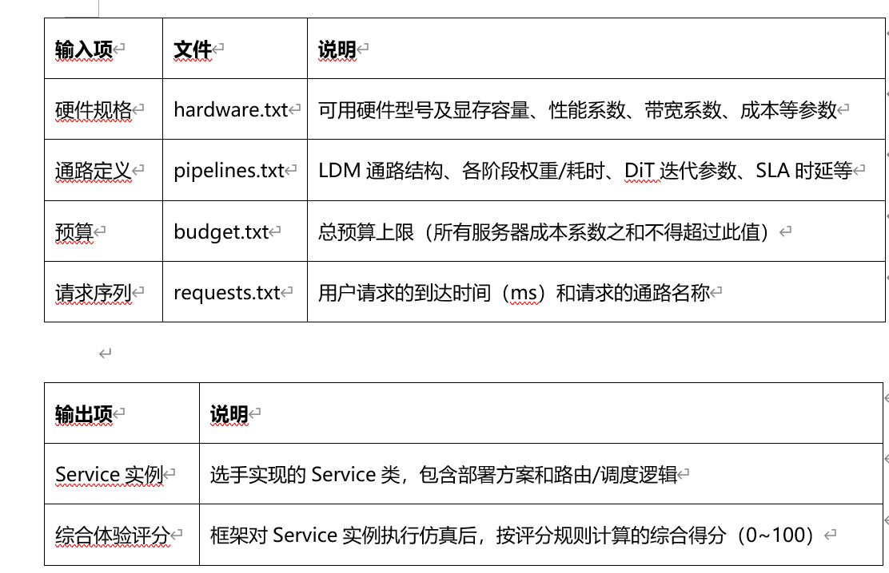

# 29 面向LDM推理通路的显存卸载与部署策略自动调优

> 本文件为官网公开赛题原文的 Markdown 整理版；正文按原文保留，图片和公式本地保存，未自行改写赛题要求。

- 官方标题：【2026Hackathon决赛】29：面向LDM推理通路的显存卸载与部署策略自动调优
- 来源：[官网赛题页](https://www.chaspark.com/#/races/competitions/1326718525036126208)
- 获取日期：2026-10-11（北京时间）
- 赛题 ID：1326718525036126208
- 原始资料：[JSON](../../官方资料/赛题原始数据/29_1326718525036126208.json) · [HTML](../../官方资料/赛题原始数据/29_1326718525036126208.html)

---

**面向LDM推理通路的显存卸载与部署策略自动调优**

## **一、题目名称：**

**决赛赛题名称：面向LDM推理通路的显存卸载与部署策略自动调优**

**决赛赛题来自技术领域：大模型推理部署优化**

**赛题限制：无限制**

## **二、背景信息（赛题产生的业务背景）：**

**LDM****（隐空间扩散模型）推理通路包含文本编码、多步扩散迭代（DiT）、VAE等多个阶段，各阶段权重规模巨大，单卡显存难以同时容纳，部署成本高昂。业界主流方案是显存卸载（Offload）+ 预取（Prefetch）：将未使用的权重卸载至Host内存，在Device实际需要前异步提前加载，使数据传输与计算重叠，降低显存占用。实际业务中，一台服务器需共服务多条LDM通路（让多条通路在同一台服务器上交替服务，提升服务器利用率、降低部署成本）。不同硬件（A3、A4等）的显存容量、带宽、成本各异。如何选择硬件、分配通路、设计offload调度策略，在有限预算下最大化用户体验，是当前AIGC服务部署的核心难题。**

## **三、问题描述（现状、技术挑战等）：**

**3.1****总体任务：**

**选手实现一个仿真服务集群，基于主办方提供的仿真通路（SimPipeline）和仿真服务器（SimServer），完成以下工作：**

**1.** **部署规划：在给定预算下，选择硬件型号，创建服务器，将通路实例分配到服务器上**

**2.** **网关路由：接收用户请求，决定将请求路由到哪个服务器实例**

**3.** **显存卸载调度：为每条通路设计offload/load策略，控制权重的加载和卸载时机**

**4.** **在有限成本内，端到端时延+显存占用综合调优：根据部署和调度策略模拟执行仿真服务器，计算每个请求的端到端时延和显存占用，最终给出时延体验评分。**

**3.2 LDM****通路结构：**

**LDM****推理通路由多个阶段组成，通过PipelineDef中的stages列表和deps依赖关系描述。不同测试用例可定义不同结构的通路（如文生图、视频生成、图生图等），不是固定写死某一种结构。**

**基本骨架：**

**文本编码器(TextEncoder) → DiT迭代N步(每步执行K个block) → VAE解码器(VAEDecoder)**

**文本编码器：执行一次，产出文本特征供DiT使用；DiT迭代：循环执行N步，每步依次执行K个Transformer block，每步输入为上一步的输出；VAE解码器：执行一次，将DiT最终输出解码为图像/视频。通路均为简化为串行执行，步骤阶段之间不存在并行。各阶段的权重独立，可以在不使用时offload到Host内存，假设Host内存无限大。**

**3.3** **仿真器接口：**

**3.3.1 SimServer****（仿真服务器）：**

**SimServer****是服务器仿真，内部显存和模块状态。SimPipeline绑定到SimServer后，load/offload向SimServer添加事件。**

**3.3.2 SimPipeline****（仿真通路）：**

**SimPipeline****由通路定义创建，初始化时一次性传入服务器绑定和offload调度声明。execute时仿真器按调度声明自动执行load/offload和计算，按时间推进实现异步。**

**3.3.3 Schedule****（调度声明）**

**选手通过schedule声明每条通路的offload/load调度策略。schedule是一个dict，key为触发时机，value为操作列表。声明可覆盖通路全部阶段—text\_encoder、dit\_block\_0~K（每步每block）、vae\_decoder，选手可对任意权重做load/offload。仿真器按声明在对应时机发起load/offload操作。同一服务器同一时刻只能执行一个传输操作，多个传输按发起顺序排队。传输与计算可以重叠（异步）。**

**3.4** **硬件规格**

**包括硬件型号、显存容量、性能系数、带宽系数、成本系数。 传输时间 = 权重大小/（默认带宽 \* 权重系数）**

**3.5** **选手接口**

**选手需要实现仿真服务集群，根据输入样例返回服务集群仿真实例。框架对该实例进行仿真请求，输出用户评分。要求仅使用基础包及numpy、torch-cpu包。**

## **四、期望达到的指标和效果（含性能/精度等指标）：**

**• 功能正确：选手的部署方案和调度策略能被仿真器正确执行，无报错**

**• 预算合规：总硬件成本不超过给定预算**

**• 显存合法：任何时刻服务器显存不超过硬件上限**

**• 路由时间约束：1s内，不算在端到端时延计算内**

**• 时延体验得分最优： 在成本、显存及路由时间的约束下，时延体验得分最大化。得分计算细则：在测试用例的给定时延区间内[a, b]，线性计算得分。端到端时间t=排队时间 + 通路执行时间，则得分为：Score = (b-t)/(b-a) \* 100。总评分 = 所有请求时延评分的简单平均**

**决策空间包括但不限：根据成本，决策挑选服务器类型、数量；任务路由、调度；服务器内存分配使用，通路模块offload策略，常驻策略。**

**五、测试用例**

****

**5.1** **输入样例**

**每个测试用例由以下4个文本文件组成，选手的Service.init()方法将接收由这些文件解析得到的Python对象（list[PipelineDef]、list[HardwareSpec]、int）。**

- **hardware.txt** **— 硬件规格，每行定义一种可用硬件型号：**

|  |  |  |
| --- | --- | --- |
| 字段 | 类型 | 说明 |
| name | str | 硬件型号标识，如 "A3" |
| mem | int | 显存容量（MB） |
| perf\_coef | float | 性能系数，计算时间 = time\_cost / perf\_coef |
| bw\_coef | float | 带宽系数，传输时间 = weight\_mem / (base\_bw × bw\_coef) |
| cost | int | 成本系数，所有服务器cost之和不得超过预算 |

**示例：**

|  |
| --- |
| # hardware.txt  HARDWARE A3  mem=65536  perf\_coef=1.2  bw\_coef=1.0  cost=5  HARDWARE A4  mem=32768  perf\_coef=1.0  bw\_coef=0.8  cost=4 |

- **pipelines.txt** **— 通路定义，每条通路以 `PIPELINE <name>` 开头，包含通路级参数、多个STAGE定义和DEPS依赖声明：**

|  |  |  |
| --- | --- | --- |
| 字段 | 类型 | 说明 |
| name | str | 通路名称，用于请求路由匹配 |
| expected\_latency | int | 期望时延（ms），评分满分阈值 |
| timeout\_latency | int | 超时时延（ms），评分归零阈值 |
| dit\_steps | int | DiT迭代步数N |
| dit\_blocks | int | DiT每步block数K |
| STAGE name | str | 阶段名称 |
| STAGE weight\_mem | int | 权重占用显存（MB） |
| STAGE run\_mem | int | 执行时运行内存（MB），执行完释放 |
| STAGE time\_cost | int | 标准性能执行耗时（ms）实际耗时 = time\_cost / perf\_coef |

**示例：**

|  |
| --- |
| PIPELINE text2img    expected\_latency=2000  timeout\_latency=5000    dit\_steps=2  dit\_blocks=3    STAGE text\_encoder   weight\_mem=2000  run\_mem=500  time\_cost=50    STAGE dit\_block\_0    weight\_mem=800   run\_mem=300  time\_cost=30    STAGE dit\_block\_1    weight\_mem=800   run\_mem=300  time\_cost=30    STAGE dit\_block\_2    weight\_mem=800   run\_mem=300  time\_cost=30    STAGE vae\_decoder    weight\_mem=1500  run\_mem=400  time\_cost=40 |

- **budget.txt** **— 预算**

|  |  |  |
| --- | --- | --- |
| 字段 | 类型 | 说明 |
| BUDGET | int | 总预算上限，所有创建服务器的cost系数之和不得超过此值 |

- **requests.txt** **— 请求序列，每行定义一个用户请求，按到达时间升序排列：**

|  |  |  |
| --- | --- | --- |
| 字段 | 类型 | 说明 |
| t | int | 请求到达时间（ms），从0开始 |
| pipeline | str | 请求的通路名称，必须匹配pipelines.txt中已定义的通路 |

|  |
| --- |
| t=<arrive\_time\_ms>  pipeline=<pipeline\_name>  # requests.txt  t=0      pipeline=text2img  t=100    pipeline=text2img  t=500    pipeline=video\_gen  t=800    pipeline=text2img |

**5.2** **部署方案合法性说明**

**预算合法性-举例：预算18，选手选择：**

**服务器1: 类型A 3(cost=5), 部署 text2img + video\_gen (共服务)**

**服务器2: 类型A 3(cost=5), 部署 text2img**

**服务器3: 类型B4 (cost=4), 部署 text2img**

**服务器4: 类型B4 (cost=4), 部署 video\_gen**

**总成本 = 5+5+4+4 = 18 ≤ 预算18，预算合法****✓**

**显存合法性：由仿真器在执行过程中检查：任何时刻SimServer的device\_mem不超过mem\_size。共服务的核心是通过offload让多条通路轮流使用显存，不是所有权重同时驻留。选手需通过offload调度策略确保执行时显存不超限，具体以仿真器execute返回的mem\_peak为准。**

**5.3** **通路执行和offload调度举例说明**

**text2img****通路（DiT 2步×3 blocks），不offload时的默认执行流程：**

|  |
| --- |
| t=0:    load text\_encoder (已完成, 初始在Device)  t=0:    执行 text\_encoder, 耗时50ms, 显存峰值 += 500(run)  t=50:   执行 dit\_block\_0\_step1, 耗时30ms, 显存峰值 += 300(run)  t=80:   执行 dit\_block\_1\_step1, 耗时30ms, 显存峰值 += 300(run)  t=110:  执行 dit\_block\_2\_step1, 耗时30ms, 显存峰值 += 300(run)  t=140:  执行 dit\_block\_0\_step2, 耗时30ms  t=170:  执行 dit\_block\_1\_step2, 耗时30ms  t=200:  执行 dit\_block\_2\_step2, 耗时30ms  t=230:  执行 vae\_decoder, 耗时40ms, 显存峰值 += 400(run)  t=270:  完成, 总耗时270ms  显存峰值 = 全部权重 + 最大运行内存 = 5900 + 1800(各阶段run\_mem+output\_mem) |

**插入offload调度后的优化执行流程（示例）,假设**base\_bw=50**：**

|  |
| --- |
| 选手调度声明：    schedule = {        "pre:text\_encoder": [("load", "dit\_block\_0")],        "post:dit\_block\_0\_step1": [("load", "dit\_block\_2"), ("offload", "dit\_block\_0")],        "post:dit\_block\_1\_step1": [("load", "dit\_block\_0"), ("offload", "dit\_block\_1")],        "post:dit\_block\_2\_step1": [("load", "dit\_block\_1"), ("offload", "dit\_block\_2")],        "post:dit\_block\_0\_step2": [("load", "dit\_block\_2"), ("offload", "dit\_block\_0")],        "post:dit\_block\_1\_step2": [("offload", "dit\_block\_1")],        "post:dit\_block\_2\_step2": [("offload", "dit\_block\_2")],    }     执行时间线：  t=0:    执行 text\_encoder (50ms), 完成于t=50  t=50:   offload text\_encoder  t=50:   执行 dit\_block\_0\_step1 (30ms), 完成于t=80  t=80:   offload dit\_block\_0           同时发起 load dit\_block\_2 (耗时800/50=16ms)           同时执行 dit\_block\_1\_step1 (30ms), 完成于t=110  t=110:  offload dit\_block\_1           同时发起 load dit\_block\_0 (耗时800/50=16ms)           同时执行 dit\_block\_2\_step1 (30ms), 完成于t=140  ...  同一时刻最多2个dit\_block占用显存，显存峰值下降。 |

**5.5** **输出说明**

1. **选手需实现用于服务调度的Service类，用于结果复现，展示决策路径，至少包含以下三个方法：**
2. init() ：部署方案，创建SimServer实例、将通路绑定到服务器、设定schedule调度策略
3. handle\_request() ：路由决策，决定请求发送到哪个服务器实例，调用SimPipeline.execute()
4. get\_servers() ：服务器列表，返回所有创建的SimServer，供框架校验预算和显存

2.**用户体验总评分 = 所有请求体验评分的简单平均**

**六、评分标准：**

**1.****门槛（一票否决）：部署方案不合法（超预算、显存超限）、通路执行报错（权重未就绪）、无法在仿真器复现、路由时间不超时，不得分**

**2.****评分（满足门槛的前提下）：**

**◦** **所有测试用例的平均用户体验评分为主评分（权重80%）**

**◦** **方案设计评分（权重20%）：部署规划合理性、offload调度策略创新性、共服务框架设计、代码质量和文档完整性，由评委评定**
