# 31 虚拟陀螺仪：三颗加速度计重建运动轨迹：图片文字 OCR 辅助稿

> 本文件不是官方准确原文。采用 Windows 本地简体中文 OCR，未逐字校正；尤其变量、数字、上下标、数学公式、代码可能识别错误。用于搜索定位和辅助阅读，正式要求及评分以同目录 `原文.md` 中的官网图片为准。中文字符间多余空格仅作可读性整理。

- [官方原文与图片](原文.md)
- 提取日期：2026-10-11（北京时间）

## 图片 01

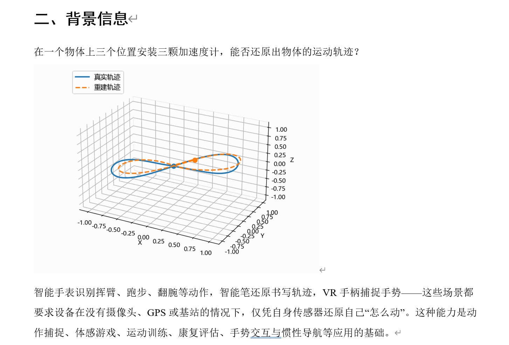

```text
在一个物体上三个位置安装三颗加速度计 ， 能否还原出物体的运动轨迹 ？
0 ， 50
0 ． 75
1 00
一 、 背景信息
真实轨迹
重建轨迹
． 0 ． 75
℃ ． 50
． 0 ， 25
000
1 ℃ 0
075
050
0 ． 25
0 ℃ 0
℃ ． 25
． 0 ． 50
一 0 ． 75
025
． 0 ． 50
． 0 ． 75
一 1 、 00
智能手表识别挥臂 、 跑步 、 翻腕等动作 ， 智能笔还原书写轨迹 ， VR 手柄捕捉手势
这些场景都
要求设备在没有摄像头 、 GPS 或基站的情况下 ， 仅凭自身传感器还原自己 “ 怎么动 " 。 这种能力是动
作捕捉 、 体感游戏 、 运动训练 、 康复评估 、 手势交互与惯性导航等应用的基础 。
```

## 图片 02

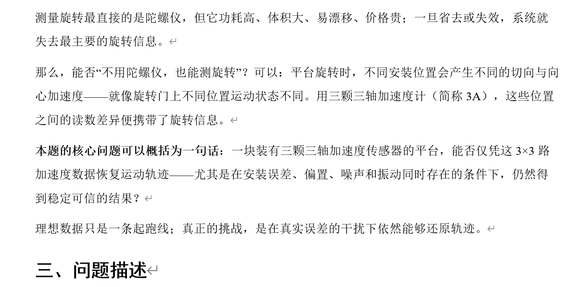

```text
测量旋转最直接的是陀螺仪 ， 但它功耗高 、 体积大 、 易漂移 、 价格贵
一旦省去或失效 ， 系统就
失去最主要的旋转信息 。
那么 ， 能否 “ 不用陀螺仪 ， 也能测旋转 " ？ 可以 ： 平台旋转时 ， 不同安装位置会产生不同的切向与向
心加速度一一一一就像旋转门上不同位置运动状态不同 。 用三颗三轴加速度计 （ 简称 (A) ， 这些位置
之间的读数差异便携带了旋转信息 。
本题的核心问题可以概括为一句话 ： 一块装有三颗三轴加速度传感器的平台 ， 能否仅凭这 3 × 3 路
加速度数据恢复运动轨迹一一一尤其是在安装误差 、 偏置 、 噪声和振动同时存在的条件下 ， 仍然得
到稳定可信的结果 ？
理想数据只是一条起跑线 ； 真正的挑战 ， 是在真实误差的干扰下依然能够还原轨迹 。
二 、 问题描述
```

## 图片 03

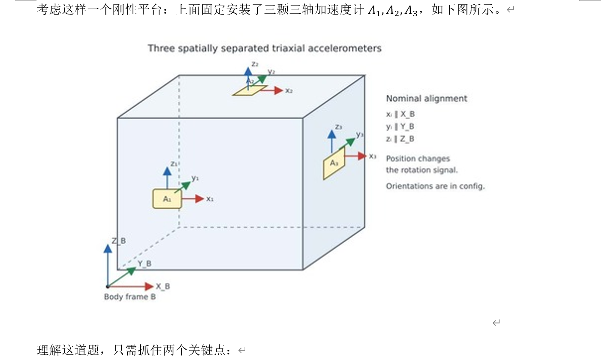

```text
考虑这样一个刚性平台 ： 上面固定安装了三颗三轴加速度计
1 ， 2 ， 3 ，
Three spatially separated triaxial accelerometers
如下图所示 。
Nominal alignment
X_B
1 Z_B
POSitiOn （ h s
t 》 rotation $ 匈 n ，
Orientations are config.
8
× B
8 y frame 8
理解这道题 ， 只需抓住两个关键点 ：
```

## 图片 04

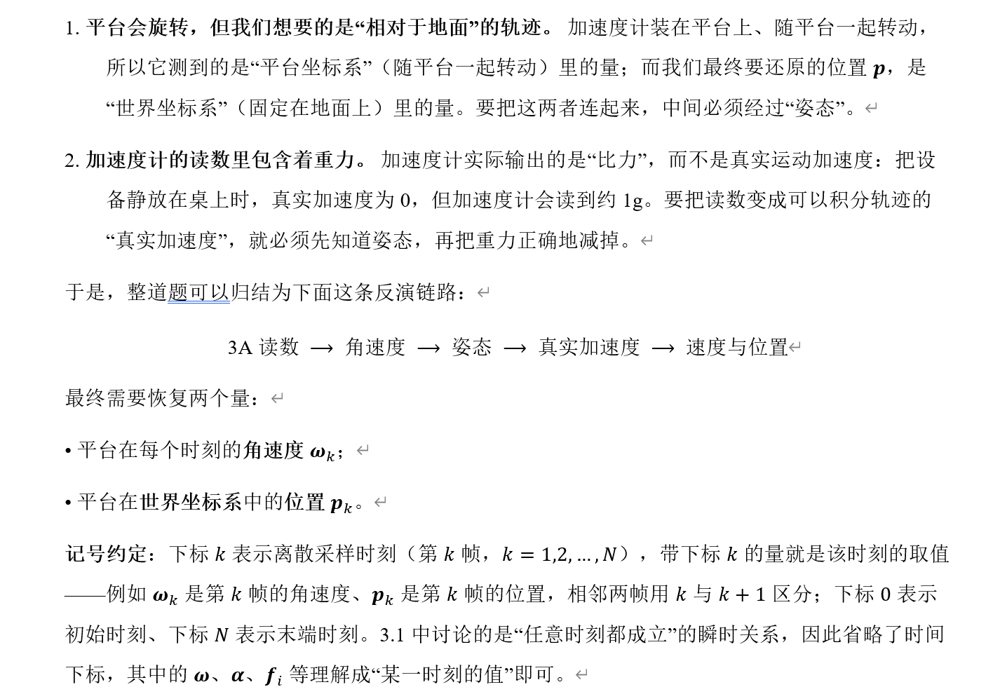

```text
1. 平台会旋转 ， 但我们想要的是 “ 相对于地面 ” 的轨迹 。 加速度计装在平台上 、 随平台一起转动 ，
所以它测到的是 “ 平台坐标系 " （ 随平台一起转动 ） 里的量 ； 而我们最终要还原的位置 p, 是
“ 世界坐标系 " （ 固定在地面上 ） 里的量 。 要把这两者连起来 ， 中间必须经过 “ 姿态 " 。
2 ． 加速度计的读数里包含着重力 。 加速度计实际输出的是 “ 比力 " ， 而不是真实运动加速度 ： 把设
备静放在桌上时 ， 真实加速度为 0 ， 但加速度计会读到约 lgo 要把读数变成可以积分轨迹的
“ 真实加速度 " ， 就必须先知道姿态 ， 再把重力正确地减掉 。
于是 ， 整道题可以归结为下面这条反演链路 ：
3A 读数乛角速度一姿态
最终需要恢复两个量 ：
· 平台在每个时刻的角速度 ；
· 平台在世界坐标系中的位置 。
真实加速度
速度与位置
记号约定 ： 下标表示离散采样时刻 （ 第 k 帧 ， k = 1 ， 2 一 ． ， N ） ， 带下标的量就是该时刻的取值
例如是第帧的角速度 、 是第 k 帧的位置 ， 相邻两帧用 k 与 k + 1 区分 ； 下标 0 表示
初始时刻 、 下标 N 表示末端时刻 。 3 彐中讨论的是 “ 任意时刻都成立 " 的瞬时关系 ， 因此省略了时间
下标 ， 其中的 、 等理解成 “ 某一时刻的值 " 即可
```

## 图片 05

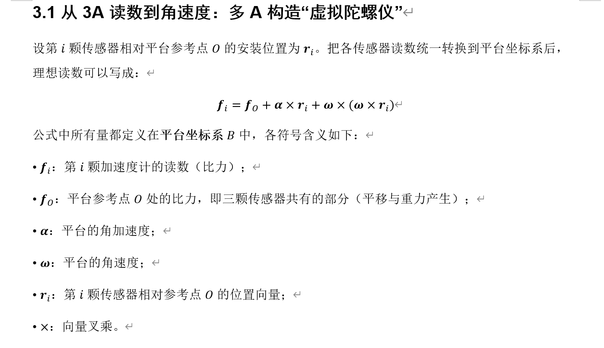

```text
3 ． 1 从 3A 读数到角速度 ： 多 A 构造 “ 虚拟陀螺仪 "
设第 i 颗传感器相对平台参考点 0 的安装位置为把各传感器读数统一转换到平台坐标系后 ，
理想读数可以写成 ：
公式中所有量都定义在平台坐标系 B 中 ， 各符号含义如下 ：
· ： 第老颗加速度计的读数 （ 比力 ） ·
平台参考点 0 处的比力 ， 即三颗传感器共有的部分 （ 平移与重力产生 ）
· 平台的角加速度 ；
· ： 平台的角速度 ；
“ · 第颗传感器相对参考点 0 的位置向量 ；
· × ： 向量叉乘 。
```

## 图片 06

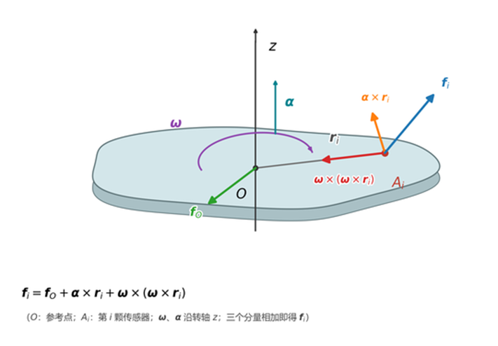

```text
囤 ： 参考点 ； ： 第 i 传感器 ； 0 转健 z ； 三个分量咀腱即得 0
```

## 图片 07

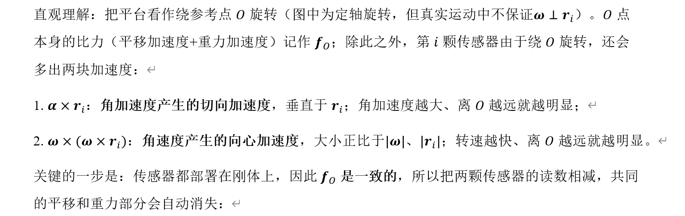

```text
直观理解 ： 把平台看作绕参考点 0 旋转 （ 图中为定轴旋转 ， 但真实运动中不保证上后 ） 。 0 点
本身的比力 （ 平移加速度十重力加速度 ） 记作 ； 除此之外 ， 第 i 颗传感器由于绕 0 旋转 ，
还会
多出两块加速度 ：
l. × 后 ： 角加速度产生的切向加速度 ， 垂直于后 ； 角加速度越大 、 离 0 越远就越明显 ；
2 ． × × rD ： 角速度产生的向心加速度 ， 大小正比于 ] ] 、 lrtl; 转速越快 、 离 0 越远就越明显
关键的一步是 ： 传感器都部署在刚体上 ， 因此是一致的 ， 所以把两颗传感器的读数相减 ， 共同
的平移和重力部分会自动消失 ：
```

## 图片 08

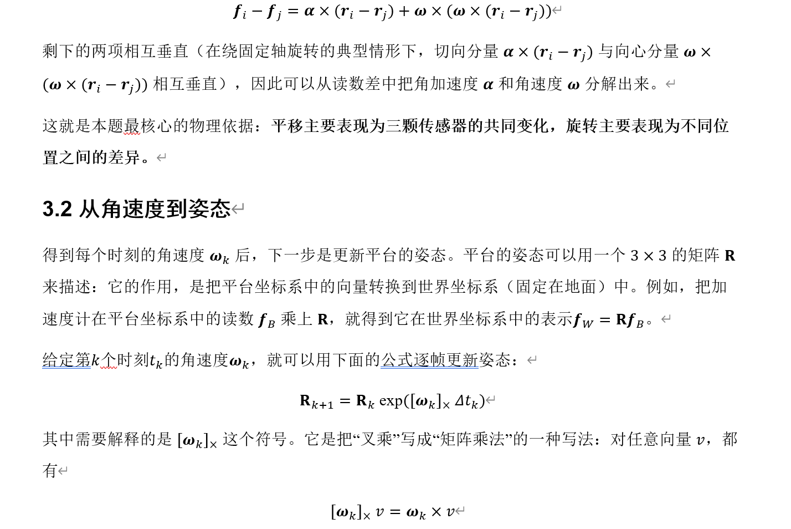

```text
剩下的两项相互垂直 （ 在绕固定轴旋转的典型情形下 ， 切向分量 × 一与 ） 与向心分量 ×
× 一与 ） ） 相互垂直 ） ， 因此可以从读数差中把角加速度 “ 和角速度分解出来 。
这就是本题最核心的物理依据 ： 平移主要表现为三颗传感器的共同变化 ， 旋转主要表现为不同位
置之间的差异 。
3 ． 2 从角速度到姿态
得到每个时刻的角速度后 ， 下一步是更新平台的姿态 。 平台的姿态可以用一个 3 × 3 的矩阵 R
来描述 ： 它的作用 ， 是把平台坐标系中的向量转换到世界坐标系 （ 固定在地面 ） 中 。 例如 ， 把加
速度计在平台坐标系中的读数 0 乘上 R, 就得到它在世界坐标系中的表示 f “ = RfB
给定第 k 个时刻的角速度 ， 就可以用下面的公式逐帧更新姿态 ：
= Rk exp([ü)k]>< ntk)
其中需要解释的是 [0k]>< 这个符号 。 它是把 “ 叉乘 " 写成 “ 矩阵乘法 " 的一种写法 ． 对任意向量 ， 都
有
```

## 图片 09

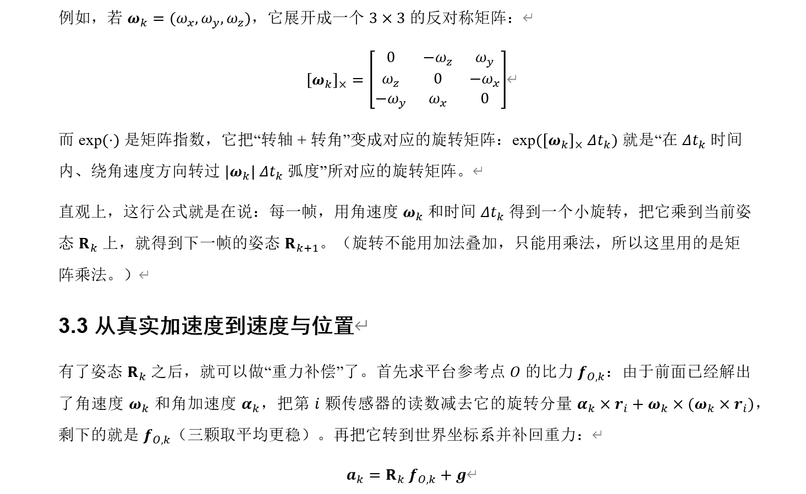

```text
例如
它展开成一个 3 × 3 的反对称矩阵 ．
0
0
0
而 exp(•) 是矩阵指数 ， 它把 “ 转轴十转角 " 变成对应的旋转矩阵 ： 就是 “ 在时间
内 、 绕角速度方向转过 (ü)klåtk 弧度 " 所对应的旋转矩阵 。
直观上 ， 这行公式就是在说 ： 每一帧 ， 用角速度和时间得到一个小旋转 ， 把它乘到当前姿
态 Rk 上 ， 就得到下一帧的姿太 R
（ 旋转不能用加法叠加 ， 只能用乘法 ， 所以这里用的是矩
阵乘法 。 ）
3 ． 3 从真实加速度到速度与位置
有了姿态 Rk 之后 ， 就可以做 “ 重力补偿 " 了 。 首先求平台参考点 0 的比力 k ： 由于前面己经解出
了角速度和角加速度 ， 把第颗传感器的读数减去它的旋转分量 × 后 + × × rD ，
剩下的就是 （ 三颗取平均更稳 ） 。 再把它转到世界坐标系并补回重力 ：
ak = Rk fo k + g
```

## 图片 10

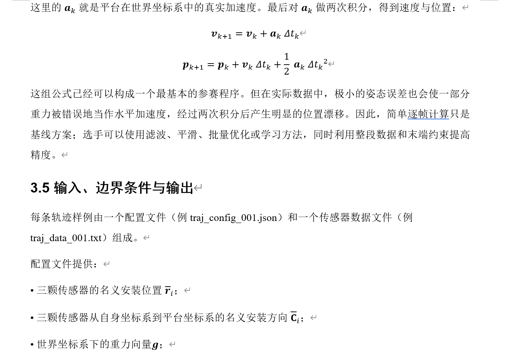

```text
这里的就是平台在世界坐标系中的真实加速度 。 最后对做两次积分 ， 得到速度与位置 ：
k + 1 = Vk + ak 刁 tk
1
Pk+1 = Pk + Vk + 一 ak
这组公式己经可以构成一个最基本的参赛程序 。 但在实际数据中 ， 极小的姿态误差也会使一部分
重力被错误地当作水平加速度 ， 经过两次积分后产生明显的位置漂移 。 因此 ， 简单逐帧计筧只是
基线方案 ； 选手可以使用滤波 、 平滑 、 批量优化或学习方法 ， 同时利用整段数据和末端约束提高
精度 。
3 ． 5 输入 、 边界条件与输出
每条轨迹样例由一个配置文件 （ 例 traj-config-001.json) 和一个传感器数据文件 （ 例
traj data 001.txt ） 组成 。
配置文件提供 ：
三颗传感器的名义安装位置
三颗传感器从自身坐标系到平台坐标系的名义安装方向
· 世界坐标系下的重力向量
```

## 图片 11

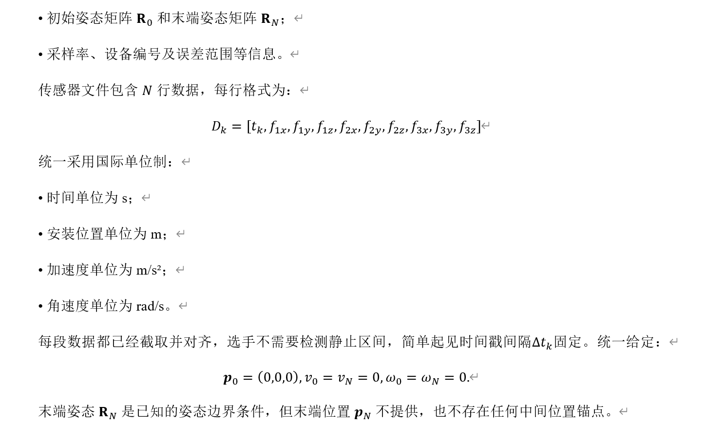

```text
· 初始姿态矩阵 RO 和末端姿态矩阵
· 采样率 、 设备编号及误差范围等信息 。
传感器文件包含 N 行数据 ， 每行格式为 ．
统一采用国际单位制 ：
· 时间单位为
· 安装位置单位为
· 加速度单位为 m/s2,
· 角速度单位为 rad/sa
每段数据都己经截取并对齐 ， 选手不需要检测静止区间 ， 简单起见时间戳间隔 k 固定 。 统一给定 ：
Po = （ 0 ， 0 ， 0 ） ， 0 = VN
0 ， 仞 0 = = 0 ．
末端姿态 RN 是己知的姿态边界条件 ， 但末端位置不提供 ， 也不存在任何中间位置锚点 。
```

## 图片 12

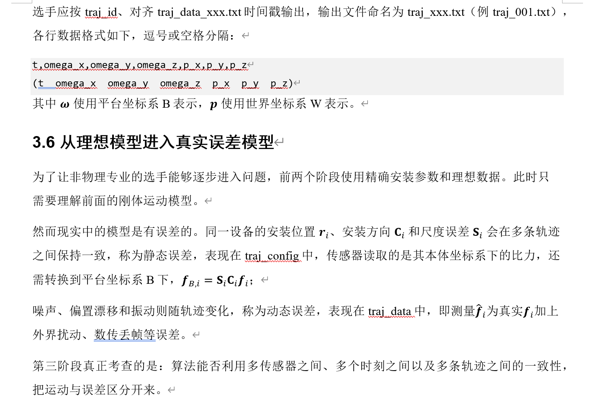

```text
选手应按一 ， 、 对齐 traj data-xxx.txt 时间戳输出 ， 输出文件命名为 traj xxx.txt （ 例 traj 001.txt) ，
各行数据格式如下 ， 逗号或空格分隔 ．
ome a X ome a
ome a Z
（ t—æegg—?€ 9 些一 Y 9 些一 《 P2€ P—Y p—4)
其中使用平台坐标系 B 表示 ， p 使用世界坐标系 w 表示 。
3 ． 6 从理想模型进入真实误差模型
为了让非物理专业的选手能够逐步进入问题 ， 前两个阶段使用精确安装参数和理想数据 。 此时只
需要理解前面的刚体运动模型 。
然而现实中的模型是有误差的 。 同一设备的安装位置 、 安装方向和尺度误差会在多条轨迹
之间保持一致 ， 称为静态误差 ， 表现在訌一四萌 g 、 中 ， 传感器读取的是其本体坐标系下的比力 ， 还
需转换到平台坐标系 B 下 ， fB,L = ；
噪声 、 偏置漂移和振动则随轨迹变化 ， 称为动态误差 ， 表现在轾为一@@中 ， 即测量氕为真实加上
外界扰动 、 数传丢帧等误差 。
第三阶段真正考查的是 ： 算法能否利用多传感器之间 、 多个时刻之间以及多条轨迹之间的一致性 ，
把运动与误差区分开来 。
```

## 图片 13

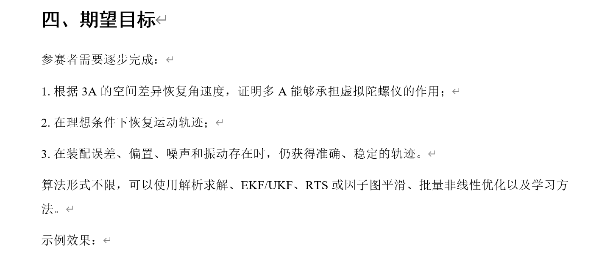

```text
四 、 期望目标
参赛者需要逐步完成 ：
1. 根据 3A 的空间差异恢复角速度 ， 证明多 A 能够承担虚拟陀螺仪的作用 ；
2 ． 在理想条件下恢复运动轨迹 ；
3 ． 在装配误差 、 偏置 、 噪声和振动存在时 ， 仍获得准确 、 稳定的轨迹 。
算法形式不限 ， 可以使用解析求解 、 EKF/UKF 、 RTS 或因子图平滑 、 批量非线性优化以及学习方
法 。
示例效果 ：
```

## 图片 14

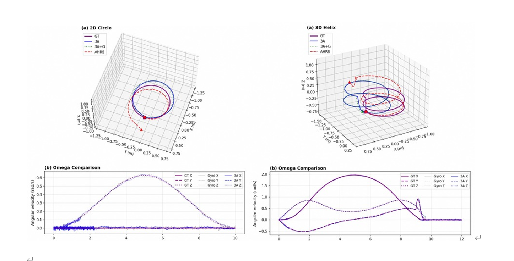

```text
《 0 ） 20 Circle
3A.G
0 ， 25
-125
-0 过 ，
一 0 ． 2S
02 ，
(b) 0m0g0 Comparison
02
一 L25
一 07 ，
侦 ℃ 0 ～
050
07 ，
》 30 H
， G
§ 025
一 L25
-0 丿 ，
一 0 ． 50
今丿 -0 ． 25
(b) 0m0q0 （ ompa 以 ， on
```

## 图片 15

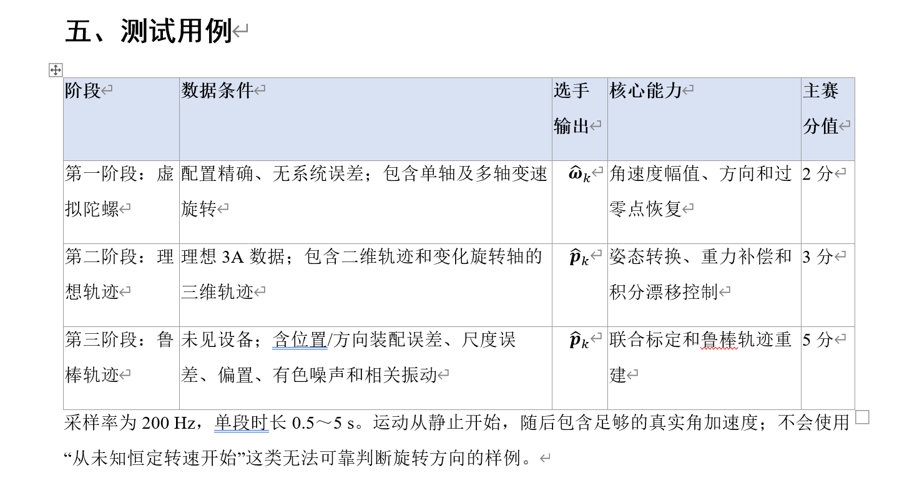

```text
五 、 测试用例 。
阶段
拟陀螺@
想轨迹
棒轨迹
数据条件
选手核心能力
输出
主赛
分值
第一阶段 ． 虚配置精确 、 无系统误差 ； 包含单轴及多轴变速
旋转
第二阶段 ： 理理想 3A 数据 ； 包含二维轨迹和变化旋转轴的
三维轨迹
第三阶段 ． 鲁未见设备 ； 含位置 / 方向装配误差 、 尺度误
差 、 偏置 、 有色噪声和相关振动
的角速度幅值 、 方向和过 2 分
零点恢复
p 的姿态转换 、 重力补偿和 3 分
积分漂移控制 < 」
p 的联合标定和鲁棒 ． 轨迹重 5 分
建
采样率为 200 Hz, 单段时长 0 ． 5 、 5 运动从静止开始 ， 随后包含足够的真实角加速度 ； 不会使用
“ 从未知恒定转速开始 " 这类无法可靠判断旋转方向的样例 。
```

## 图片 16

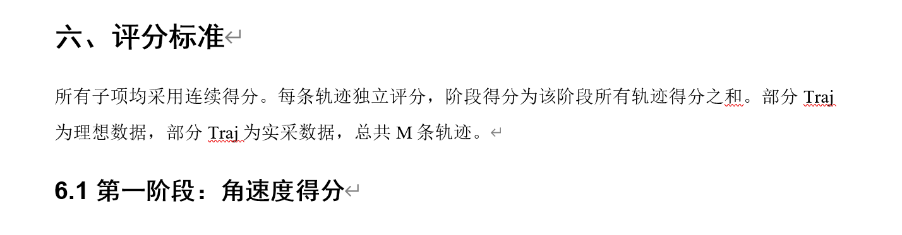

```text
六 、 评分标准
所有子项均采用连续得分 。 每条轨迹独立评分 ， 阶段得分为该阶段所有轨迹得分之租 。 部分 T 画 、
为理想数据 ， 部分为实采数据 ， 总共 M 条轨迹 。
6 ． 1 第一阶段 ： 角速度得分
```

## 图片 17

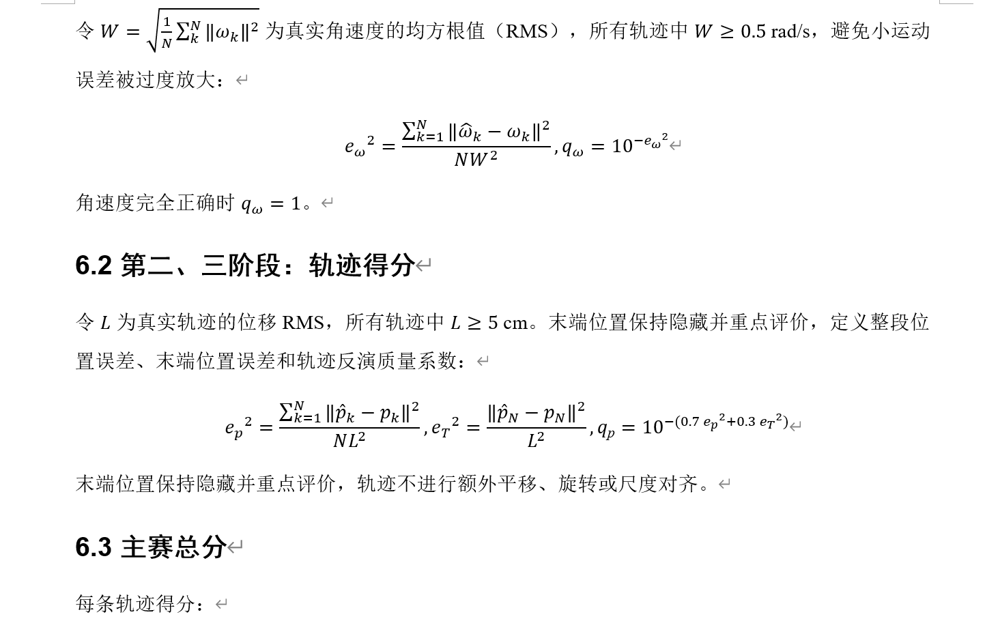

```text
令 ： 〗 阊仞 2 为真实角速度的均方根值 （ RMS ） ，
误差被过度放大 ：
2
角速度完全正确时 ％ = 10
〗 1 llök 一仞冒 2
NW2
所有轨迹中之 0 ． 5 避免小运动
= 10 一
6 ． 2 第二
三阶段 ： 轨迹得分
令 L 为真实轨迹的位移 RMS, 所有轨迹中 L 之 5 cm 末端位置保持隐藏并重点评价 ， 定义整段位
置误差 、 末端位置误差和轨迹反演质量系数 ：
〗 1 llPk _ Pk112
2
2
N L2
| | _ PN112
10 一 〔 0 ． 7 2 + 0 ． 3 2 ）
末端位置保持隐藏并重点评价 ， 轨迹不进行额外平移 、 旋转或尺度对齐 。
6 ． 3 主赛总分
每条轨迹得分 ：
```

## 图片 18

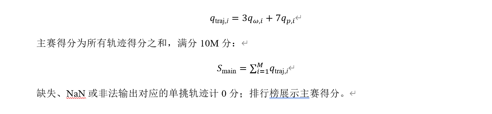

```text
qtraj,l
主赛得分为所有轨迹得分之和 ， 满分 10M 分 ．
3qQ) i + 7qp,i
= ü=lqtraj,i
缺失 、 NaN 或非法输出对应的单挑轨迹计 0 分 ， 排行榜展示主赛得分 。
```
