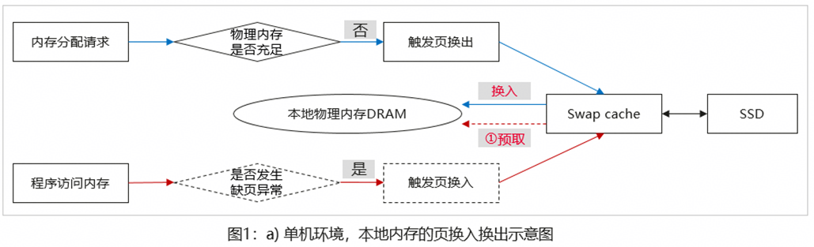
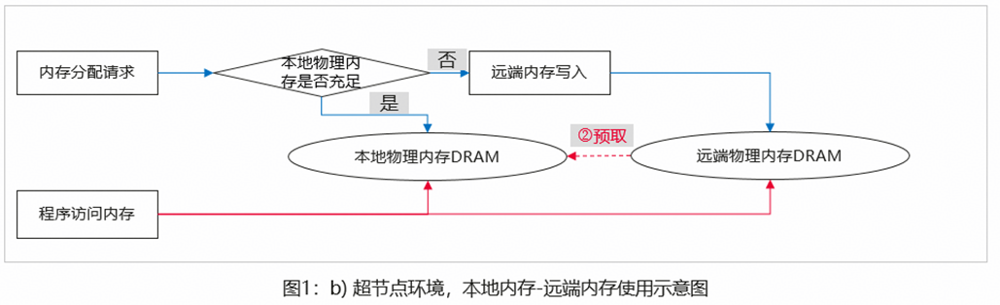
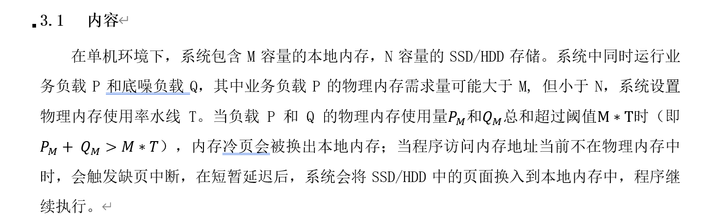
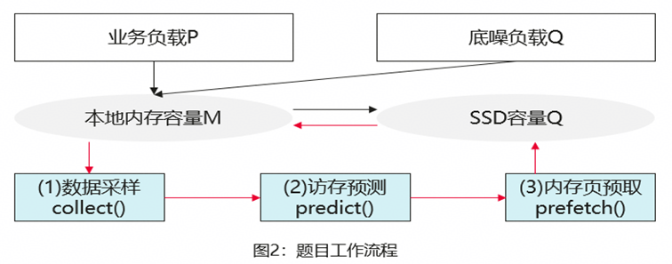
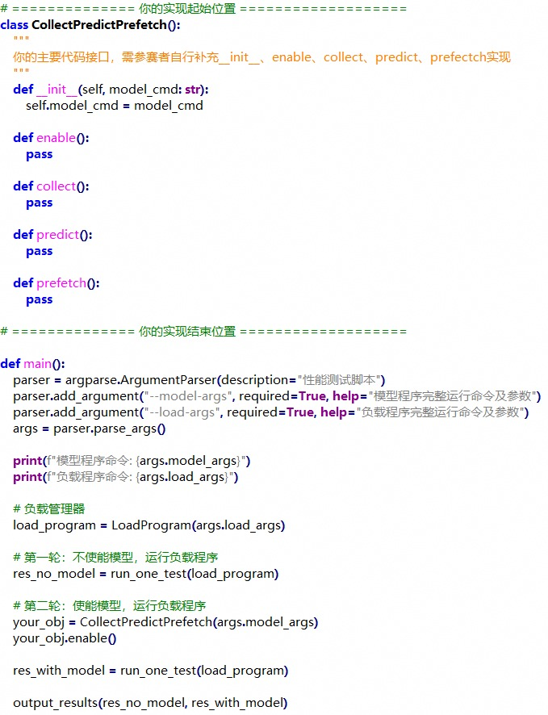
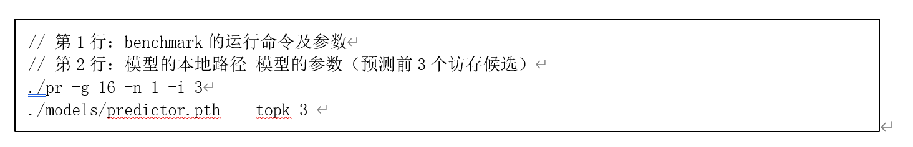
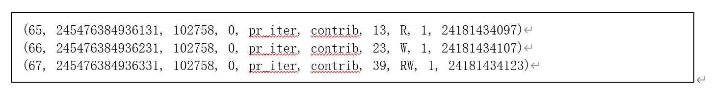
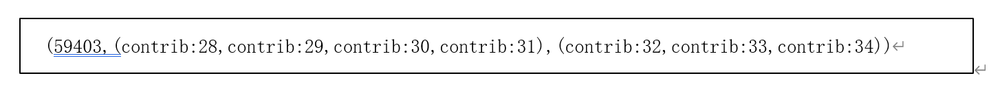
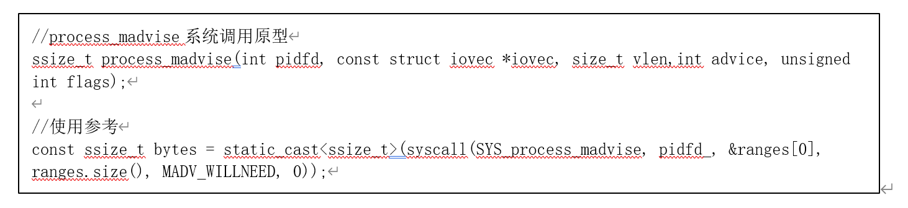
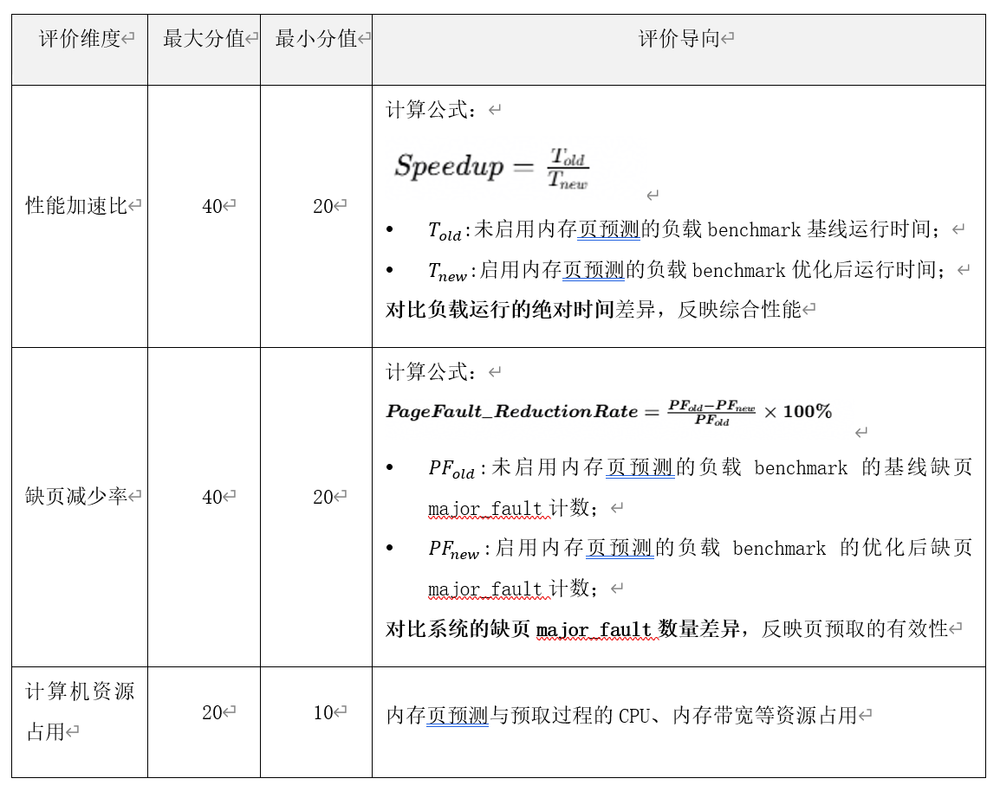

# 32 AI驱动的内存页智能预测与预取技术

> 本文件为官网公开赛题原文的 Markdown 整理版；正文按原文保留，图片和公式本地保存，未自行改写赛题要求。

- 官方标题：【2026Hackathon决赛】32：AI驱动的内存页智能预测与预取技术
- 来源：[官网赛题页](https://www.chaspark.com/#/races/competitions/1326724286017466368)
- 获取日期：2026-10-11（北京时间）
- 赛题 ID：1326724286017466368
- 原始资料：[JSON](../../官方资料/赛题原始数据/32_1326724286017466368.json) · [HTML](../../官方资料/赛题原始数据/32_1326724286017466368.html)

---

**AI****驱动的内存页智能预测与预取技术**

# 1  赛题名称

决赛赛题名称：AI驱动的内存页智能预测与预取技术

决赛赛题来自技术领域：操作系统

赛题限制：赛题验收OS内核为openEuler 6.6版本（可参考附录安装）；模型微调和预测要求在仅含CPU的机器完成。

# 2  背景信息

计算机系统采用多级存储结构（SRAM->DRAM-> SSD/HDD）来缓存/存储程序数据，下层存储相对上层存储有更大的容量，但伴随着更低的访存速度。静态随机存取存储器（SRAM），在物理上还是逻辑上都最接近CPU核心，用于实现高速缓存（如L1-L3）；速度较慢的内存，例如动态随机存取存储器（DRAM），通常作为系统的主要存储技术；速度更慢的存储技术，例如固态硬盘（SSD）或硬盘（HDD）的大容量存储设备，常用于辅助存储。

计算机处理速度很大程度上取决于对主内存和辅助存储的读写效率。由于SSD/HDD等存储设备的访问速度通常比DRAM慢XXX倍以上，单纯增加DRAM数量虽能直接缓解瓶颈，却面临两大阻碍：一是成本高昂，DRAM占服务器总成本的比例高；二是扩展性受限，难以满足Redis、Neo4j、Spark等内存敏感型应用及万亿参数大语言模型对容量的指数级增长需求。此外，**传统全量配置高速内存的方式常导致利用率低下。因此，业界普遍采用内存超分技术，通过分配超过物理总量的内存给不同业务负载，以平衡成本与业务需求。**

**（1）单机环境，冷页从SSD换入内存的性能损失大**

然而，**内存超分在峰值负载下会加剧业务性能的劣化**，如图1a)所示，但单机环境下，系统物理内存压力过大，**部分不常用的物理内存页会被交换到swap cache及SSD存储中**，当应用程序发起对被换出页地址访问时会触发缺页中断，等待OS将冷页从swap cache及SSD存储中换入到主内存，**期间业务线程阻塞，承受百级us的延迟**，对业务P99和QPS等性能产生严重影响。

****

**（2）超节点环境，远端内存访问延迟大**

随着AI基础设施、数据中心的不断发展，其上运行业务应用对更大容量和更高带宽的DRAM提出需求。为满足这些越来越具有挑战性的需求，业界基于UB或CXL提出内存池解决方案。以UB总线互联的超节点通算服务器集群（8个服务器互联）为例，超节点中的每台机器有自己的本地内存，同时基于UB可实现远端内存借用/共享，对每台机器而言，相当于增加一个远端numa，其访存速度略低于本地numa。如图1b)所示，当程序所需内存超过单机的本地内存时，可申请使用远端内存，将程序虚拟内存与远端物理内存页映射，后续当程序访问内存时，通过查找页表按需访问本地物理内存或远端物理内存，**当访问到远端物理内存时，有约X倍的访存时延，一定程度影响业务的最佳性能**。

为缓解缺页而导致内存页换入、本地物理内存紧张而访问远端物理内存带来的性能损耗，一种可行的方法是预测程序的未来内存访问特征，在实际发生缺页中断或远端内存访问前，预先将内存页换入本地内存，目标是减少内存访问的延迟，如图1中红色虚线所示，该过程被简记为“访存预测”和“页预取”。

- **访存预测**：通过软硬件方式，采用启发式方法、ML等方法预测未来内存访问的技术。
- **页预取**：数据从较慢的下层存储（如处于远端内存或SSD中的页面）提前移动到较快的近端存储（如本地内存），隐藏访问远端存储数据的延迟。

现在的软件访存预测方法主要有2类：**启发式方法、ML方法**。此类方法旨在识别虚拟地址空间中表示相对距离的地址增量，利用应用程序的空间局部性特点预测未来访存需求。**受限于仅考虑地址的空间局部性，以及ML模型的有限范围的预测，其实际应用效果不佳**。

热页智能预测与预取技术的应用，一方面可以**掩盖慢速但成本更低的SSD访存时延，以较小的性能损失实现近似DRAM的内存容量扩展**，并支持更激进的内存超分。另一方面，内存池化场景，可以实现**冷页面的提前交换，发挥大内存需求应用的极致性能**。因此，它可以从技术上维持业务极致性能，并降低大内存应用的成本。

# 3  问题描述

**题目目标**：

实现内存页的预测和预取功能，在未来访存实际发生前预测程序可能访存地址，并在缺页中断前，将处于SSD/HDD中的内存冷页提前预取到本地内存中，最大程度减少因缺页中断导致的访存延迟。

注意事项：

- 在有限计算资源下，控制错误预测及无效预取，减少额外CPU、带宽占用，降低本地内存的冷页污染。
- 负载类型不唯一，典型地包括PageRank、Redis 或其他可观测程序负载，每类负载将提供至少1个benchmark作为研究对象。
- 预测与预取过程中，页面可能已经驻留，或这预测结果可能来不及完成预取，错误请求也会占用计算机资源。因此，需要考虑预测置信度、整体性能改善和预取有效率等。

## 3.2     实现要求

解决本题需要至少完成图2所示的3个基本环节（青色背景）：

（1）**数据采样**：根据算法需求，实现可复现、开销可控的自定义数据采样方法。具体方法不限，赛题提供1种参考的采样方法。

（2）**访存预测**：根据负载类型实现未来访存地址或内存页的预测算法。算法可不唯一，但预测过程中只能使用当前时刻之前的采样数据做输入，不能使用当前时刻之后才会出现的数据，输出候选访存地址或页面及其置信度。

（3）**内存页预取**：根据所实现访存预测算法的输出，采用适当方法按需预取内存页到本地内存。赛题提供1种参考的预取方法。注意避免重复预取、已驻留页预取和过量预取，以减少系统开销。

 

# 4    期望达到的指标和效果

## 4.1     接口定义

编程语言Python/C/C++，要求提供可编译的程序或脚本实现，实现内容需对应图2所示的三个环节，每个环节的代码建议分别实现在各自主接口中（collect、predict、prefetch），主接口的参数和返回值可自定义，允许主接口内调用其他功能函数。所实现的三个环节代码将统一通过python驱动运行，建议按照如下代码结构实现赛题（可根据实际情况调整接口结构）。

在CollectPredictPrefetch类中分别实现collect、predict、prefetch等接口要求的数据采样、访存预测和内存页预取功能，支持对PageRank、Redis 或其他可观测程序负载的访存性能优化。

## 4.2     预测模型要求

根据负载特征，训练新模型或微调已有模型，完成未来访存行为的预测：

- **模型及方法不限制**：**赛题不做模型规模、Agent、大小模型组合等限制，可使用大模型、Agent做离线负载分析，使用小模型做在线实时预测**。
- **模型训练**：使用collect接口中实现的系统内存使用信息采样，在**仅含CPU的机器上完成模型的训练**。
- **模型预测**：在仅含CPU的机器上应用训练好的模型。每种负载程序需提供至少一个训练好的模型，要求相同负载的模型具有访存预测的泛化性；不同负载程序间可使用差异化模型，暂不要求不同类别负载间的泛化性。

## 4.3     输入与输出

**输入**：针对每个负载benchmark，选手需提供至少一个模型完成预测与预取功能，benchmark和模型信息通过python程序参数传递给4.1所示的CollectPredictPrefetch类接口。传递的参数建议格式如下（章节5.1提供示例）：

第1行【**确定格式**】：负载benchmark的应用名称 应用运行依赖的参数；

第2行【**建议格式**】：模型n的本地路径 模型n依赖的参数；（当有多个模型时，可通过分号或冒号分隔符在第2行拼接字符串）

**输出**：在线实时预测阶段无需程序输出，完成章节3要求的赛题功能即可。

 

## 4.4     其他说明

模型训练过程中允许使用公开数据或自行采集数据，但须提交采集方法说明和适用范围。

提交物应包含模型结构或算法说明、基础模型版本、随机种子、超参数、数据清单和可加载 checkpoint等；在规定环境中应能够复现训练或至少复现模型导出过程。

所有输出具有可复现性，不依赖测试标签、网络访问或人工介入。

# 5    测试用例

给定一个PageRank负载（https://github.com/sbeamer/gapbs）的参考用例，用于理解题目。其他用例暂不贴出，比赛当天开放。

在评估阶段，针对PageRank负载benchmark的运行输入示例如下：

## 5.1     数据采样示例

选手可自行决定使用工具（例如,damon）或代码插桩方式采样内存使用信息。此处示例给出通过代码插桩方式的数据采样，仅供参考：

上述格式为：(seq, timestamp\_ns, pid, tid, phase, region, page, access, repeat, virtual\_page)，其中,seq 为事件序号,timestamp\_ns 为采集时间，pid/tid 为进程和线程编号，phase 为算法阶段，region 为数据区域，page 为区域内相对页号，access 为访问类型，repeat 为连续同页访问次数，virtual\_page 为本次运行中的虚拟页号。

现有damon工具采样：damon是Linux 内核轻量级内存访问监控子系统，采用稀疏随机采样 + PTE Accessed bit（访问位）来采集内存区域访问热度，区分冷页/热页，参考链接：

https://docs.kernel.org/translations/zh\_CN/admin-guide/mm/damon/usage.html。

## 5.2     访存预测示例

使用训练好的模型预测未来的内存访问信息，选手可根据实际情况自行调整访存预测输出。此处示例模型预测的输出，仅供参考：

上述格式为：(index,(history trace),(Top-K预测))。该结果表示下一页 contrib:32 是第一候选，可作为内存页预取的Top-1目标。候选目标需要根据当前活进程的 region 基址重新转换为虚拟地址，不能直接复用历史运行中的绝对地址。这里contrib:32是区域内相对页号，通过基地址+相对页号\*4096转换得到页虚拟地址(例如0x7c402625b000)。

## 5.3     内存页预取示例

根据前述的访存预测结果，根据置信度等选取合适候选目标完成预取请求。预取可通过process\_madvise 系统调用接口或其他方式完成，此处给出process\_madvise系统调用预取的简单介绍。它的原型如下框所示，其中advice参数值MADV\_WILLNEED表示异步预取提示，提示内核该地址范围很快访问，把页从磁盘/swap 预读到page cache。

# 6    评选标准

赛题验收会提供多类型负载的benchmark，每个benchmark会运行两组实验，所得出的结果作为主要的性能对比项：

- **基线性能**：在默认环境下，未启用内存页预测与预取功能下的性能表现。
- **优化性能**：在默认环境下，启用内存页预测与预取功能下的性能表现。

（1）**评价维度**

每个benchmark用例的最高分值为100分，在性能加速比或缺页减少率有改善的赛题结果中，按照每个评价子维度的优化结果递减给与分值。例如，该benchmark的性能加速比维度，第1名得最大分值40分，第二名得35分，依次递减5分，最低得分20分。综合各个benchmark的子维度得分，将计算队伍的综合得分。

 

（2）**其他加分项**

比起得分的绝对高低，本题综合关注方案的创新性和实用性，例如相同负载不同benchmark下的模型泛化性，不同负载benchmark下的模型泛化性，较高的页预测准确率等。能提供详细的算法说明文档、分析文档等。代码规范和设计模式良好。

 

（3）**结果评级**

当有多个队伍选取该赛题时，在至少60%的benchmark有显著的性能加速比提升或缺页减少率改善的基础要求下，可根据benchmark的综合得分，对赛题结果评级。

- 优秀：综合得分位于前10%的队伍。
- 良好：综合得分位于前10%-20%的队伍。
- 合格：至少60%的benchmark有显著的性能加速比提升或缺页减少率改善。

# 7    附件

## 7.1     资源下载

openEuler 6.6内核二进制RPM包：

<https://repo.openeuler.org/openEuler-24.03-LTS/update/aarch64/Packages/kernel-6.6.0-140.0.0.121.oe2403.aarch64.rpm>

openEuler 6.6内核源码RPM包：

<https://repo.openeuler.org/openEuler-24.03-LTS/update/source/Packages/kernel-6.6.0-140.0.0.121.oe2403.src.rpm>

## 7.2     赛题用例

本赛题用例以“业务程序”或“业务服务程序及其用例”形式提供，分为多组用例，每组包含训练参考用例和验收用例。训练参考用例模拟程序执行轨迹的子集，将在开赛当天提供。验收用例将用于评估赛题完成效果。每组用例包含下面内容：

- 程序源码、编译命令
- 用例执行参数、配置
- 赛题的Python接口(参考4.1节)

参考用例：

- pr负载用例：https://github.com/sbeamer/gapbs/blob/master/src/pr.cc
- 编译命令：make pr
- 用例执行参数：./pr -g 20 -n 5
