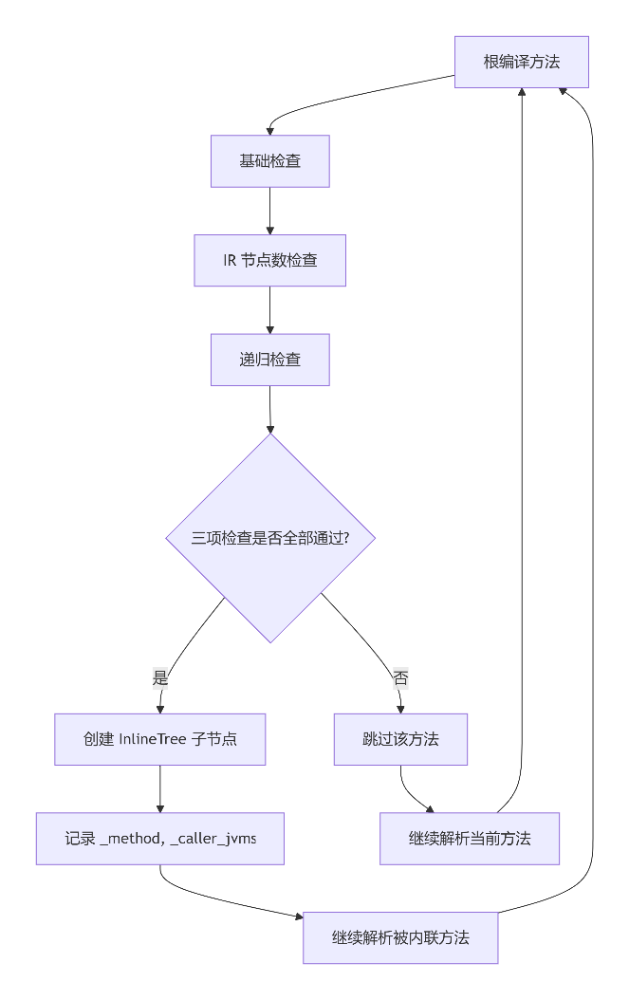
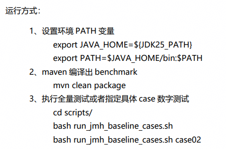

# 33 Java 虚拟机内联策略优化

> 本文件为官网公开赛题原文的 Markdown 整理版；正文按原文保留，图片和公式本地保存，未自行改写赛题要求。

- 官方标题：【2026Hackathon决赛】33：Java 虚拟机内联策略优化
- 来源：[官网赛题页](https://www.chaspark.com/#/races/competitions/1326726924167634944)
- 获取日期：2026-10-11（北京时间）
- 赛题 ID：1326726924167634944
- 原始资料：[JSON](../../官方资料/赛题原始数据/33_1326726924167634944.json) · [HTML](../../官方资料/赛题原始数据/33_1326726924167634944.html)

---

Java 虚拟机内联策略优化

**一、题目名称**

决赛赛题名称：Java 虚拟机内联策略优化

赛题所属技术领域：JVM 即时编译器（JIT）/ 编译器优化 / 性能工程

赛题限制：本赛题聚焦于 HotSpot JVM C2 编译器的内联决策逻辑，基于 OpenJDK 开源代码，无需公司内特殊环境或保密业务数据。由于本次参赛验证机器为鲲鹏CPU，建议参赛者使用arm机器完成开发与验证。

**二、背景信息**

微服务场景中，应用通常包含大量小函数，且调用栈较深。方法内联是提升其执行效率的常见编译优化手段之一。根据经验，不同的内联决策对最终性能影响较大，当前主要依赖人工识别并手动调整 JVM 参数进行进一步调优。

在 JVM C2 编译器中，方法内联（Method Inlining）将 callee 的方法体直接复制到 caller 中，并通过 InlineTree 数据结构驱动整个内联决策过程。

InlineTree 当前使用 MaxInlineSize、FreqInlineSize、MaxRecursiveInlineLevel、MaxInlineLevel 等静态全局阈值进行内联决策。这些阈值均为经验值，难以适应多样化应用，亟需更优的自适应算法来调整。

**三、问题描述**

**3.1** **问题拆解**

内联决策当前考虑的决策点主要有三类：

1. 基础检查：当前内联决策主要依赖固定的字节码大小阈值（MaxInlineSize=35 字节、FreqInlineSize=325 字节）和内联深度限制（MaxInlineLevel）。这些静态阈值对于不同特性的应用（如微服务、大数据处理、低延迟交易系统）难以做到最优平衡。
2. 节点数检查：C2 编译器有 LiveNodeCountInliningCutoff 和 MaxNodeLimit 限制。当 IR 图节点数接近上限时，会放弃进一步内联。但这种“全有或全无”的决策模式可能导致关键路径上的优化机会丧失。
3. 递归深度检查：InlineTree 通过回溯调用栈检测重复方法来限制递归内联深度（MaxRecursiveInlineLevel），但对于间接递归和非严格递归场景的处理较为粗糙，可能导致过早放弃或过度内联。

从抽象概念上理解，InlineTree 的本质是一个“带约束的树形遍历与决策问题”。其输入为调用图（Call Graph），根节点为编译入口方法（caller），中间节点和叶子节点为子方法，边为调用关系（含调用频率、接收者类型等信息）。输出为每条调用边的 0/1 二值决策值。

整体上，本题目期望的优化目标和效果是：通过优化 InlineTree 的决策模型，提升 C2 编译器在各类 Java 应用中的峰值性能，同时将代码膨胀控制在合理范围内。

**3.2** **接口定义**

本题涉及的核心接口位于 OpenJDK 源码，参赛者需理解和修改以下关键模块：

核心类：InlineTree（bytecodeInfo.hpp/cpp）

关键决策函数（待优化）：

// bytecodeInfo.cpp 核心内联检查逻辑  
bool InlineTree::try\_inline(ciMethod\* callee, int caller\_bci,   
                            JVMState\* jvms, ciCallProfile& profile) {  
  // 内部实现 Todo：  
  // 1. 基础编译注解动作检查（native、abstract、@DontInline 等）  
  // 2. 深度检查  
  // 3. 递归检查  
  // 4. 大小检查  
  // 5. 节点数检查  
  ......  
}

**四、期望达到的指标和效果**

功能目标

1. 实现优化后的 InlineTree::try\_inline() 决策逻辑，基于 OpenJDK jdk25u-dev/jdk-25.0.3-ga。
2. 支持通过 JVM 参数（-XX:+PrintInlining）输出详细的内联决策日志，便于分析验证。
3. 算法需具有泛化性，不能指定具体函数做内联，也不能指定具体阈值。
4. 如果引入 AI 模型，需要提供训练数据和训练脚本。

性能目标: 函数jmh单次执行时间最短

1. 基准用例不回退：在至少 5 个代表性基准（组委会提供）上，几何平均性能不低于基线（当前 OpenJDK C2 实现）。
2. 进阶用例提升率：在 5 个预期场景（组委会提供）下，总运行时间相比基线提升 ≥ 10%。

稳定性指标

1. 方案不得引入新的 JVM 崩溃（crash）或断言失败（assertion failure）。
2. 内联决策应保持确定性——同一方法在相同输入下多次编译的内联结果应一致，避免 PrintInlining 输出不稳定导致测试用例失败。

**五、测试用例**

5.1 输入规范

参赛者提交的方案需支持通过 -XX:+PrintInlining 输出内联决策日志（沿用原有内联调试日志框架），格式如下：

@ 1   java.lang.String::length (5 bytes)   accessor  
@ 2   java.lang.StringBuffer::append (13 bytes)   inline (hot)  
@ 3   com.example.ExpensiveMethod::compute (150 bytes)   failed to inline: size > DesiredMethodLimit  
@ 4   com.example.Recursive::factorial (20 bytes)   failed to inline: recursively inlining too deep  
@ 5   com.example.LambdaTarget::apply (25 bytes)   inline (hot)   late inline succeeded

5.2 基础测试用例集

包括但不限于以下几种内联场景：大小阈值拒绝、递归深度限制、热路径动态阈值、IR 节点数限制等。

**六、评选标准**

验收机型：鲲鹏 920

提交方式：JDK 25.0.3 的 patch 及构建脚本；如有 AI 模型，需提供模型的数据集及训练脚本（训练时长需小于 1 小时）。

JDK 软件构建约束：gcc 10.3.1，glibc 2.34，构建方式为 bash configure ; make images；构建脚本不允许修改现有 JDK 模块的配置。

评分维度

| 评分维度 | 分值 | 说明 |
| --- | --- | --- |
| 基础用例功能分 | 30 分（5 个 case） | 基础测试用例（1-5）,  每个用例 6 分。性能波动在 3% 以内，有提升即得 6 分，否则 0 分。 |
| 进阶用例性能提升 | 55分（5 个 case） | 进阶测试用例（6-10），  每个 case 按性能提升比阶梯评分后累加：  >30%：11 分；  >10%：7 分；  5%<提升<10%：3 分；  0<提升<5%：1 分；  劣化 >-10%：-3 分。 |
| 真实业务应用提升 | 10分 | Petclinic：  >20%：10 分；  >10%：7 分；  5%<提升<10%：3 分；  0<提升<5%：1 分；  劣化 >-10%：-3 分。 |
| 算法创新性 | 5 分 | — |

评分规则：

1. 总分制，整体分值越高，排名越靠前。
2. 整体同分时，依照顺序分别比对进阶用例、真实业务提升、算法创新性的比分，确定最终排名。

**附录：**

赛题目录结构：

     hackathon-Java-Inline

               ├── pom.xml  
               ├── README.md  
               ├── scripts  
               │  ├── run\_jmh\_baseline\_cases.sh  
               └── src  
                   └── bench  
                       └── C2InliningBenchmarks.java

