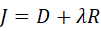
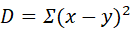
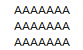
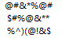
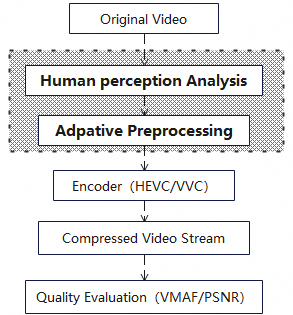
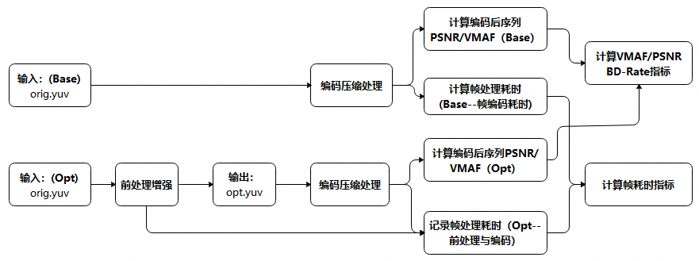

# 34 视频编码前处理增强：基于人眼感知提升压缩率

> 本文件为官网公开赛题原文的 Markdown 整理版；正文按原文保留，图片和公式本地保存，未自行改写赛题要求。

- 官方标题：【2026Hackathon决赛】34：视频编码前处理增强：基于人眼感知提升压缩率
- 来源：[官网赛题页](https://www.chaspark.com/#/races/competitions/1326727307262779392)
- 获取日期：2026-10-11（北京时间）
- 赛题 ID：1326727307262779392
- 原始资料：[JSON](../../官方资料/赛题原始数据/34_1326727307262779392.json) · [HTML](../../官方资料/赛题原始数据/34_1326727307262779392.html)

---

## 视频编码前处理增强：基于人眼感知提升压缩率

决赛赛题来自技术领域：媒体图像处理。

赛题限制：本赛题开发验证与结果验收均在Windows11（X64）环境，建议开发者使用Windows11参赛；对网络环境无限制。

## 二、背景信息（赛题产生的业务背景）：

随着短视频、直播、云游戏、超高清视频和实时通信等业务快速发展，服务器端视频转码的计算量和资源消耗都在持续增加。视频编码效率直接影响**带宽成本、存储成本和用户体验**。如何在产业成熟编码生态（H.265/HEVC）基础上，进一步提升转码效率（相同带宽下提升感知画质或同感知质量减少编码码率）成为新的挑战。

**视频前处理**是一种无需修改编码器结构的优化手段，通过在编码前对视频进行图像去噪、纹理调整、边缘增强与亮度映射等处理，减少无效信息、改善人眼视觉主观感知质量，提升编码的压缩效率。

本赛题的核心问题：**不修改编码器前提下对视频进行“编码友好”的智能处理，让视频更容易被压缩，提升人眼感知质量。**

参赛者需设计创新的视频前处理算法，在**不修改指定编码器内部配置**的前提下，通过对原始视频序列进行处理，使编码后的视觉感知质量（VMAF BD-Rate）更高，同时控制像素保真度（PSNR BD-Rate）损失，并兼顾计算效率与内容泛化能力等。

**核心目标：让视频“更好看、更好压、更高效”**。

## 三、问题描述（现状、技术挑战等）：

- **1.** **常规编码方案：**

视频常规压缩方案基于像素域保真度指标优化率失真性能，主要通过预测、变换、量化和熵编码等技术方案降低视频码率。

- **编码器内部的关键技术：**

- ü  RDO（Rate Distortion Optimization）;
- ü  SAO；
- ü  Deblocking；
- ü  Adaptive Quantization；
- ü  PSY-RD。

- **优化目标：**

率失真优化公式   ，即在有限码率约束下，使重建视频失真（D）最小；或在满足质量要求下，使码率最低。该公式为视频编码大量决策过程中的理论基础。其中D为像素误差MSE（原始值与预测值之差），  ，由于MSE等像素域指标与人眼感知存在差异，单纯依赖像素误差优化可能导致编码效率与主观质量不匹配，因此，需结合人视觉感知特性设计优化方案。

例如：a）平坦区域  ；b）复杂纹理区域  产生同样数量的像素误差，MSE虽然一致，但人眼感知不一样（即平坦区域可明显感知，复杂纹理区域感知不明显）。

- **2.** **视觉感知前处理算法：**

HVS（Human Visual System，人类视觉感知系统）对不同视频画面的区域失真的敏感度不同，HVS具有如下特点：

- 对高频不敏感
- 对边缘敏感
- 对局部对比度敏感

- **优化的目标方向：**

对视频进行前处理，可以去除视频信号冗余，但也不能简单降噪，否则PSNR会明显下降，故要寻找视觉损失小+编码收益间的平衡方案。

- **3.** **技术挑战点：**

- **感知质量与像素保真度的权衡**

相同码率下提升感知质量（VMAF BD-Rate）的同时，需将像素保真度（PSNR BD-Rate）损失控制在合理范围内。

- **前处理与编码器特性的非线性耦合**

前处理会改变视频纹理、结构与时空特征，其最终收益与编码器的预测、变换、量化等过程相关，难以通过单一规则准确建模。

- **多目标协同优化**

需权衡VMAF、PNSR、码率和编码速度等指标，避免单一指标优化导致整体收益下降。

- **内容自适应与泛化能力**

不同视频内容在纹理、运动与噪声等特征上存在差异，前处理算法需具备内容自适应能力，并在不同视频场景下保持稳定收益。

- 4. 视频感知前处理探索方向：

本次挑战赛核心目的：设计图像前处理方案，提升视频编码效率。可以探索方向如下（鼓励新方案，不限制新方向的探索）：

- **编码友好的图像降噪：**降低编码器难以预测的随机信息（如Temporal/Spatial Denoise、Bilateral Filter）
- **视觉感知的纹理优化：**利用人眼视觉掩蔽效应，优化人眼不敏感编码代价高的纹理区域，对视觉重要区域进行保护（如Texture Analysis、 Contrast Optimization、Frequency-domain Filtering）
- **视觉信号域（亮度与色度）分布优化：**亮度分布特性、边缘、纹理、主体细节，亮度重映射调整亮度分布，使其更符合编码器的预测特性（如Luma Mapping、Adaptive tone Mapping、Luma Quantization Optimization、Chroma Denoise）
- **图像细节重构与压缩优化增强：**让图像更容易被预测，提升编码效率（如Edge-aware smoothing、Structure Enhancement）

    参赛者选取上述一种或多种方向进行图像的前处理优化，也可以探索新的方向达成优化目的。

- 5. 赛题任务：

完成前处理模块算法设计与实现，视频序列、视频编码器与编码参数及质量评测流程出题方均会提供评测方法。参赛者需根据探索方向中的技术（如降噪、纹理优化等）设计具体实现方案，并验证其对编码效率的提升效果。

**接口定义：**本赛题对视频序列帧进行前处理，参赛者聚焦帧的增强处理算法即可（帧数据读取/写入等逻辑出题方提供，参赛者完成**8bit**的视频序列前处理）。

void processYUVFrame(const uint8\_t\* src, uint8\_t\* dst, int width, int height, int crf)

## 四、期望达到的指标和效果（含性能/精度等指标）：

功能目标：本赛题为图像前处理优化，处理后要保证内容的语义与初始的一致性。

- 禁止对输入序列进行超分、插帧、降分辨率、变动FPS等
- 允许对图像进行去噪、平滑、纹理调整、颜色增强优化等

性能目标：在满足PSNR损失约束的前提下，**最大化VMAF增益或码率节省**，且算法具备良好的内容泛化能力和时域稳定性。

视频编码常用指标：VMAF、PSNR、编码速度，三个指标均与基线版本三个指标计算变化量。对3个指标进行综合评价作为参赛者的最终成绩（三个指标权重依次为：VMAF>PSNR>编码速度），切莫追求单一指标，造成另外两个指标影响较大。

- PSNR损失满足约束下，VMAF提升幅度（越高越好）；
- PSNR损失控制（PSNR BD-Rate损失 ≤ 0.3）；
- 相同VMAF质量下的码率节省；
- 计算复杂度与处理时间限制。

开发语言&环境：

开发语言：C/C++；运行平台：Windows 11（X64），Intel CPU 主频2~4GHz即可（不严格要求）。

## 五、测试用例

视频帧前处理指标评测用例执行流程如下（测试序列、测试框架代码、执行脚本、编码工具、指标计算工具等开赛前发布）。

## 六、参考文献（可选，如有请提供）：

NA

## 七、评选标准（如评分维度，分成几档等）：

赛题验收会使用多条视频序列，每条序列会执行两遍测试用例流程，所得的结果作为主要的质量与性能对比项：

- 基线版本：在默认环境下，未进行编码前处理，执行测试用例执行，得到每条序列的PSNR、VMAF、帧编码耗时数据。
- 前处理优化版本：在同基线版本验证环境下，先对每条序列进行前处理，再执行编码操作，得到每条序列的PSNR、VMAF、帧编码耗时（含帧前处理耗时）；再与基线版本计算每条序列的VMAF BD-Rate、PSNR BD-Rate、帧编码耗时指标变化（多条序列取各指标均值）。

1、评价维度：

a）基础项：经前处理与编码后生成的序列与原始序列主观对比画质正常，无明显异常，此项有异常表示前处理优化挑战失败。

b）**VMAF BD-Rate指标：**对比基线提升越高越优，优化1%，得20分，优化2%，得40分，依次累计。

c）**PSNR BD-Rate指标：**指标损失 ≤ 0.3不扣分，损失每超0.1%，扣5分，同样指标优化0.1%，多得5分，累计计算该项分数。

d）帧编码耗时指标：影响越小越优，如编码耗时<3%不扣分，每超过1%，多扣5分。

2、其他加分项：提出算法具备独立的创新性，能提供详细的算法说明文档、复杂度分析文档等，根据文档或方案质量加分10~30分；

3、结果评级

结合上述评价维度与加分项，累加计算参赛者的总分数。
